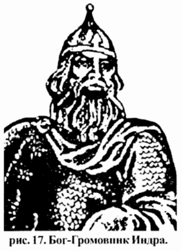

# Бог Индра

**БОГ ИНДРА** - Вышний Бог, Громовник, помощник Вышнего Бога Перуна в Небесных битвах при защите Сварги Пречистой и всех Звёздных Небес от сил Тьмы.

Бог-Громовник Индра

Индра является Тысячеоким Богом-Хранителем Светлых Небес и Небесных Чертогов Вышних Богов на Сварожьем Круге.

Он хранитель Божественных Мечей и Священного Божественного Оружия Справедливого Возмездия, которые ему отдают на хранение тридцать Богов-Защитников Светлых Миров, когда отдыхают от Небесных битв с Тёмными силами.

Эти тридцать Светлых Богов-Защитников составляют могучую Небесную дружину Бога-Громовержца Индры, цель которой охранять Рубежи Светлых Миров.

Вышний Бог Индра всегда был покровителем для воинов-защитников Отечества, а также для всех Священнослужителей-Жрецов из древнейших Родов, в которых хранятся Древние Священные Веды.

Индра участвует не только в Небесных битвах с Тёмными силами - в древние времена Он помогал Славянским и Арийским ратям и дружинам в справедливых битвах с вражескими силами, кои нападали на различные грады и селения Великой Расы.

Кроме того, считается, что Бог Индра низводит из облачных гор стремительные потоки дождя и, собирая их в особые вместилища, творит земные источники, ручьи и реки, умножает их воды, роет для них широкие русла и направляет их бег.

**Гимн-Правьславление:**  
О Индра! Внемли призывающим Тя! Славен и Триславен буди! И помози нам в ратных сечах с ворогами наша! И даруй нам помощь в деяниях славных! И речем мы Славу Тебе и молвим, Велик Индра! И величие Славы, да буде уделом громовержца, ныне и присно и от Kpуга до Kpуга! Тако бысть, тако еси, тако буди!

Похожие: Список Богов
