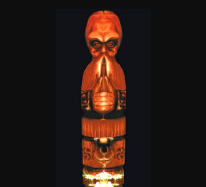

# Бог Инглъ

**БОГ ИНГЛЪ** - Вечный Бог-Хранитель Первичного Жизньродящего Огня Мироздания (Жизньнесущей Инглии) и Чистого Света Духовного Познания и Созидания.

Куммир Бога Ингла / Боги наши

Бог Инглъ является Богом-Покровителем наших Многомудрых Первопредков, которые населяют нашу Мидгард-Землю и всех Православных Староверов-Инглингов, которые сохраняют в неизменной чистоте, древнюю Веру - Инглиизм.

Он наполняет Божественным сиянием и теплом Священный Огонь в наших домашних Очагах и оберегает Священный Огонь в Капищах и Святилищах наших, в Городищах и Овинах наших.

Ныне вокруг Куммира изображающего Бога Ингла, Православные Староверы-Инглинги, как и в древние времена, всегда высаживают различные цветы с яркой огненной расцветкой. Это символизирует родство и гармонию между Изначальным, Небесным божественным Огнем и нашим Природным земным огнем.

Пред Куммиром Вышнего Бога Ингла, который украшался нашими Предками огненной символикой, в Священном свастичном жертвеннике Жрецами Бога Ингла постоянно поддерживался Священный Огонь.

В качестве жертвы Богу Инглу приносились Природные Дары: цветы, благоухающие травы, шишки, грибы и ягоды, веточки от Священных Деревьев, которые срезались только в безлунные ночи (новолуния), или зимой, чтобы не навредить Душе Древа.

Место среза на дереве смазывалось благовонным маслом и завязывалось льняной или шелковой лентой.

**Гимн-Правьславление**:  
Великий Бог Инглъ, Хранитель Священной Инглии! Славен и Триславен Буди! Освяти и согрей Души и Сердца наши, Капища и жилища наши, не оставляй без пригляда Роды наши, ныне и присно и от Круга до Круга!
