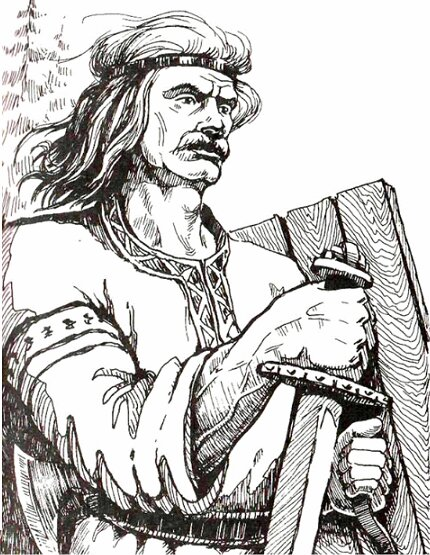

# Бог Коляда

**БОГ КОЛЯДА** - Вышний Бог, управляющий Великими Переменами в жизни Родов Расы Великой и потомков Рода Небесного.

Вышний Бог Коляда

В древние времена Вышний Бог Коляда даровал многим Родам, переселившимся в западные земли, систему исчисления сезонного времени для ведения полевых работ - Календарь (Коляды дар), а также свои Мудрые Веды, заповеди и наставления.

Коляда является Богом-Покровителем ратных людей и Жрецов. Коляду часто изображали с мечом в руке, причём клинок меча был обращён остриём вниз. Меч, обращённый остриём вниз, в древние времена означал сохранение Мудрости Богов и Предков, а также незыблемое следование *Небесным Законам*, как это установлено Богом Сварогом для всех Чертогов Сварожьего Круга.

Праздник в честь Бога Коляды приходится на день зимнего Солнцестояния, этот праздник таже называют Менари, т.е. День Перемен. В праздник ходили по дворам группы мужчин, облачённых в шкуры различных зверей (ряженые), которых называли дружины Коляды. Они пели гимны, прославляющие Коляду, и устраивали особые хороводы вокруг больных людей, чтобы исцелить их.

**Гимн-Правьславление**:  
Бозе Коляда! Славен и Триславен буди! Благодарим Тя, за благодатну помощь Родам наша! И да буди Ты заступой во всех деяниях наша, ныне и присно и от Круга до Круга! Тако бысть, тако еси, тако Буди!
