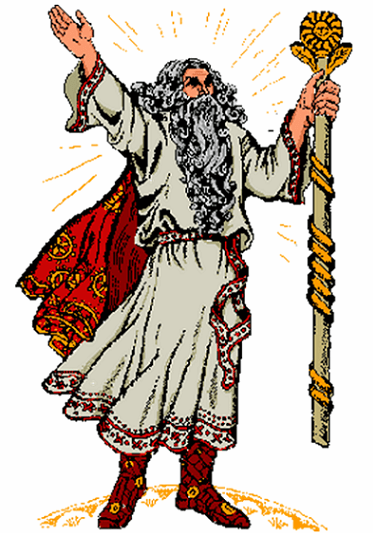

# Бог Крышень

**БОГ КРЫШЕНЬ** - Небесный Бог-Покровитель Древней Мудрости. Он Бог, управляющий совершением древних Обрядов, Ритуалов и Праздников, наблюдающий, дабы во время приношений безкровных Треб и Даров на всесожжениие не было кровавых жертвоприношений.

Рис. 19. Крышень – славянский бог / Веды

В мирные времена Крышень проповедует в различных Землях Сварги Пречистой Древнюю Мудрость, а в тяжелые для Родов Расы Великой времена Он берется за оружие и выступает как Бог-Воитель, защищающий женщин, стариков, детей, а также всех слабых и обездоленных.

Так как Крышень является Богом-Покровителем Чертога Тура во Сварожьем Круге, Его называют Небесным Пастухом, который пасет стада Небесных Коров и Туров.

**Гимн-Правьславление:**  
Бозе Заступа, Крышень Великий! Ты, Светлых Земель всех во Сварге Покровитель! Тя прославляем, к себе призываем, да прибудет Мудрость Твоя со всеми Древними Родами наша, ныне и присно и от Круга до Круга!
