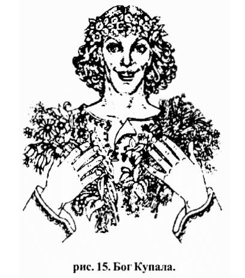

# Бог Купала

**БОГ КУПАЛА** (Купало) - Бог, который дает человеку возможность сотворить всякие Омовения и проводит Обряды Очищения Телес, Души и Духа от различных хворей-болезней. Бог, наставляющий на радостную и счастливую жизнь.

Бог Купала / Купало

Купала - веселый и прекрасный Бог, одевающийся в легкие белые одеяния, украшенные цветами. На голове Бога Купалы венок из прекрасных цветов.

Купалу почитали как Бога теплого времени Лета, полевых цветов и полевых плодов. Многие Славяно-Арийские Роды, занимающиеся полеводством, почитали Бога Купалу наравне с Богиней Макошью и Богиней Тарой, а также Богами - Перуном и Велесом.

## День Бога Купала

Перед началом жатвы и сбором полевых плодов, в честь Бога Купалы праздновался праздник, на котором Богу Купале, а также всем Древним Богам и Предкам приносили безкровные жертвы.

На празднике Православные Староверы-Инглинги свои безкровные жертвы и требы бросают в огонь Священного Свастичного Жертвенника, чтобы все принесенное в жертву появилось на праздничных столах Богов и Предков.

После принесения безкровных жертвоприношений от живого огня Священного Свастичного Жертвенника Общинники зажигают свечи и огневицы, которые закрепляют на венках и плотиках и отправляют по течению рек.

При этом на свечу или огневицу, Православные Староверы-Инглинги из различных Общин наговаривают свое сокровенное желание или просьбу об избавлении от хворей-болезней, всяческих неудач, различных проблем и т.п. Этот обряд можно объяснить следующим образом.

Горящая свеча или огневица освещает просьбу или желание Общинников, вода реки запоминает их и, испаряясь, поднимается к Небесам, донося до Богов все просьбы и желания Православных Староверов-Инглингов.

На празднике каждый из Православных Староверов-Инглингов должен пройти полное очищение, дабы полностью очищенным приступить к сбору полевых плодов и к началу полевой жатвы. Полное очищение Православных Староверов-Инглингов состоит из трех частей:

**Первое очищение (Очищение Тела)**. Каждый присутствующий на празднике в День Бога Купала должен омыть свое тело в священных водах (реки, озера, водоема и т.д.), чтобы смыть с себя усталость и грязь.

**Второе очищение (Очищение Души)**. Для того, чтобы присутствующие на празднике в День Бога Купала могли очистить свою Душу, возжигают большие костры, и все желающие прыгают через эти костры, ибо Огонь сжигает весь негатив и очищает ауру и Душу человека.

**Третье очищение (Очищение Духа)**. Каждый Общинник Старовер, присутствующий на празднике в День Бога Купала, а также желающие могут очистить и укрепить свой Дух. Для этого из горящих углей большого костра создают Огненный Круг, по которому Староверы-Инглинги из различных Родовых, Славянских и Арийских Общин ходят босиком. Тех желающих, кто впервые решился пройти по углям, дабы очистить и укрепить свой Дух, Общинники ведут через Огненный Круг за руку.

Этот праздник неразрывно связан и с другим событием древности. В древние времена Бог Перун освободил на Кавказе из плена своих сестер и отправил их очиститься в водах Священного Ирия (Иртыша) и в Сметанном Чистом Озере (о. Зайсан). Об этом событии также повествуется в пятом клубке Песен Птицы Гамаюн.

В связи с тем, что Купала является Богом-Покровителем Небесного Чертога Коня во Сварожьем Круге, в этот день принято купать коней, заплетать в гривы разноцветные ленты и украшать их полевыми цветами.

**Гимн-Правьславление:**  
Купала, Бозе наш! Славен и Триславен извечно Буди! Тя все-Родно прославляем, на земли наша призываем! Даруй нам всякое очищение, для Бозех наша в правьславьление! Даруй Родам наша обильну жатву на полях страдных, и полные закрома в хоромах наша. Ныне и присно и от Круга до Круга! Тако бысть, тако еси, тако буди!

Похожие: День Бога Купала (обряды и ритуалы)
