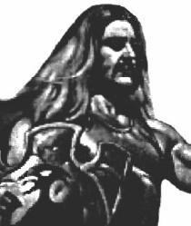

# Бог Патер Дий

**БОГ ПАТЕР ДИЙ** (Дый) - Бог-Покровитель Ясного Небесного простора и пространства, Хранитель неисчерпаемой Жизненной силы Земли Деи, при помощи которой жрецы Патер Дия совершали различные чудеса.

Рис. Бог Патер Дий / Веды

Он Бог, охраняющий Древнюю Истину Небесных Богов, а также Мудрость Потаенную.

Бог Патер Дий является Хранителем Основных Путей Междумирья, через которые Боги могли посещать обитаемые Миры.

Он мог изменять свою внешность до неузновасмости, поэтому облик этого Бога никто не мог удержать в памяти. Одни видели его в образе молодого могучего воина, другие в виде пожилого мудрого старца или жреца.

Сей Бог издревле покровительствует всем Жрецам-Священнослужителям Старой Веры: Диям - Верховным Жрецам, возглавляющим Весевые Духовные Управления, Патер Дию - Верховному Жрецу, возглавляющему Духовную Миссионерию и всю Древнерусскую Инглиистическую церковь Православных Староверов-Инглингов, а также Жрецам-Хранителям Древней Мудрости Богов и Первопредков.
