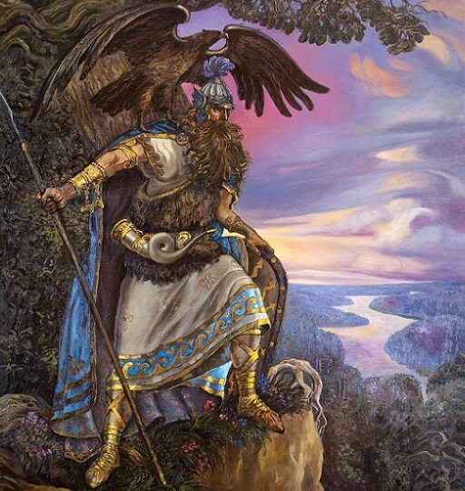

# Бог Перун

**БОГ ПЕРУН** (*Перкунас, Перкон, Перк, Пуруша*) - Бог-Покровитель всех воинов и многих Родов из Расы Великой, защитник Земель и Рода Святорусов (русичей, белорусов, эстов, литов, латов, латгалов, земгалов, полян, сербов и др.) от Тёмных сил, Бог-Громовержец, управляющий Молниями, сын Бога Сварога и Лады-Богородицы, внук Бога Вышеня. Бог-Покровитель Чертога Орла во Сварожьем Круге.

Бог Перун – картина худ. А. Клименко.

Бог Перун уже трижды прибывал на Мидгард-Землю, чтобы защитить ее и Роды Великой Расы от темных сил Пекельного Мира. Темные силы приходят из разных Чертогов Пекельного Мира, чтобы обманом, лестью и хитростью заманивать людей из Родов Великой Расы к себе в полон, а если это не помогает, то похищают людей, дабы в своем темном Мире обратить их всех в покорных рабов и не дать возможности Духовно развиваться и продвигаться по Златому Пути, как это было установлено Богом Сварогом.

## Великая Асса

Темные силы проникают не только на Мидгард-Землю, но и на другие Светлые Земли во Сварге Пречистой. И тогда происходят битвы между силами Света и Тьмы. Перун, уже однажды, освободил из Пекельного плена наших Предков и завалил на Мидгард-Земле Врата Междумирья, ведущие в Пекло, горами Кавказскими. Эти битвы Света и Тьмы происходили через определенные промежутки времени: «**по истечении Сварожьего Круга и Девяносто Девяти Кругов Жизни**», т.е. через 40176 лет.

После первых трех Небесных Битв между Светом и Тьмой, когда победили Светлые Силы, Бог Перун спускался на Мидгард-Землю, чтобы поведать людям о произошедших событиях и о том, что ожидает Земли в будущем, о наступлении темных времен и о предстоящих Великих Ассах, т.е. Небесных Битвах.

Колебания во времени между Третьей и предстоящей решающей Четвертой Битвой Света и Тьмы могут составлять, помимо вышеуказаного Перуном времени, всего лишь один Круг Жизни, т.е. 144 Лета.

Существуют также Предания о том, что Бог Перун еще несколько раз побывал на Мидгард-Земле, дабы поведать Потаенную Мудрость Жрецам и Старейшинам Родов Свята Расы, как подготовиться к темным, тяжелым временам, когда Рукав нашей свастичной галактики будет проходить через пространства, подвластные силам из Темных Миров Пекла.

Темные силы, тайно проникшие на Мидгард-Землю, создают всевозможные ложные религиозные Культы и специально пытаются уничтожить или очернить Культ Бога Перуна, стереть его из памяти народов, чтобы ко временам Четвертой, решающей битвы между Светом и Тьмой, когда Перун прибудет на Мидгард-Землю, люди не знали, кто Он такой и для какой цели прибыл.

В наше время появилось большое множество "истинных" пророчеств о Конце Света или Конце Времен, особенно в Лунных Культах, о приходе на Мидгард-Землю Вышнего Бога Спасителя. Последователи одной мировой религии называют его Христом, а других религий - Месией, Мошеахом, Буддой, Матреей и т.д. Делается все это для того, чтобы во время пришествия Перуна на Землю белые люди не признали в Нем своего Вышнего Бога и отвергли Его помощь, и тем самым обрекли себя на полное уничижение и погибель.

Во время своего Третьего посещения Мидгард-Земли, около 40000 лет назад, Перун поведал в Асгарде Ирийском людям из различных Родов Расы Великой и потомкам Рода Небесного Священную Мудрость о грядущем, которую Жрецы Беловодья записали х'Арийскими Рунами и сохранили для потомков в Девяти Кругах «Саньтий Веды Перуна» (в девяти «Книгах Мудрости Бога Перуна»).

## Гимн-Правьславление

Перуне! Внемли призывлющим Тя! Славен и Триславен буди! Благости Светлаго Мира, всей Свята Расе дажьди! Лик свой прекрасный потомкам яви! Нас наставляй на деяния благи, гридьням даруй больше Славы, отваги. Нас отврати от урока Безпутства, нашим Родам подари многолюдство, ныне и присно и от Круга до Круга! Тако бысть, тако еси, тако Буди!

\* 16 пороков и 16 обетов - Веды Перуна

### Боги славян

- Бог Велес
- Бог Индра
- Бог Купала
- Бог Семаргл
