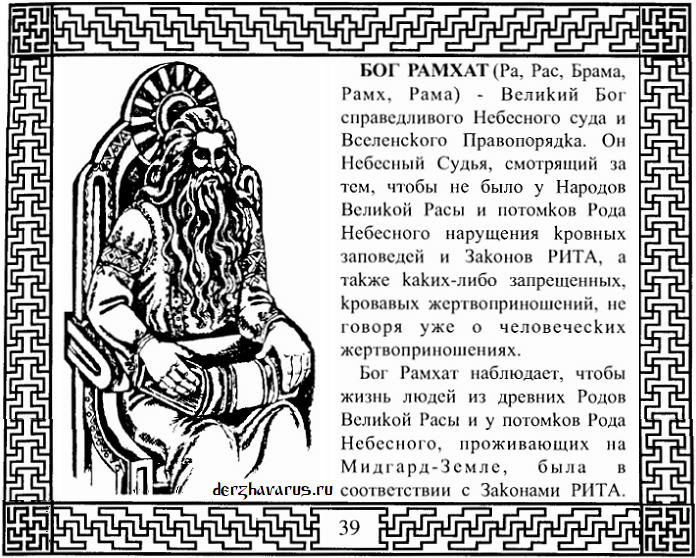

# Бог Рамхат

**БОГ РАМХАТ** (*Ра, Рас, Брама, Рамх, Рама*) - Великий Бог справедливого Небесного суда и Вселенского Правопорядка. Он Небесный Судья, смотрящий за тем, чтобы не было у Народов Великой Расы и потомков Рода Небесного нарушения кровных заповедей и Законов РИТА, а также каких-либо запрещённых, кровавых жертвоприношений, не говоря уже о человеческих жертвоприношениях.

Бог Рамхат – Небесный Судья (Законы о чистоте Рода и Крови).

Бог Рамхат наблюдает, чтобы жизнь людей из древних Родов Великой Расы и у потомков Рода Небесного, проживающих на Мидгард-Земле, была в соответствии с Законами РИТА.

Бог Рамхат напоминает своими мудрыми Заповедями всем Родам Великой Расы и потомкам Рода Небесного, чтобы они жили только по Небесным Законам Любви и Справедливости, которые записаны в Небесную Книгу Законов РИТА для всего нашего Мироздания, т.е. Небесными Законами о чистоте Рода и Крови. Эта **Небесная Книга Законов РИТА** всегда покоится на коленях у Бога Рамхата, ибо Он является Вечным Хранителем её, а также является Богом-Покровителем Чертога Небесного Вепря во Сварожьем Круге.

Тех людей, которые нарушают Законы РИТА и Заповеди Рамхата, Бог-Покровитель Чертога Небесного Вепря объявляет вне Закона и низводит их в касту неприкасаемых, и Роды тех людей вырождаются, не имея потомства здорового.

**Гимн-Правьславление:**  
Бозе Рамхате! Услышь гимн-правьславление во Славу Твою! Да буди милосерден взор Твой! Да приидет помощь и защита Твоя, да ко всем Родам наша, ныне и присно и от Круга до Круга!
