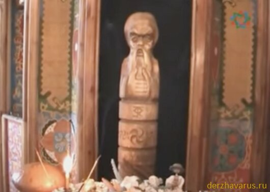

# Бог Род

**БОГ РОД** - персонификация множества всех Светлых Богов и многомудрых Предков наших. Вышний Бог Род - Един и Множествен одновременно. Когда мы говорим о всех Древних Богах и Великих и Мудрых Предках наших: Пращурах, Прадедах, Дедах и Отцах, - мы говорим - это мой РОД.

Куммир Бога Рода в Капище Веды Перуна (г. Омск) / Персонификация всех Богов и Предков наших / Извечный символ кровного родства всех Славянских и Арийских Родов

К нему мы обращаемся, когда необходима Духовная и Душевная поддержка Светлых Богов и Предков, ибо Боги наши суть Отцы наши, а мы дети их. Бог Род является, **извечным символом кровного родства**, воплощением нерушимости всех Славянских и Арийских Родов и Племен, их постоянного взаимодействия и взаимопомощи друг другу.

При рождении на Мидгард-Земле человека из Великой Расы или потомка Рода Небесного, его будущая судьба записывается в Саньтии или Харатьи Бога Рода, именуемые также Книгой Рода. Поэтому во всех Родах Православных Староверов-Инглингов говорят: «Что на Роду написано, никому не миновать!» или «Что в Харатьи Бога Рода записано пером, того не вырубишь топором».

Вышний Бог Род является Богом-Покровителем Чертога Бусла (Аиста) во Сварожьем Круге. Это послужило для создания народного иносказательного Образа, что **Аист детей приносит** из Сварги Пречистой, для продления наших Славянских и Арийских Родов.

**Гимн-Правьславление Рода**:  
Великий Бог Род, Ты наш Покровитель! Славен и Триславен буди! Тебя извечно величаем, во всех ниших Родах прославляем! Да не изсякнет помощь Твоя, во всех Благих и созидательных деяниях наших, ныне и присно и от Круга до Круга! Тако бысть, тако еси, тако буди!

Прим. Родина - это народ, а не территория
