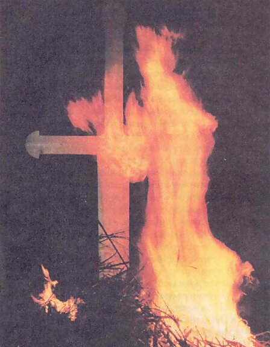

# Бог Семаргл

**БОГ СЕМАРГЛ** (Огнебог) - Вышний Бог, хранитель Вечно живого Огня и блюститель точного соблюдения всех Огненных Обрядов и Огненных Очищений.

Фото: Огнебог Семаргл / День Бога Купала, Омск, 1994 г.

Семаргл принимает Огненные Дары, Требы и безкровные Жертвоприношения на древних Славянских и Арийских праздниках, особенно на Красногор, в День Бога Купала и в Вышний День Бога Перуна, являясь посредником между людьми и всеми Небесными Богами.

Огнебог Семаргл является Богом-Покровителем Чертога Небесного Змея во Сварожьем Круге.

Огнебог с радостью благославляет всех людей из Родов Расы Великой, кои с чистой Душой и Духом соблюдают все Небесные Законы и Многомудрые Заповеди Светлых Богов и Предков.

Семаргла также призывают при лечении заболевших животных и людей, для того, чтобы избавить больных от различных хворей и болезней. Когда у человека поднималась температура, то говорили, что Огнебог поселился в Душе заболевшего. Ибо Семаргл, как Огненный Пес, яростно сражается с хворями и болезнями, кои подобно ворогам пробрались в тело или Душу заболевшего. Поэтому считается недопустимым сбивать у больного поднявшуюся температуру. Самым лучшим местом для очищения от хвори считается баня.

**Гимн-Правьславление:**  
Семаргл Сварожич! Велик Огнебожич! Спали боль-хворобу, очисти утробу, у чада людины, у всякой тварины, у стара и млада, Ты, Божья услада. Огнем очищая, мощь Душ отворяя, спаси чадо Бога, да сгинет хвороба. Тебя прославляем, к себе призываем, ныне и присно и от Круга до Kруга! Тако бысть, тако еси, тако буди!
