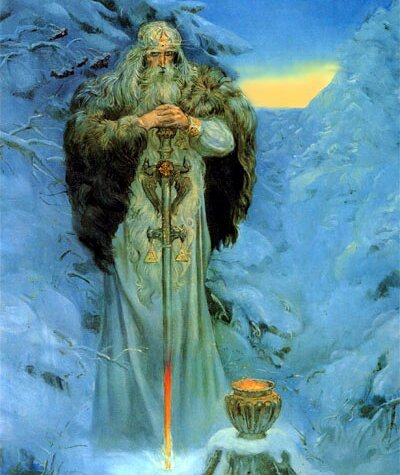

# Бог Сварог

**БОГ СВАРОГ** - Верховный Небесный Бог, управляющий течением Жизни нашей и всем Мироустройством Вселенной в Явном Мире.

Сварог-прародитель, худ. Андрей Клименко

Великий Бог Сварог является Отцом для множества древних Светлых Богов и Богинь, поэтому мы, Православные Староверы-Инглинги, называем всех Их Сварожичами, т.е. Детьми Бога Сварога.

Бог Сварог как любящий Отец, заботится не только о своих Небесных детях и внуках, но и о людях из всех Родов Великой Расы, которые являются потомками Древних Сварожичей, Светлых Небесных Богов на Мидгард-Земле.

Но наши Великие и многомудрые Предки, кроме Детей и Внуков Вышнего Бога Сварога, Сварожичами называли и Небесные Светила - Солнца и Звезды, а также любое Небесное тело, которое появлялось на Небосклоне и иногда падало с Небес на Землю (метеориты, болиды...).

## Сварог - Хранитель Небесного Вырия

Вышний Бог Сварог очень любит живую Природу и бережет различные растения и наипрекраснейшие, редкие цветы. Бог Сварог - Хранитель и Покровитель **Небесного Вырия** (Славяно-Арийского райского сада), посаженного вокруг Небесного Асгарда (Града Богов), в котором собраны со всех Светлых Миров всевозможные деревья, растения и наипрекраснейшие, редчайшие цветы со всей подконтрольной ему Вселенной. Но Сварог заботится не только о Небесном Вырии и о Небесном Асгарде, но также заботится о Природе Мидгард-Земли и других схожих с ней Светлых Земель, находящихся у Рубежа между Светлыми и Темными Мирами, на которых Он создал прекрасные Сады, подобные Небесному Вырию.

Посылаемая Сварогом на Мидгард-Землю плодотворная сила лучей Ярилы-Солнца и дождевых ливней согревает и питает растительный и животный мир земного Сада-Вырия возле Асгарда Ирийского, а также согревает и питает растительный и животный мир всего Мидгарда. Вышний Бог Сварог дает необходимую растительную пищу птицам и животным. Людям он указал, какую им необходимо пищу выращивать для питания Родов своих и какой пищей нужно кормить прирученных птиц и животных.

Вырий Сад примыкает к Небесному Асгарду (Граду Богов), в центре которого находятся Величественные Хоромы Сварога.

Великий Бог Сварог является постоянным Хранителем Небесного Чертога Медведя во Сварожьем Круге.

Вышний Бог Сварог установил Небесные Законы восхождения по Златому Пути Духовного Развития. Этим законам следуют все Светлые Гармоничные Миры.

**Гимн-Правьславление:**  
Сварог-Прародитель, всей Сварги Пречистой Хранитель! Славен и Триславен Буди! Тебя все-Родно прославляем, к себе Твой Образ призываем! Да неразлучно, Ты, с нами Буди, ныне и присно и от Круга до Круга! Тако бысть, тако еси, тако буди!

### См. также

- Заповеди Бога Сварога
- Заповедь Бога Сварога о вегетарианстве?
- Даруйте десятую часть Богу Единому – это кому?
- ПОСТ – Полное Очищение Собственных Телес
