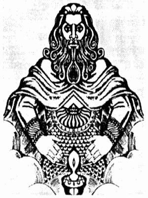

# Бог Свентовит

**БОГ СВЕНТОВИТ** - Вышний Небесный Бог, который несет Чистый Духовный Свет Благости, Любви, Озарения и Просвещения Мира Прави, в Души всех Белых людей из Родов Расы Великой, а также в Души потомков Рода Небесного.

Бог Свентовит

Православные Староверы-Инглинги из различных Славяно-Арийских Общин почитают Бога Свентовита за его повседневную Духовную помощь во всех благих *созидательных деяниях* и начинаниях, которые направлены на благо и процветание наших Древних Родов.

На праздниках в честь Бога Свентовита проводились состязания в познании Древней Мудрости среди молодежи. К состязаниям в познании Древней Мудрости допускались только те молодые люди, кто уже достиг Круга Лет \*.  
\* **достиг Круга Лет** - т.е. возраста 16 лет.

Смысл состязаний, которые проводили Жрецы Свентовита, сводился к тому, чтобы определить, насколько у подрастающего поколения развита Родовая память, образное мышление, интуиция, ловкость и смекалка.

В самом начале состязаний Жрецы Свентовита загадывали молодым людям вопросы на различные темы и загадки. Победителем считался тот, кто быстрее и остроумнее ответит на большее количество вопросов и загадок. Далее для победителей первого состязания проводились состязания, которые определяли ловкость и мастерство молодых людей в различных единоборствах, умение в обращении с мечем и ножом, меткость при стрельбе из лука.

Прошедшие вышеуказаные испытания проверялись также на выносливость; для этого молодые люди отправлялись в лес на три недели, или как говорили в старину, на тридевять дней \*.  
\* **на тридевять дней** - т.е. на 27 суток, ибо Неделя в Славяно-Арийском календаре состоит из 9 дней.

**Гимн-Правьславление:**  
Свентовит, Бозе наш Светлый! Славим и Триславим Тя все-Родно! И просвети Ты Души наша и ниспошли озарение во сердца наша, ибо Благий Бозе Ты еси, да ко всем Родам наша. Тя извечно величаем и в Роды наша призываем, да буде Души наша со Тобою, ныне и присно и от Круга до Круга, да во вси времена, пока светит нам Ярило-Солнце!
