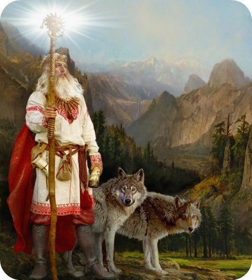

# Бог Велес

**БОГ ВЕЛЕС** - Бог-Покровитель скотоводов и животноводов, а также Родовой Покровитель западных славян - Скоттов (шотландцев), поэтому и говорили они всем из покон веков, что «Велесъ скотiй Богъ». Переселившись на британские острова, древние Роды Славян-Скоттов назвали все обжитые провинции - Землей Скоттов - Scotland (Шотландией), а в честь своего Родового Бога-Покровителя Велеса они назвали земли с лучшими пасбищами его именем - **Wales** (Уэльс, т.е. Велес).

Бог Велес – покровитель скотоводов и животноводов / Верховный Хранитель Небесных Врат Междумирья

Так как Велес является Богом-Покровителем и Управителем Небесного Чертога Волка во Сварожьем Круге, который расположен рядом с Небесным Рубежом, разделяющим Миры Света и Тьмы, Вышние Боги доверили Велесу быть верховным Хранителем Небесных Врат Междумирья. Эти Небесные Врата находятся на Золотом Пути Духовного Развития, который ведет в Небесный Асгард, а также в Небесный Вырий и в Светлые Чертоги Волхаллы.

Бог Велес всегда олицетворяет всестороннюю заботливость, кропотливое созидательное трудолюбие, честность и решительность, стойкость, постоянство и хозяйскую мудрость, способность отвечать за все свои деяния, сказанные слова и совершенные поступки.

Бог Велес, охраняя Небесные Врата Междумирья, пропускает во Сваргу Пречистую Души только тех усопших, кто не щадил своей жизни во защиту Родов своих, во защиту земель Отцов и Дедов, во защиту древней Веры; которые усердно и созидательно трудились для процветания своих Родов и которые от чистого сердца выполнялии Два Великих Принципа: Свято чтить Богов и Предков своих, и живших по Совести в гармонии с Матерью-Природой.

**Гимн-Правьславление:**  
Велесе Бозе-Покровитель! Сварга Двара охранитель! И прославляем Тя, все-Родно, ибо Ты, заступа и опора наша! И не остави нас Без призора, и огради от мора стада тучны наша, и наполни добром житницы наша. Да буди ми со Тобою во едине, ныне и присно и от Круга до Круга! Тако бысть, тако еси, тако буди!
