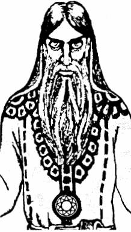

# Бог Вышень

**БОГ ВЫШЕНЬ** - Бог-Покровитель нашей Вселенной в Светлых Мирах Нави, т.е. в Мирах Слави. Заботливый и могучий Отец Бога Сварога. Справедливый судья, разрешающий любые споры, которые возникают между Богами различных Миров или между людьми.

Бог Вышень

Он покровительствовал нашим Многомудрым Предкам в их стремлении продвигаться по Пути Духовного Развития и Совершенства, а также покровительствует всем Православным Староверам-Инглингам, когда они идут по стопам своих Великих Предков.

Бог Вышень является Богом-Покровителем Чертога Финиста во Сварожьем Круге.

Вышень строг по отношению к тем, кто стремится исказить Пути Духовного Развития и Совершенства, к тем, кто выдает Кривду за Правду, низменное за Божественное и черное за белое. Но при этом Он добр по отношению к тем, кто соблюдает Небесные Законы Мироздания и не позволяет другим нарушать их. Он помогает стойким побеждать в борьбе с темными силами, которые несут во все Миры зло и невежество, лесть и обман, желание чужого и уничижение одного живого существа другим.

Бог Вышень наделяет людей, продвигающихся по Пути Духовного Развития и Совершенства, способностью размышлять о различных сторонах Жизни, как Земной, так и последующей, и делать правильные соответствующие выводы; чувствовать, когда люди говорят неискренно или намеренно, преследуя какие-то корыстные интересы, лгут.

**Гимн-Правьславление**:  
Вышень Великий, Слави всей Покровитель! Услышь зов наш, Тя прославляющий! Помози в деяниях наша и разреши споры наша, ибо благ Ты к Родам наша, ныне и присно и от Круга до Круга!
