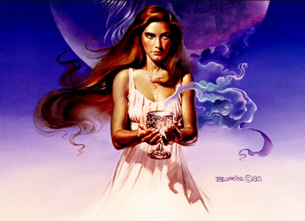

# Богиня Джива

**БОГИНЯ ДЖИВА** (Дева Жива, Дива, Сива) - Богиня Вечной Вселенской Жизни, Богиня младых и чистых Душ Человеческих.

Картина Бориса Вальехо - Грифон в хрустальном шаре, 1985 / Дива

Богиня Джива дает каждому человеку из Расы Великой, или потомку Рода Небесного, при рождении в Мире Яви чистую и светлую Душу, а после праведной земной жизни дает человеку испить Божественной Сурицы из Чаши Вечной Жизни.

Богиня ДЖИВА является олицетворением плодоносной силы Жизни, вечной молодости, юности и влюбленности, а также наивысшей Красоты всей Природы и человека.

Богиня-Покровительница Чертога Девы во Сварожьем Круге. Считается, что когда Ярило-Солнце находится в Небесном Чертоге Девы, рождаются дети, наделенные особыми чувствами, такими как: предвидение великих изменений в жизни людей и предсказание грозных природных явлений, способность разобраться в любой запутанной ситуации.

Богиня Джива - добросердечная супруга и спасительница Тарха Даждьбога. Она также наделяет нежностью, добротой, сердечностью и внимательностью беременных женщин и кормящих матерей из Родов Расы Великой, кои соблюдают древние семейные традиции и многовековой Родовой уклад.

**Гимн-Правьславление:**  
Джива-Матушка! Душ Хранительница! Ты, Родам всем нашим Покровительница! Призываем Тя, Прославляем Тя, Светлых Душ дарительницей величаем Тя! Подари людям всем утешение, а Родам древним нашим размножение. И прибудешь, Ты, извечно в сердцах наших, ныне и присно и от Круга до Круга. Тако бысть, тако еси, тако Буди!
