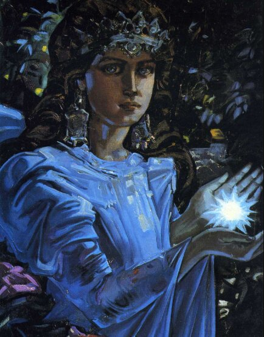

# Богиня Марена

**БОГИНЯ МАРЕНА** (Mapa) - Великая Богиня Зимы, Ночи и Вечного Сна и Вечной Жизни. Богиня Марена, или Марена Свароговна, одна из трех нареченных сестер Многомудрого Бога Перуна.

Очень часто ее называют Богиней Смерти, прекращающей земную жизнь человека в Явном Мире, но это не совсем верно. Богиня Марена не прекращает человеческую жизнь, а дает людям Расы Вечную Жизнь в Мире Слави.

Богиня Марена / Худ. Андрей Клименко, картина Царица ночи

Считается, что Великая Богиня Марена имеет на крайнем севере Мидгард-Земли Ледяные Чертоги, в которых Она любит отдыхать после странствий по Сварге Пречистой.

## Марена - Богиня Зимы

Когда Богиня Марена приходит на Мидгард-Землю, вся Природа засыпает, уходит на покой, погружаясь в долгий трехмесячный сон, ибо сказано в Саньтиях Веды Перуна:

> «Великое Похолодание принесет ветер да’Арийский на землю сию, и Марена на треть Лета укрывать будет ее своим Белым Плащом»  
> Саньтия 5, шлока 3.

А когда Марена Свароговна уходит в свои Ледяные Чертоги, на второй день после дня Весеннего равноденствия происходит пробуждение Природы и разнообразной жизни.

В честь проводов Богини Марены на Север, ежегодно отмечается праздник Красногор, День Масленицы-Марены, называемый также Проводами Богини Зимы (современное название - Проводы Русской Зимы).

В этот день сжигается кукла, изготовленная из соломы, символизирующая не Богиню Марену, как многие думают, а снежную Зиму. После ритуала сжигания соломенной куклы горсть пепла развеивали над полем, садом или огородом, чтобы вырос хороший, богатый урожай. Ибо, как говорили наши Предки:

> «Богиня Веста на Мидгард-Землю пришла, на Красногор новую жизнь принесла, огонь запалила и зимние снега растопила, всю землю живой силой напоила и от сна Марены разбудила. Будет Мать Сыра Земля полям нашим жизньродящую силу давать, будет отборное зерно в полях наших прорастать, чтобы всем Родам нашим - хороший урожай дать».

## Богиня Вечной Жизни

Но Богиня Марена, кроме наблюдения за отдыхом Природы на Мидгард-Земле, когда Мать Природа набирает живительные силы для весеннего пробуждения и жизни растений и животного мира, наблюдает еще и за жизнью людей. А когда приходит время людям из Родов Расы Великой отправляться в долгую дорогу по Золотому Пути, Богиня Марена дает наставления каждому умершему человеку в соответствии с его земной Духовной и мирской жизнью, а также в соответствии с полученным созидательным опытом, в каком направлении ему продолжать свой посмертный Путь, в Мир Нави или в Мир Слави.

Богиня Марена является Покровительницей Чертога Лисы во Сварожьем Круге.

**Гимн-Правьславление:**  
Марена-Матушка, Славна и Триславна буди! Мы, Тя, извечно величаем, безкровны Требы и Дары для, Тя, все-Родно возжигем! Даруй нам достаток во всех деяньях наших, и сохрани от мора скотину нашу, и не давай опустеть житницам нашим, ибо велика есть щедрость Твоя, ныне и присно и от Круга до Круга! Тако бысть, тако еси, тако буди!
