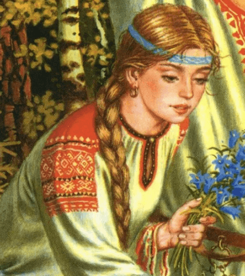

# Богиня Тара

**БОГИНЯ ТАРА** (*Тарина, Тая, Табити*) - младшая сестра Бога Тарха, названного - Даждьбогом, дочь Небесного Бога Перуна.

Богиня Тара

Богиня Тара всегда искрится добротой, любовью, нежностью, заботой и вниманием. Ее благодать изливается не только на Природу, но и на людей.

Вечнопрекрасная Богиня Тара является Небесной Хранительницей Священных Рощ, Лесов, Дубрав и Священных Деревьев Великой Расы - Дуба, Кедра, Вяза, Березы и Ясеня.

В связи с тем, что Богиня Тара вместе со своим старшим братом Тархом Даждьбогом охраняют безкрайние земли Беловодья и Свята Расы, данные территории называют землями Тарха и Тары, т.е. Великой Тартарией (Grand Tartaria).

Кроме того, Полярная Звезда у Славянских и Арийских народов именовалась в честь сей прекрасной Богини - Тара.
