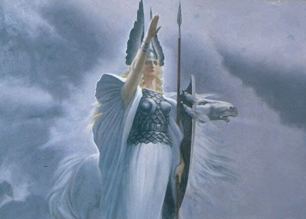

# Богиня Валькирия

**БОГИНЯ ВАЛЬКИРИЯ** - Богиня-Покровительница воинов, Родов-Хранителей (народа Беловодья), т.е. хранителей Древней Мудрости Богов и Чистоты Великой Расы. Валькирия является Богиней-Утешительницей всех погибших за Родное Отечество и Правое дело воинов, коих Она сопровождает в Небесную Волхаллу, где их встречают хозяин - Бог-Воин Волх и его Великие Небесные Соратники: Бог Перун, Бог Один, Бог Индра, Бог Велес, Бог Ладаад, Бог Тор, Бог Семаргл и др.

Валькирия над сраженным воином, худ. К. Васильев / 1971 год

На Мидгард-Земле **Валькирия** избирает среди красивых девушек себе помощниц, которых наделяет Великой Небесной Силой, при помощи которой девушки создают Обережный Круг вокруг своих суженых, коим на Роду написано быть Воинами-Защитниками Родной земли.

Этих прекрасных девушек в древние времена называли, как и Богиню - *Валькириями*. Их везде узнавали по особому вышитому орнаменту на рубахах и сарафанах, а также по богатой, почти до пят, русой косе. Именно через волосы девичей косы Богиня Валькирия передавала девушкам Великую Небесную Силу. Считалось, что если у земной Валькирии обрезать косу, то ее мужчина-Воитель лишится Обережного Круга Валькирии и в первом же бою погибнет.

Валькирия - этимология
