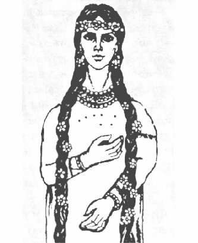

# Богородица Макошь

**БОГОРОДИЦА МАКОШЬ** - Небесная (Сва) Богородица, Справедливая Богиня счастливого жребия и Судьбы.

Богиня Макошь

Вместе со своими дочерьми, Долей и Недолей, определяет Судьбы Небесных Богов, а также судьбы всех людей из Великой Расы и всех потомков Рода Небесного, живущих на нашей Мидгард-Земле и на всех других прекрасных Землях Сварги Пречистой, плетя для каждого из них Нити Судьбы. Поэтому многие люди обращались к Богине Макоше, чтобы она доверила сплетать Нить Судьбы в клубок своей младшей дочери - Богине Доле.

Богиня Макошь во все времена была очень внимательной и заботливой Покровительницей ткачества и всевозможного рукоделия, а также следила за тем, чтобы па полях, где орачи (крестьяне) вкладывают Душу в свой нелегкий труд, вырастал хороший урожай.

Следует помнить, что великая Небесная Богиня Макошь -это не только Богиня-Покровительница произрастания и плодородия, как могут подумать многие, а Богиня, дарующая трудолюбивым и прилежным людям хороший урожай.

К тем Родам из Великой Расы и ко всем потомкам Рода Небесного, которые не ленились, а трудились в полях, в садах и на огородах в поте лица, вкладывая Душу в свой нелегкий труд, Богиня Макошь посылала свою младшую дочь - белокурую Богиню Долю.

Тем же людям, кто плохо и нерадиво трудился на своих полях (неважно, из какого он Рода), доставался плохой урожай. Поэтому в народе говорили, что «*от Макоши Доля пришла урожай мерить*» или «*Макошь Недолю послала урожай мерить*».

Для трудолюбивых людей Богиня Макошь - подательница всяких благ, поэтому на Образах и Куммирах Богини Макоши ее очень часто изображали с Рогом Изобилия или его символическим изображением в виде Небесного Ковша из Семи Звезд\*.  
\* **Небесный Ковш из Семи Звёзд** - созвездие Большой Медведицы, в Славяно-Арийской космогонической системе данное созвездие называется Макошь, т.е. Мать Ковша.

Православные Староверы-Инглинги, неизменно следуя всем наставлениям Богини Макоши, стремятся к спокойной и размеренной жизни, к исторически традиционному укладу, к чувственному сопереживанию и трудолюбию.

Богиня Макошь управляет Чертогом Небесного Лебедя во Сварожьем Круге. Поэтому Богиню Макошь очень часто изображают в виде Белой Лебедушки, плывущей по безкрайнему Морю-Океану, т.е. в Небесах.

В честь Мудрой Небесной Богородицы Славяне и Арии ставили Великие Куммирни и Капища, ибо Богиня Макошь олицетворяла не только судьбу, удачу, достаток в Славянских Родах, соблюдающих законы и заповеди Древних Светлых Богов, к ней также обращались люди с просьбой преумножить их Древний Род, т.е. просили побольше детей, внуков и правнуков.

**Гимн-Правьславление**:  
Государыня Макошь-Матушка! Мать Небесная, Богородица, сопряди для нас жизнь укладную, жизнь общинную, вельми славную. Правьславляем Тя, Мать-наставницу, добродетельну и старательну, ныне и присно и от Круга до Круга! Тако бысть, тако еси, тако буди!
