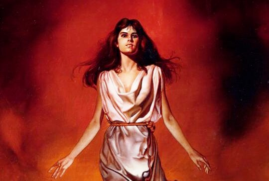

# Богородица Рожана

**БОГОРОДИЦА РОЖАНА** (Мать Родиха, Рожаница) - вечно молодая Небесная Богородица. Богиня семейного достатка, Душевного богатства и Уюта. Богородице Рожане совершали особые жертвоприношения едой: блинами, оладьями, хлебами, кашами, мёдом и медовым квасом.

Богородица Рожана / Картина Бориса Вальхео – Firewalker

Древний Славяно-Арийский культ Богородицы Рожаны, как и другие культы, посвященные Богородицам и Богиням, связан с женскими представлениями о продолжении Рода и судьбе новорожденного младенца, которому определяется Судьба.

Небесная Богородица Рожана во все времена Покровительствовала не только беременным женщинам, но и младым девочкам, пока они не прошли обряды Совершеннолетия и Имянаречения в двенадцатилетнем возрасте \*.

Богиня-Покровительница Чертога Щуки во Сварожьем Круге. Считается, что когда Ярило-Солнце находится в Небесном Чертоге Щуки, рождаются люди, чувствующие себя везде как рыба в воде.

**Гимн-Правьславление:**  
Трисветлая Рожана-Матушка! Не дай оскудеть Роду нашему, освяти чрево всех жен и невест наших, благодатной силой своей, ныне и присно и от Круга до Круга!

---

\* **В двенадцатилетнем возрасте** - возраст 12 лет выбран нашими Предками неслучайно, это 108 месяцев Славяно-Арийского календаря, период взросления и обретения начального жизненного опыта. Кроме того, рост ребенка к этому возрасту достигал 124 см., или как говорили в древние времена - семь пядей во лбу. До прохождения Обрядов любой ребенок, независимо от пола, назывался - чадо и находился под обереговой защитой своих родителей, которые отвечали за него. После прохождения в 12 лет Обрядов Совершеннолетия и Имянаречения ребенок становился полноправным членом Общины и нес ответственность за все свои слова и поступки.
