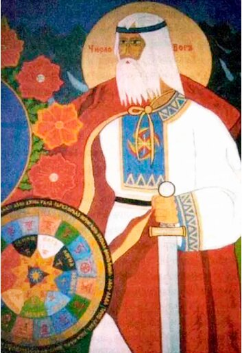

# Числобог

**ЧИСЛОБОГ** - Мудрый, Вышний Бог, управляющий течением Реки Времени, а также Бог-Хранитель Даарийского Круголета и различных жреческих систем Славяно-Арийского летоисчисления.

Изображение Числобога в Капище Веды Перуна (г. Омск)

В левой руке Числобог держит меч, направленный острием вниз, что символизирует постоянную защиту и всемерное сохранение, а в правой руке Числобог держит свой щит, на котором начертан Древнейший Рунический календарь, называемый Даарийским (Даарским) Круголетом Числобога.

По Даарийскому Круголету Числобога раньше велись различные летоисчисления во всех Славянских и Арийских землях. Эти системы использовались до насильственной христианизации народов Руси и Европы и до введения нового летоисчисления от Рождества Христова (использование Славяно-Арийских систем летоисчисления по Даарскому Круголету Числобога в Русских землях было отменено царем Петром Алексеевичем Романовым в Лето 7208 от Сотворения Мира в Звездном Храме (1700 г. н.э.).

В настоящее время различными системами летоисчисления по Даарскому Круголету Числобога пользуются лишь Жрецы-Священнослужители Весевых Духовных Управлений и Старейшины Славянских, Арийских и Родовых Общин Древнерусской Инглиистической церкви Православных Староверов-Инглингов.

**Гимн-Правьславление**:  
Славен и Триславен Буди, Числобог наш! Ты, хранитель течения жизни во Сварге Пречистой, наделяющий живот наш сроком разумения Мира Явнаго нашаго, и указуешь Ты, егда Яриле-Солнцу восходить, егда Лунам и Звездам светить. И даруй нам, по велицей благости Твоей, внуков и правнуков Родов наших узреть, Бозем и Предкам наша Велику Славу воспеть, яко добродетель, Ты, и человеко-любец. И Славу все-Родно Теве воспеваем, ныне и присно и от Круга до Круга! Тако бысть, тако еси, тако буди!
