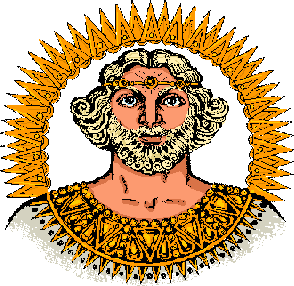

# Дажьбог

**ДАЖЬБОГ** - Сварожич, является Богом-Покровителем и олицетворением Златого Солнца в Чертоге Расы на Сварожьем Круге. Сие Солнце Роды Белых людей живущих на Землях в данной солнечной системе именуют Дажьбогом-Солнцем.

**Дажьбог** - Покровитель и олицетворение Златого Солнца в Чертоге Расы.

Их великие и славные потомки, переселившиеся на Мидгард-Землю у Ярилы-Солнца, помнили о своей древней Прародине и величали себя не иначе, как «*Дажьбоговы внуки*», т.е. потомки тех Родов Великой Расы, кои жили под сиянием Дажьбога-Солнца и переселились на Мидгард, к Яриле-Солнцу.

В дальнейшем с прекрасной Ингард-Земли, из системы Златого Солнца, прибыл на Мидгард-Землю в древнейшие времена Даждьбог Тарх Перунович, чтобы даровать потомкам переселившихся с Ингард-Земли Древние Веды и Заповеди.

Потомки людей, переселившихся с Ингард-Земли, образовали великие Роды Расичей и Расенов, а после посещения их Богом Тархом стали именовать себя также и «*Даждьбожьи внуки*».

Наши Предки верили, что Дажьбог покровительствует свадьбам, встречает жениха на рассвете в день Освящения Семейного Союза, поэтому и говорили, что Свадьбы свершаются на Небесах и освящаются Дажьбогом-Солнцем.
