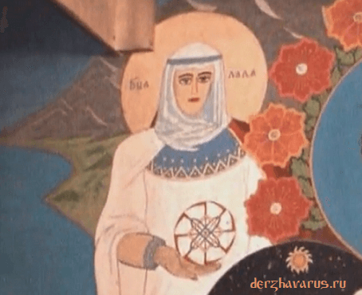

# Лада-Матушка (Небесная Богородица)

**ЛАДА-МАТУШКА** (*Матерь Сва*) - Великая Небесная Мать, Богородица. Любящая и нежная Мать Большинства Светлых Богов Расы Великой, Богородица-Покровительница всех Народов Великой Рассении (территорий, по которым расселилась Великая Раса, т.е. Славянские и Арийские племена и народы) и Чертога Лося во Сварожьем Круге.

Богородица Лада - Богиня Красоты и Любви, оберегающая Семейные Союзы / Изображение Лады в Капище Веды Перуна (г. Омск)

Небесная Богородица Лада-Матушка - это Богиня Красоты и Любви, оберегающая Семейные Союзы Родов Великой Расы и Семьи всех потомков Рода Небесного.

## Лада-Матушка оберегает Семейные Союзы Расы

Для того, чтобы получить постоянную заботу и сердечное внимание со стороны Лады-Матушки, каждая пара молодоженов приносит в дар Небесной Богородице самые яркие и благоухающие цветы, мёд и различные лесные ягоды, а также молодые супруги пекут для Лады блины с ягодной начинкой, медовые оладьи и возлагают перед Куммиром или Образом Её.

Вышняя Богородица Лада всегда дарует молодым супругам все то, что они просят для начала совместной счастливой жизни. Она приносит в жизнь людей домашний уют, дружелюбие, взаимопонимание, любовь, продолжение Рода, многодетство, взаимовыручку, семейный уклад, взаимоуважение и взаимопочитание. Поэтому про такие Союзы говорили, что в них царит лишь Лад да Любовь.

**Гимн-Правьславление:**  
Ой, Ты, Лада-Матушка! Матерь Сва Пречистая! Не остави нас без любви и счастья! Благодать свою ниспошли на нас, яко и мы, чтим и славим Тя, ныне и присно и от Kpуга до Kpуга, до скончания Времен, пока светит нам Ярило-Солнце!

### Небесные Богородицы

- Заповеди Лады-Богородицы
- Богородица Макошь
- Богородица Рожана
- Богородица Зимун
