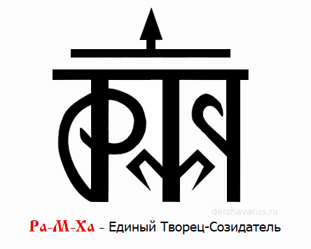

# Ра-М-Ха (Рамха)

**Ра-М-Ха (РАМХА)** - Единый Творец-Созидатель, Вышняя Непознаваемая Сущность, излучающая Изначальный Жизньродящий Свет Радости и Первичный Огонь Мироздания (Жизньнесущую Инглию), из которого появились все ныне существующие, а также существовавшие в прошлом видимые и невидимые Вселенные, и всевозможные обитаемые Миры.

Трёх-Рунник Ра-М-Ха / Рамха - Единый Творец-Созидатель

Куммиров и Образов, изображающих Рамху, никогда не существовало, ибо невозможно изобразить Непознаваемую, Неизведанную Вышнюю Сущность, поэтому для отождествления и определения Вышней Сути использовался Священный Трех-Рунник.

## Гимн-Правьславление РАМХА

Великий Ра-М-Ха, Единый Творец-Созидатель, Ты во Мирах всех - Жизни податель! Славим и Триславим, Тя, все-Родно, от малаго и до великаго, во Капищах и во Святилищах наша, на Городищах и на Погостах наша, во Градах и во селениях наша, во Священных Рощах и во Дубравах наша, на брегах Священных рек и озер наша, за Священную Инглию, коия несет нам Свет Любви и Радости, и освещает наша сердца и помыслы. Да будут вси деяния наша, да во Славу Твою, ныне и присно и от Круга до Круга! Тако бысть, тако еси, тако Буди!

### См. также

- Боги наши
- Бог Род
- Бог Вышень
- Бог Сварог
