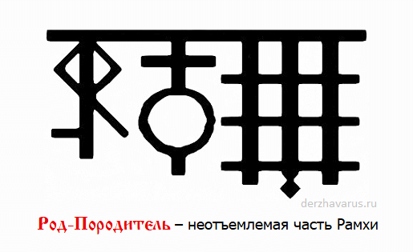

# Род-Породитель

**РОД-ПОРОДИТЕЛЬ** - неотъемлемая часть Единого Творца-Созидателя - Великого Рамхи. Род-Породитель является Единым Богом-Покровителем всех Родов Расы Великой и потомков Рода Небесного.

Трех-Рунник: Род-Породитель

Бог-Покровитель Вселенных Мира Прави. Он является Вышним Богом-Хранителем всех Живых и Разумных обитателей во всех неповторимых видимых и невидимых Мирах, существующих в различных и многообразных Вселенных.

Куммиров и рукотворных Образов, изображающих Рода-Породителя, в древние времена не существовало, ибо невозможно изобразить Великий Непознаваемый Источник, из коего появились все наши древние Светлые Боги, ставшие Родителями или Покровителями для многих Родов.

Могучая сила Его покровительства проистекает по всем Обителям, расположенным в Мирах Яви, Слави, Прави, и поэтому для обозначения Светлого Образа во время Правьславления Вышнего Рода-Породителя наши Великие и многомудрые Предки использовали Священный Трех-Рунник, который они изображали во Капищах и на Алатырь-камне.

**Гимн-Правьславление**:  
Великий наш Род-Породитель! Внемли призывающим Тя! Славен и Триславен Буди! Ибо Ты есть Вечный Источник жизни Богов наша и Родов наша, и посему Велику Славу для Тя воспеваем, и денно и нощно Тя - Правьславляем, ныне и присно и от Круга до Круга! Тако бысть, тако еси, тако Буди!
