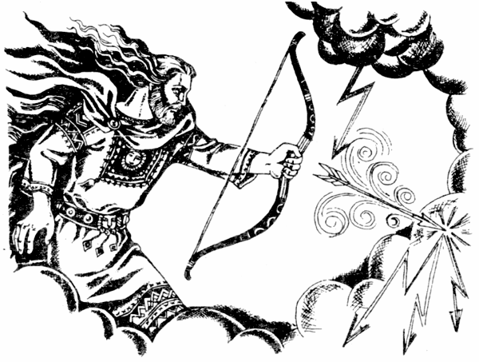

# Стрибог

**СТРИБОГ** - является Богом, который управляет молниями, вихрями, ураганами, ветрами и штормами морскими на Мидгард-Земле. К нему мы обращаемся, когда в засушливый период необходима дождевая туча или наоборот, в дождливый период когда необходимо, чтобы Стрибог разогнал тучи и Ярило-Солнце согрело наполненные влагой поля, сады и огороды.

**Стрибог** - управляет молниями, вихрями, ураганами, ветрами и штормами. | Истребляет всяческие злодеяния и разрушает злые умыслы.

Стрибог управляет также ветрами и песчаными бурями на Земле Орея (Марсе). Кроме того, Он является Богом-Покровителем Земли Стрибога (Сатурна) в системе Ярилы-Солнца. Но пуще всего наши Предки почитали Стрибога как истребителя всяческих злодеяний и разрушителя злых умыслов.
