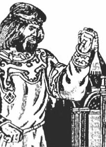

# Даждьбог

**ДАЖДЬБОГ** - Бог Тарх Перунович, Бог-Хранитель древней Великой Мудрости. Был назван Даждьбогом (дающим Богом) за то, что дал людям Великой Расы и потомкам Рода Небесного Девять Саньтий (Книг). Эти Саньтии, записанные древними Рунами, содержат Священные Древние Веды, Заповеди Тарха Перуновича и его наставления.

Тарх Даждьбог

Существуют различные Куммиры и Образы, изображающие Бога Тарха. На многих Образах он держит в своей руке гайтан со Свастикой.

Тарха очень часто называют многомудрым сыном Бога Перуна, внуком Бога Сварога, правнуком Бога Вышеня, что соответствует истине\*.  
\* **Соответствует истине** - хотя существует и ошибочное мнение: Тарха Даждьбога в многих древних источниках очень часто называют Сварожичем, т.е. Небесным Богом, а многие исследователи древности трактуют это так, что Даждьбог является сыном Бога Сварога.

Даждьбог - податель всяческих благ, счастья и благополучия. Тарха Даждьбога прославляли в священных и народных песнопениях и гимнах не только за счастливую и достойную жизнь Родов Расы Великой, а также за избавление от сил Темного Мира. Тарх не позволил победить темным силам из Пекельного Мира, которых собрали Кощеи на ближайшей Луне - Леле, чтобы захватить Мидгард-Землю. Тарх Даждьбог уничтожил Луну вместе со всеми темными силами, которые на ней находились. Об этом сообщают «Саньтии Веды Перуна. Круг Первый»:

> «Вы, на Мидгарде живете спокойно, с давних времен, когда мир утвердился... Помня из Вед о деяниях Даждьбога, как он порушил оплоты Кощеев, что на ближайшей Луне находились... Тарх не позволил коварным Кощеям Мидгард разрушить, как разрушили Дею... Эти Кощеи, правители Серых, сгинули вместе с Луной в получастьи... Но расплатился Мидгард за свободу, Даарией скрытой Великим Потопом... Воды Луны тот Потоп сотворили, на Землю с Небес они радугой пали, ибо Луна раскололась на части и ратью сварожичей в Мидгард спустилась»  
> *Саньтия 9, шлоки 11-12.*

В память об этом событии появился своеобразный Обряд с глубоким смыслом\*\*, совершаемый всеми Православными людьми, а не только Староверами-Инглингами в каждое Лето, на великий весенний Славяно-Арийский праздник - Пасхетъ.  
\*\* **Обряд с глубоким смыслом** – сей обряд всем хорошо знаком. На Пасхетъ (Пасху) крашеные яйца ударяют друг о друга, проверяя, чье яйцо крепче. Разбитое яйцо называли – Яйцом Кощеев, т.е. разрушенной Луной (Лелей), а целое яйцо называли – Силой Тарха Даждьбога.

Даждьбог Тарх Перунович является Богом-Покровителем Чертога Расы во Сварожьем Круге.

Очень часто в разных древних Ведических текстах Тарха Перуновича просит помочь людям из Родов Великой Расы его прекрасная сестра, златовласая Богиня Тара. Вместе они совершали благие деяния, помогали людям обживать безкрайние просторы на Мидгард-Земле. Бог Тарх указывал, на каком месте лучше всего разместить поселение и построить Капище или Святилище, а его сестра, Богиня Тара, подсказывала людям из Великой Расы, какие деревья необходимо использовать для строительства. Кроме того, она обучала людей, чтобы они на месте срубленных деревьев садили новые лесопосадки, дабы для их потомков выросли новые деревья, необходимые для строительства. Впоследствии многие Роды стали называть себя внуками Тарха и Тары, а территории, на которых эти Роды поселились, назвали Великой Тартарией, т.е. землей Тарха и Тары.

**Гимн-Правьславление**:  
Даждьбог Тарх Перунович! Славен и Триславен Буди! Благодарим Тя, подателя всяческих благ, счастья и благополучия. И велику Славу возглашаем Тебе за помощь в благих деяниях наша, и за помощь в деяниях ратных наша, да супротив темных ворогов и всякаго зла неправедного. Да прибуде Велика Сила Твоя со всеми Родами наша, ныне и присно и от Круга до Круга! Тако бысть, тако еси, тако буди!
