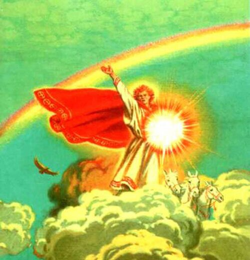

# Ярило-Солнце

**ЯРИЛО-СОЛНЦЕ** (Ярила) - Светлейший Небесный Бог-Покровитель Земной Жизни. Ярила - покровитель всех Светлых, Чистых, Добрых, Сердечных Помыслов и Мыслей людей.

Ярило-Солнце / Ярила

Ярила - хранитель Благих и Чистых Сердец и нашего дневного Светила, которое дарует всем живущим на Мидгард-Земле согревающее тепло, любовь и полноценную жизнь. Образ Ярилы-Солнца часто изображается в быту в виде разнообразных свастичных символов и коней.
