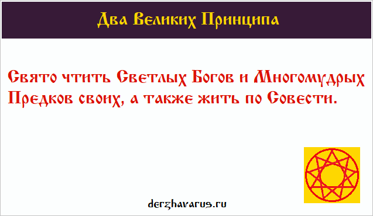

# Заповеди Богов

Заповеди Богов Светлых: Рамхата, Сварога, Перуна, Лады-Богородицы, Стрибога, Одина, Ладаада, Числобога, Даждьбога... и Два Великих Принципа, чтобы человек мог выполнять все Заповеди: - Свято чтить Светлых Богов и Многомудрых Предков своих, а также жить по Совести.

Издревле во многих Родах отдавалось предпочтение наиболее близким по Духу и Крови Небесным Богам, которые всегда приходили на помощь к белым людям во всех краях Мидгард-Земли, где жили Роды Расы Великой. Как повествуют древнейшие Писания и Предания, в те древнейшие времена люди и Небесные Боги братались между собой, помогали друг другу, и Небесные Боги оставляли земным братьям и потомкам свои простые, но мудрые **Заповеди**, чтобы Счастье и Радость не покидали Роды Великой Расы и потомков Рода Небесного.

Заповедей Светлых Богов множество, так же, как и Небесных Богов, их даровавших. Чтобы человек мог выполнять в своей повседневной жизни все Заповеди, которые дали Многомудрые Небесные Боги, ему следует помнить Два Великих Принципа: «*Свято чтить Светлых Богов и Многомудрых Предков своих, а также жить по Совести*».

Два Великих Принципа позволят выполнять все Заповеди Богов Светлых

В глубокой древности Заповеди Вышнего Бога Перуна были записаны Рунами на златых пластинах в «Саньтиях Веды Перуна» (в Книгу Мудрости Перуна). Заповеди других Небесных Богов также были записаны в древние времена в Священные Саньтии и Харатьи. Далее мы приводим **Заповеди Небесных Богов**, немногие из существующих множеств, которые выполняют и неуклонно придерживаются их в своей повседневной жизни все Православные Староверы-Инглинги.

## ЗАПОВЕДИ БОГА РАМХАТА

1. Вернитесь к своим корням, и вы откроите врата в Божественный Мир (Правь).  
2. Не входите в другие Миры со своими законами, а соблюдайте законы Мира того.  
3. Соблюдайте Законы Рамхи Великого, будьте мудрыми и совершенными.  
4. Не идите за Тьмой, а идите за Светом, ибо идущие за Тьмой сгинут безвременно.  
5. Не внимайте тем, кто призывает к Кривде, а внимайте тем, кто призывает к Правде.  
6. Не внимайте тем, кто глаголет, что жизнь конечна, ибо они сами не ведают, о чем возвещают.  
7. Не внимайте тем, кто глаголет, что ближний ваш - ворог ваш, а внимайте вы тем, кто глаголет, что ближний ваш - друже ваш.  
8. Идите через Миры многие, познавая их и совершенствуя Дух свой.  
9. Познавайте Мудрость Бога Единого (Рода) и обрящете Свет Божий на Пути своем.  
10. Не давайте Веды тем, кто во зло превращает их да на погибель всего живого.  
11. Не создавайте заповедей и законов ложных, что идут супротив Законов и Заповедей Божиих, ибо себя погубите и потомков с Пути совратите.  
12. Не стремитесь к другим Мирам, дабы захватить их, ибо кто сие в помыслах имеет, свой Мир потерять может.  
13. Не думайте, что многие Земли безжизненные, на них жизнь вами не видимая, вашими чувствами не ощущаемая.  
14. Не используйте Вайтманы и Вайтмары во зло, дабы захватить другие Миры, а используйте их для добра и познания Миров, и тогда дружбу жителей тех Миров обрящете.  
15. Не проявляйте агрессивность против тех, кто прибывает к вам из других Миров, ибо как вы будете вести себя, так подумают они о всех жителях Мира вашего.  
16. Не разрушайте Мир ваш и природу его, ибо себя погубите и свой Мир потеряете.  
17. Да не отвергнет жена первого мужа своего, ибо отвернется Род Небесный от нее.  
18. Дочь, рожденная во Священное Лето, да сочетается Союзом Семейным с мужем своим только во Священное Лето.  
19. Да не коснется перст отца другой жены, когда жена его носит чадо его под сердцем своим.  
20. Да не возымеете других жен, кроме своей, да в любое время, кроме лихой годины, когда Род мужской гибнет во защиту дома своего, во защиту Земли своей и Веры своей.  
21. Не применяйте Фаш-разрушитель против Мира своего, ибо Мир свой живой погубите и потомков Рода своего лишитесь.  
22. Сохраняйте Память о всех предках Рода своего, и обрящете вы благосклонность Богов и Предков ваших.  
23. Уважайте Странников, посланцев Бога Единого (Рода), внимайте Слову их и Мудрости их.  
24. Не живите по законам, что создали люди, дабы лишить вас Свободы, а живите по Законам Бога Единого.  
25. Не произносите имени Бога Единого в суе, а глагольте его только в Великие праздники.  
26. Почитайте Богов Небесных, Отца и Матерь свою, ибо они Жизнь вам дали, Отец и Матерь дали Дух и Тело вам, а Боги - Душу и Совесть.  
27. Не ругайте тех, кто покинул Мир ваш, ибо об ушедших глаголют только хорошее.  
28. Не судите тех, кто сбился с Пути Света, а направьте их вновь на Путь Праведный, ибо за деяния свои они ответят перед Совестью и Родом.  
29. Да не устыдитесь вы того, что дано вам природой вашей и Родом Единым, а стыдитесь незнания и невежества.  
30. Воздавайте уважение Богам вашим и Творцу Единому, и обрящете мир и покой в жизни вашей, и да будут открыты Врата Междумирья для вас.  
31. Стройте Храмы, да во всех Мирах, познавайте вы Мудрость Божию, ибо кто Мудрость Божию не познает, тот себя потеряет.  
32. Чтите Свято все праздники, что оставили вам Предки ваши, украшайте жизнь свою радостью и деяниями благими, да во Славу Богов и Предков ваших.  
33. Соблюдайте Заповеди Мои, что дал вам, и обрящите помощь Мою да во все времена.

## ЗАПОВЕДИ БОГА СВАРОГА

1. Почитайте друг друга, сын - Мать и Отца, супруг с супругою живите в согласии.  
2. На едину жену должен муж посягать - а иначе спасения вам не узнать.  
3. Убегайте от Кривды и следуйте Правде, чтите Род свой и Рода Небесного.  
4. Почитайте вы три дня в неделе - третий, седьмый и девятый. Почитайте Великие Праздники.  
    Потому подобает поститься всем людям в третий и в седьмый дни. Ежели кто в день девятый трудится, то не будет ему прибытка, ни по жребию, ни по таланту во другие дни без изъяна. День седьмый человекам, скоту и рыбам на покой дан, на отдых телесный. Друг ко другу ходите, друга за дружку радейте, будет радостно вам - пойте гимны Богам.  
5. Почитайте Великий ПОСТЪ от сожжения Марены и до свадьбы Дживы. Берегитесь люди в это время Кривды, сохраняйте строго от съедения чрево, руки от сграбления, от хулы - уста.  
6. Почитайте яйца в честь яйца Кощеев, что разбил Даждьбог наш, вызвав тем Потоп.  
7. Почитайте Страстную Неделю - как скорбел Даждьбог наш от распятия до спасения Лебедью-Дживой, так и вы скорбите смиренно. И не пейте питья хмельного, не скажите бранного слова!  
8. Почитайте Купальские дни. Вспоминайте победу Перунову, как Перун победил зверя-Скипера и как сестрам своим он Свободу дал, как очистил их в водах Ирия.  
9. Почитайте Перунов день. Как Перун в пятый день к Диве сватался, как Перун Ния победил, и с Небес низверг Бога Велеса, вспоминайте и свадьбу Перунову!  
10. Почитайте Ладу-Матушку и Рода Небесного. Покровителей Родов Расы Великой и потомков Рода Небесного.  
11. После жатвы своей вспоминайте об Златогорке, почитайте также День Волха Мудрого, сына Индры, Ясна Сокола.  
12. Почитайте день Макоши-Матушки, Светозарной Великой Матери, Небесной Богородицы.  
13. Почитайте и день Тарха Даждьбога - вспоминайте его женитьбу.  
14. Почитайте Великую Инглию и Богов Ваших, которые суть посланцы Бога Рода Единого.  
15. Почитайте старость и защищайте младость, познавайте Мудрость, что оставили вам Предки ваши.  
16. С другими Родами живите в согласии, помогайте, когда просят вас о помощи.  
17. Не щадите живота своего для защиты Дома своего, для защиты Рода своего и Святой Веры своей, для защиты Святой земли своей.  
18. Не навязывайте Святую Веру насильно людям и помните, что выбор Веры - личное дело каждого свободного (вольного) человека.  
19. Почитайте ПАСХЕТЪ и помните о пятнадцатилетнем переходе из Даарии в Рассению, как шестнадцатое Лето Предки наши славили Род Небесный за спасение от Потопа Великого.  
20. Живите в союзе с Природой, не губите ее, ибо она опора Жизни вашей и всего Рода живого.  
21. Не приносите на Алатырь жертвы кровавые, не гневите Богов ваших, ибо мерзко для Них принимать кровь невинную от созданий Божиих.  
22. Защищайте рукою крепкою ваши Капища и Святилища, помогайте всеми силами вы всем Странникам и Капенам, что хранят ту Тайну Древнюю, Слово Божие, Слово Мудрое.  
23. Не питайтесь пищей с кровию, ибо будете как звери дикие, и болезни многие поселятся в вас. Вы питайтесь пищей чистою, что растет на полях ваших, в лесах и садах ваших, обретете вы тогда силы многие, силы светлые, и не настигнут вас хвори-болезни и мучения со страданиями.  
24. Не стригите свои власы русые, власы разные да с сединами, ибо мудрость Божию не постигните и здоровие потеряете.  
25. Воспитай отец сынов с дщерями, приучи их к жизни праведной, воспитай ты в них трудолюбие, уважение к младости и почтение к старости. Освяти их жизнь Святой Верою и Мудростью Первопредков.  
26. Не хвалитесь своей силою перед слабыми, чтобы восхваляли и боялись вас, а обретайте славу и силу в битвах с ворогом.  
27. Не глагольте ложно против ближнего вашего, сберегите от хулы уста ваши.  
28. Творите деяния добрые, да во славу Рода Небеснаго, и великих Предков ваших, и Святой земли вашей.  
29. Какие деяния сотворят вам люди, такие же и вы сотворяйте им, ибо каждое деяние своею мерою мерится.  
30. Даруйте десятую часть от достатка вашего Богу Единому, а сотую часть вождю и дружине его, дабы охраняли они землю вашу.  
31. Не отвергайте незнаемое и необъяснимое, но постарайтесь незнаемое познать, а необъяснимое объяснить, ибо Боги помогают стремящимся к познанию Мудрости.  
32. Не отнимайте жизнь у ближнего вашего, ибо не вы ее дали, а Боги; но не щадите жизней ворогов, что нападают на вас и земли ваши, ибо они против воли Богов пошли.  
33. Не принимайте подношений и воздаяний за деяния, что сотворены вами при помощи Дара Богов, и за деяния добрые ваши, ибо пропадет Дар Богов, вам данный, и не молвит никто, что благое творите.

## ЗАПОВЕДИ БОГА ПЕРУНА

1. Почитайте Родителей своих и содержите их в старости, ибо как вы проявите заботу о них, тако же и о вас проявят заботу чада ваши...  
2. Сохраните память о всех Предках Родов ваших, и ваши потомки будут помнить о вас...  
3. Защищайте старых и малых, отцов и матерей, сынов и дочерей, ибо это Родичи ваши, мудрость и цвет народов ваших...  
4. Воспитайте в чадах своих любовь к Святой земле Расы, чтобы не прельщались они чудесами заморскими, а могли сами сотворить чудеса более чудные и прекрасные, да во славу Святой земли вашей...  
5. Не творите чудес на благо свое, а творите чудеса на благо Рода своего и Рода Небесного...  
6. Помогите ближнему в беде его, ибо придет к вам беда, помогут и вам ближние ваши...  
7. Творите дела добрые да во славу Рода вашего и Предков ваших, да обрящите покровительство от Богов Светлых ваших...  
8. Помогайте всеми силами строить Капища и Святилища, сохраняйте Мудрость Божию, Мудрость Древнюю...  
9. Омывайте после дел ваших руки ваши, ибо кто рук своих не омывает, тот силу Божию теряет...  
10. Очищайтесь вы в водах Ирия, что течет река во Святой земле, чтоб омыть свое тело белое, освятить его Божьей силою...  
11. Утверждайте на Земле вашей Закон Небесный, что дали вам Светлые Боги ваши...  
12. Почитайте, люди, вы дни русальские, соблюдайте Божии праздники...  
13. Не забывайте Богов ваших, возжигайте во славу Богов вы курения и благовония и обрящите вы благосклонность и милость Богов ваших...  
14. Не чините обид соседям вашим, вы живите с ними в мире и согласии...  
15. Не унижайте достоинство других людей, и да не унижено будет достоинство ваше...  
16. Не творите бед людям других вер, ибо Бог-Творец Един над всеми Землями... и над всеми Мирами...  
17. Не продавайте вы землю свою за злато и серебро, ибо проклятия вы на себя призовете и не будет вам прощения во все дни без остатка...  
18. Защищайте вы землю свою, и победите вы оружием правым всех врагов Расы...  
19. Защищайте Роды Рассенов и Святорусов от Чужеземных ворогов, что идут в земли ваши со злым помыслом и с оружием.  
20. Не хвалитесь своей силою, поезжая на Брань, а хвалитесь с Поля Брани съезжаючи...  
21. Сохраняйте в тайне Мудрость Божию, не давайте Мудрость Тайную вы язычникам...  
22. Не убеждайте вы тех людей, кто не хочет слушать вас и внимать словам вашим...  
23. Сберегите ваши Капища и Святилища от поругания язычников, если не сбережете вы Святыни Святой Расы и Веру Предков ваших, посетят вас годы горести да обиды со страданиями...  
24. Кто убежит из земли своей на чужбину в поисках жизни легкой, тот отступник Рода своего, да не будет ему прощения Рода его, ибо отвернутся Боги от него...  
25. Да не возрадуетесь вы горю чужому, ибо кто чужому горю радуется, тот к себе горе призывает...  
26. Не злословьте и не смейтесь над теми, кто любит вас, а отвечайте вы на любовь любовью и обрящите покровительство Богов ваших... Любите ближнего вашего, если он того достоин...  
27. Не берите в жены брат - сестру свою, а сын - мать свою, ибо Богов прогневите и кровь Рода загубите...  
28. Не берите жен с черной кожею, ибо оскверните дом и свой Род загубите, а берите жен с кожей белою, вы свой дом прославите... и свой Род продолжите...  
29. Не носите жены одеяний мужских, ибо женственность потеряете, а носите жены то, что вам полагается...  
30. Не руште узы Союза Семейного, Богами освященные, ибо против закона Бога-Творца Единого пойдете и счастье свое потеряете...  
31. Да не убиенно будет чадо во чреве матери, ибо кто убьет чадо во чреве, навлечет на себя гнев Бога-Творца Единого...  
32. Любите жены мужей своих, ибо они защита и опора ваша и всего Рода вашего...  
33. Не пейте много питья хмельного, знайте меру в питье, ибо кто много питья хмельного пьет, теряет вид человеческий...

## ЗАПОВЕДИ ЛАДЫ-БОГОРОДИЦЫ

1. Благословленные Сварогом первенцы Рода, да сочетаются Союзом Семейным в Лета Мудрости своей.  
2. Та из жен, коия отречется от мужа своего и Рода его, недостойна быть Матерью и не изведает она Счастья и Радости в жизни своей, а токмо лишь горечь утрат.  
3. Ежели коия Матерь отречется от чада своего, в муках рожденного, то не обрящет она покоя в Душе своей, ни в Мире Яви, ни в Мире Нави, и Сварга Пречистая навечно скроется от нее.  
4. Да вложит любая Матерь Душу свою, да во все деяния свои, и сотворит в Доме своем Покой, Ладность и Радость.  
5. Да не отречется дщерь Божия от долга пред Родом и не отречется от рождения чад сверх Долга пред Родом.  
6. Да царит в Союзе Семейном лишь Лад да Любовь, и да не постигнут Союз Семейный тот беды, лихолетье и утраты.  
7. Живите, люди, в Союзе с Природою, возмножая ее, а не губя ее.  
8. Да приимет дщерь Божия в Семейном Союзе, супруга нареченного своего, и любить-почитать будет его, как Бога-Защитника Рода своего.  
9. Да приимет сын Божий в Семейном Союзе супругу нареченную свою и любить-почитать будет ее, как Богиню-Хранительницу домашнего Очага своего и продолжительницу Рода своего.  
10. Сохраняйте Семейные Союзы ваши, Богами освященные, во времена радостные и во времена горестные, и да помогут вам Боги Светлые, и приумножатся древние Роды ваши.  
11. Берегите, дщери Божии, с измальства власы русые - честь Родов своих, заплетайте свои власы русые в косы дивные, покрывайте их берегинями.  
12. Пробуждайтесь вы ото снов с Ясным Солнышком, на покой проводят вас Звезды Ясные.  
13. Да прибудет во Родах младший сын со Родителями, и содержит он Родителей своих во дни старости, тако же, как и они содержали его во дни младости.  
14. Ежели во славном Роду вашем, более шести дочерей, то лучше породниться вам с могучим Родом, в коем более шести сыновей. И сие благодатное Родство ваше укрепит древние и славные Роды ваши.  
15. Чем больше детей будет в Родах ваших, тем больше Любви, Радости и Счастья пребудет в Родах ваших, ибо дети ваши укрепляют Роды ваши и приводят их к величию и процветанию.  
16. Никогда не забывайте, чада Расы Великой, Богов-Покровителей Родов ваших и всех Предков Родов ваших, ибо все Боги-Покровители и мудрые Предки ваши есть могучие корни Родов ваших, источник жизни и процветания Родов ваших.

## ЗАПОВЕДИ СТРИБОГА

1. Одухотворенный Семейный Союз, да освящен есть всеми стихиями и Богами Небесными.  
2. Мужчина, не имеющий детей, не исполняет долга перед Родом своим и Расой Великой, ибо чада его есть продолжение Рода древнего его.  
3. Да не погаснет Огонь сердец и очагов ваших, ежели жить будете по Совести своей, а не по наущению чужеродному.  
4. Да не оскверните вы тленом своим Святу землю Предков ваших, коия полита Кровью и Потом Дедов ваших.  
5. Облегчайте уход близким вашим через Кроды Великие и Лодьи просторные, дабы могли Души близких ваших с дымом Кродным подняться во Сваргу Пречистую к Предкам Вашим.  
6. Почитайте память Предков своих жертвоприношениями безкровными, ибо что пожертвуете вы им, то и возымеют они.  
7. Не губите Души свои стремясь за благами земными, ибо все блага Мира Яви не создадут мельчайшего блага Мира Прави.  
8. Неисполнение Заповедей многих лишает человека помощи от Богов и Предков его, ибо только тем, кто соблюдает Заповеди и Два Великих Принципа, помогают все Боги.  
9. Завершайте все споры меж Родами вашими братским миром, а битвы с ворогами - победным пиром.  
10. До создания своего Семейного Союза пусть сердце ваше всегда будет покорно Родительской воле, ибо жизнь без Родительского благословления хуже неволи.  
11. Не ходите, люди Родов Расы Великой, супротив Чистой Совести своей и древних законов Родов ваших, ибо на окольных Путях жизни вашей нет покоя для Души вашей.  
12. Берегите, люди Родов Расы Великой, Родителей своих и Старцев Родов ваших, ибо нет никого Роднее и Мудрее для вас, чем Родители и Старцы древних Родов ваших.  
13. Не сотворяйте, люди Родов Расы Великой, вольный ветер в головах своих, громовые тучи в речах своих и грозовую бурю в сердцах своих.  
14. Помните, люди Родов Расы Великой, что богатство и процветание древних Родов ваших изначально заключено в малых чадах ваших, коих вам надлежит воспитать в любви, благости и трудолюбии.  
15. Ведайте, люди Родов Расы Великой, что смысл жизни и процветания Родов ваших покоится на четырех древних основах, кои есть Вера, Совесть, Любовь и Воля.  
16. Созидайте, люди Родов Расы Великой, по велению сердца своего, ибо сердце ваше - неиссякаемый источник вдохновения и Божественной Силы.

## ЗАПОВЕДИ ОДИНА

1. Да не будет Семейного Союза между рожденными в Едином Лете, кроме рожденных в Единый День и Единый Час.  
2. Самые великие и безценные драгоценности в Мире - это Меч, Совесть и Мудрость. Все остальное не принесет процветание Роду.  
3. Овладевайте всеми искусствами и древней Мудростью, что хранят ваши Роды изначально, а также познавайте искусства и древнюю Мудрость других народов, но не всему учите другие народы.  
4. Помните, что за глоток из источника Мудрости Древней не жалко и глаз свой отдать, ибо ведающий Руны без очей зряч.  
5. Не открывайте тайну Рун другим народам, ибо используют они древнюю тайную Мудрость и Величайшую Силу Природы против вас и Родов ваших.  
6. Каждый умерший должен отправляться в Небесный Мир на Огненном Корабле или через Великий костер Кроды, и добро его должно возноситься на Корабль или Кроду. Ибо каждый должен прийти в Волхаллу с тем добром, которое было с ним на костре, и пользоваться тем, что сам закопал в землю.  
7. Пепел умершего надо бросать в воды реки или моря, или, собрав в кувшин, зарывать в землю, а в Память о Ведающих людях необходимо насыпать курган, а по всем Стоящим людям надо ставить Памятный Камень.  
8. В начале Зимы надобно приносить безкровные жертвы древним Богам за полученный урожай, в середине Зимы - за весеннее прорастание, в середине Весны - за Победу.  
9. Каждый настоящий мужчина из любого древнего Рода должен знать, что Совесть и Меч надо с детства беречь.  
10. Непозволительно прощать того, кто умышленно совершает зло, ибо зло, оставшееся без наказания, умножается, а вина за приумноженное зло лежит на том, кто оставил совершившего зло не наказанным и не привел его на правый Божий суд.  
11. Будьте всегда стойкими и решительными в битвах с ворогом и не выпускайте из рук мечей своих, оберегая древние Роды свои и следуя по вечному Правому Пути в Чертоги Волхаллы.  
12. Не допускайте, люди, извечный страх перед неизведанным в сердца ваши, а глупость и невежество - в мысли и речи ваши.  
13. Каждый стоящий мужчина из любого древнего Рода должен знать, что развитию и всяческому умножению его древнего Рода помогают только лишь четыре Великие Силы: Чистая Совесть и Древняя Вера, Острый Меч и Трудолюбие.  
14. Воздавайте люди за добро только добром, и не сотворяйте злое и непотребное там, где вас принимали с добром и открытой Душой.  
15. Не воздавайте, люди, добром за причиненное вам зло, ибо ежели воздавать будете добром за зло, то чем воздавать вы станете за добро.  
16. Ведайте, люди, что каждый потомок Древних Богов должен иметь Родовую Веру, ясный Разум, пытливый Ум, любящее и храброе Сердце, чистую Совесть, сильные Руки и крепкую Волю.

## ЗАПОВЕДИ ЛАДААДА

1. Семейный Союз, углубленный Древней Верой Первопредков, да строится на великом правиле, несущем Духовную Свастику.  
2. Ведайте, что Гармония вливается в противолежащие Чертоги, кроме Свастичнаго и Трисвастичнаго, ибо эти Небесные Чертоги порождают не Гармонию, а Взаимолюбие и Плодородие.  
3. Сохраняйте в великих и малых Родах ваших Древнюю Мудрость Предков ваших и Небесную Мудрость Светлых Богов ваших.  
4. Высшая Небесная Истина становится доступной и понятной только тем из людей, кто стремится к вершинам созидания, продвигаясь по Златому Пути Духовного и Душевного совершенства.  
5. Оберегайте, люди, Высшую Небесную Истину от темных сил и от несведущих людей со спящими Душами и черствыми сердцами. Ибо завладев знаниями об Высшей Истине, извратят они Истину и сокроют от взоров ищущих Златой Путь Духовного и Душевного совершенства.  
6. Передавайте Мудрость Творческого Созидания, что хранят Роды ваши, потомкам вашим. И пусть переходит Мудрость сия от Отцов к сыновьям и от Дедов к внукам.  
7. Сохраняйте, люди, красоты Родной Земли вашей для потомков древних Родов ваших, преумножая красоты Родной Земли, да во славу Богов и Предков ваших.  
8. Не допускайте, люди, зло и гнев неправедный в Души ваши, ибо очернят они Души ваши, и сердца ваши станут черствыми.  
9. Не внимайте гласу тех людей, кои молвят, что утеряна Высшая Истина и Мудрость Светлых Богов. Поскольку они сами не ведают, о чем возвещают, ибо невозможно утерять то, что соединено с Душами и Сердцами вашими.  
10. Священный Долг каждого мужчины из Родов Расы Великой и потомков Рода Небесного - породить сыновей, дабы стали они продолжателями Древних Великих Родов.  
11. Великий Долг каждого мужчины из Родов Расы Великой - породить дочерей, ибо им надлежит рождать детей для продолжения Древних Великих Родов.

## ЗАПОВЕДИ ЧИСЛОБОГА

1. Рожденный во Рамхате да пусть гармонию несет всем чадам, рожденным в остальном Лете.  
2. Рожденные в Небесных Чертогах Девы, да не ищут суженой своей в Небесных Чертогах Девы.  
3. Не теряйте время понапрасну, ибо теряющий толику времени, по частям теряет Жизнь свою.  
4. От рассвета до заката созидайте, люди, а от заката до рассвета отдыхайте, люди.  
5. Никакая личная свобода или воля не может изменить течения Реки Времени и долга перед Родом Небесным и Богами вашими.  
6. Ведайте, люди Расы Великой, что для жизни каждого существа определен свой ход Времени, а посему не отнимайте чужую жизнь, ибо, нарушая ход Времени жизни у других существ, вы изменяете Время жизни вашей.  
7. Ежели каждый человек устремится к цели в жизни, выполняя свое предназначение в соответствии с течением Времени жизни, то жизнь его обретет Высший Духовный смысл.  
8. Не теряйте времени попусту, а наполняйте жизнь вашу святостью, да деяниями добрыми, да во славу Богов и Предков ваших.  
9. Живите, люди Расы Великой, по Совести, и да обрящете покой в Душах ваших, и Время жизни смыслом наполнится.  
10. Каждое событие в Природе и жизни вашей происходит в определенное Богами время и в свои сроки, и как бы вы ни отвергали сие, то, чему суждено случиться, обязательно произойдет.

## ЗАПОВЕДИ ТАРХА ДАЖДЬБОГА

1. Кто имеет благословение Бога Перуна на Союз Семейный, да не будет между ними ни Рати, ни Фатты.  
2. Кто отдаст часть Души своей чадам, тот не уменьшил Душу свою, а приумножил ее.  
3. Кто Любовь расточает, тот ее потеряет, а кто Любовь излучает, тот ее умножает.  
4. Ведайте, люди Родов Расы Великой, что надобно с любовью и добротой относиться ко всему живому, созданному на Мидгард-Земле.  
5. Кто приласкает и обогреет чадо-сироту, тот деяние малое совершил, а кто, обогрев, дал кров и приучил к трудолюбию, тот деяние большее совершил.  
6. Кто не поддерживает Роды свои и Веру свою в час годины тяжкой, тот отступник Рода своего, и не будет ему прощения во все дни без остатка.  
7. Пусть во всех деяниях ваших Совесть и Законы Рода будут мерилом всего.  
8. Мудрость Древняя, что сохранена в ваших Родах, принадлежит только Родам вашим и потомкам вашим, а посему не давайте Мудрость Древнюю Чужеземцам, кои используют ее против Родов ваших.  
9. Отторгайте от себя мысли и деяния чужеземные, кои ведут в Пекло Безмерное.  
10. Почитайте Веды Древние, и пусть Слово Вед живет на устах ваших.  
11. Сохраняйте жизнь Родичей и ближних ваших и обрящете помощь от Богов Вышних ваших.  
12. Кто оберегает чадо свое от созидательных деяний, тот губит Душу чада своего.  
13. Кто потакает прихотям чада своего, тот губит великий Дух чада своего.  
14. Веды познаются через живое Слово, ибо только живое Слово раскрывает смысл, сокрытый в Ведах.  
15. Не губите Природу вашу и Кровь Родов ваших, ибо это две Великие Силы, кои дают возможность продолжать существование Древним Родам вашим.  
16. Помните, чада Родов Расы Великой, что Семейный Союз, созданный без Божьего и Родительского благословления, не защищен от страданий и непониманий.

### См. также

- Боги славян
- Родовой Устой
- 16 пороков и 16 обетов - Веды Перуна
- Слово Мудрости Волхва Велимудра
