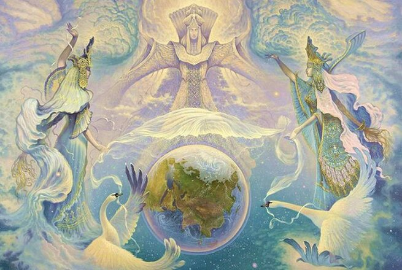

# Боги наши / Список 70 Богов Славян и Ариев

**Небесные Боги Славян и Ариев** (Светлые Боги) поддерживают во Вселенных различные формы Жизни; управляют Стихиями, желаниями, и другими событиями на Мидгард-Земле; оберегают Староверов-Инглингов и земли Расы Великой.

Картина «Покров», худ. Александр Угланов / Боги славян

Список Богов: Вышние, Покровители, Управители, Охранители.

## Вышние Боги Славян и Ариев

Вышними Богами Православные Староверы-Инглинги называют тех Богов, кои поддерживают во Вселенных различные формы Жизни и сохраняют гармоничное течение всех жизненных явлений в Светлых Мирозданиях в соответствии с Незыблемыми Законами Единого Творца-Созидателя, коего мы люди нарекаем Великий Ра-М-Ха. Каждый из Вышних Богов выполняет свои Небесные деяния, но при этом наши Вышние Светлые Боги помогают людям, идущим по Путям Духовного и Душевного Развития, по Путям Творческого Созидания и Искренней Любви, по Праведным Путям, в которых Чистая Совесть является мерилом всего.

- Ра-М-Ха
- Род-Породитель
- Бог Инглъ
- Бог Род
- Бог Вышень
- Бог Сварог
- Бог Перун
- Бог Рамхат
- Лада-Матушка
- Бог Велес
- Богородица Макошь
- Числобог
- Даждьбог
- Богиня Марена
- Богиня Джива
- Богородица Рожана
- Бог Семаргл
- Бог Купала
- Бог Свентовит
- Бог Индра
- Бог Коляда
- Бог Крышень

> Почитайте Богов Небесных, Отца и Матерь свою, ибо они Жизнь вам дали, Отец и Матерь дали Дух и Тело вам, а Боги - Душу и Совесть.  
> *Бог Рамхат*

## Боги-Покровители

Богами-Покровителями Православные Староверы-Инглинги называют тех Светлых Богов, которые покровительствуют Звёздам, Солнцам, Землям, Лунам и различным Стихиям, а также всем Родам Расы Великой и потомкам Рода Небесного во Вселенных и помогают сохранить их гармоничное развитие и существование в Светлых Мирозданиях в соответствии с Незыблемыми Законами Единого Творца-Созидателя, коего мы, люди, нарекаем Великий Ра-М-Ха. Каждый из Небесных Богов-Покровителей выполняет свои Небесные деяния, но при этом ещё и помогает людям, идущим по Путям Духовного Развития и Творческого Созидания, по Путям, в которых Чистая Совесть является мерилом всего.

- Дажьбог
- Стрибог
- Ладо-Бог
- Яра-Бог
- Ярило-Солнце
- Бог Озем и Богиня Сумерла
- Богиня Тара
- Баба Йога
- Богиня Доля
- Богиня Недоля
- Бог Хорс
- Бог Патер Дий
- Бог Хмель
- Бог Вий
- Богиня Веста
- Бог Ний
- Богиня Валькирия
- Бог Прове
- Бог Руевит
- Бог Удрзец
- Бог Один
- Богиня Леля
- Богиня Дива-Додола
- Богородица Зимун
- Бог Световит
- Бог Волх
- Мать Сыра Земля
- Богиня Дзевана
- Бог Агни
- Бог Траян
- Бог Святовит
- Богиня Желя
- Богиня Карна
- Бог Тор
- Бог Ладаад
- Бог Услад
- Бог Родомысл

> Почитайте Великую Инглию и Богов Ваших, которые суть посланцы Бога Рода Единого.  
> *Бог Сварог*

## Боги-Управители

Кроме Вышних Небесных Богов и всех Светлых Богов-Покровителей, немаловажное внимание среди Православных Староверов-Инглингов уделяется почитанию древних Богов-Управителей. Сии Светлые Боги управляют разными видами Стихий, различными желаниями, а также размеренным течением Жизни и многими другими событиями, которые постоянно происходят на Мидгард-Земле, в жизни Родов Расы Великой и в жизни потомков Рода Небесного. Богов-Управителей множество, и поэтому назовём лишь тех, с которыми рано или поздно приходится встречаться человеку.

- Бог Варуна
- Числобог
- Чернобог
- Бог Вотан
- Богиня Мерцана

> Не приносите на Алатырь жертвы кровавые, не гневите Богов ваших, ибо мерзко для Них принимать кровь невинную от созданий Божиих.  
> *Бог Сварог*

## Боги-Охранители

Кроме Вышних Небесных Богов, Светлых Богов-Покровителей и Древних Богов-Управителей, очень важное внимание Православными Староверами-Инглингами уделялось и уделяется почитанию Небесных Богов-Охранителей. Ибо все Небесные Боги-Охранители оберегают Староверов-Инглингов из всех древнейших Родов Великой Расы и потомков Рода Небесного, а также созданное Староверами для потомков добро. Боги-Охранители охраняют благодатные пашни, леса и земли Родов Расы Великой, а также все Рубежи Славяно-Арийской Державы от набегов различных ворогов.

- Бог Чур
- Бог Знич
- Бог Спех
- Белобог
- Бог Поревит

> Не забывайте Богов ваших, возжигайте во славу Богов вы курения и благовония и обрящите вы благосклонность и милость Богов ваших...  
> *Бог Перун*

### Примечание

Все вышеперечисленные Небесные Боги, будь то Вышние Боги, Боги-Покровители, Боги-Управители и Боги-Охранители, почитаемые в Древнерусской церкви, но это не означает, что мы перечислили всех Небесных Богов, входящих в Небесные Круги. Во многих Весях и во многих Родах почитают своих Родовых Богов. Древнерусская церковь признаёт всех Родовых Богов наравне с вышеперечисленными.

Слава всем Небесным Богам наша!

Боги наши - суть Отцы наши, а мы дети Их.

### См. также

- Заповеди Богов
- Великие Триглавы Миров
- Склонение: Бог, Боже, Бозе, Бох
- Небесные Обители Богов. Сварожий Круг

Вопрос: Слово «Бог» пишется с большой или маленькой буквы?  
Ответ: Наши Боги всегда пишутся с большой буквы, а чужие боги – с маленькой.

На главную
