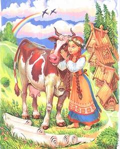

# Сказка «Крошечка-Хаврошечка»

Жила-была одна бедная женщина и была у неё доченька, **Крошечка-Хаврошечка**. Жили они дружно, счастливо, но тут настигла их беда, мама заболела тяжело, а потом и умерла. И осталась Крошечка-Хаврошечка одна одинёшенька. Взяла её к себе на воспитание тётка, отцова сестра. А у тётки этой своих дочек трое было: Одноглазка, Двуглазка и Трёхглазка. Своих дочек тётка любила, а Крошечку-Хаврошечку ненавидела. Одевали её в тряпки рваные, работать круглые сутки заставляла, кормили тем, что на столе после обеда оставалось. И совсем тяжело приходилось бы Хаврошечке, да была у неё одна отдушина: коровка, которая после смерти матушки осталась.

Вот, бывало, тётка накажет Крошечке-Хаврошечке работы непосильной: и пряжи напрясть, и ткани наткать, и полотна набелить, а Крошечка-Хаврошечка пойдет к коровке, обнимет её и скажет:  
- Коровушка, Бурёнушка! Тётка велела мне и пряжи напрясть, и ткани наткать, и полотна набелить. Помоги мне, пожалуйста.  
Бурёнушка Крошечке-Хаврошечке отвечает:  
- Влезай ко мне в правое ушко, а вылези из левого – и вся работа сделана будет.

Крошечка-Хаврошечка в одно ушко Бурёнке влезет, из другого вылезет, а вся работа уже и сделана! Приходит Крошечка-Хаврошечка домой, и тётке работу показывает. А та только дивится: и когда это Хаврошечка всю работу сделать успевает, да еще так хорошо? В сундук всё уберёт и ещё больше работы Крошечке-Хаврошечке задаст. Но сколько бы она работы ни давала, Хаврошечка всё равно вовремя всё делала. И задумала тогда тётка узнать: как это Крошечке-Хаврошечке удаётся? Кто ей помогает?

Вот позвала она к себе свою старшую дочку, Одноглазку, и говорит ей:  
- Доченька моя! Пойди, проследи, кто сироте помогает ткать и прясть.  
На следующее утро Крошечка-Хаврошечка в поле собралась, а Одноглазка за ней увязалась. Пришли они в поле, сели под кустик. Одноглазка на травку прилегла, а Крошечка-Хаврошечка приговаривает:  
- Спи глазок, усни глазок!  
У Одноглазки глазик закрылся, уснул, и пока та спала, коровушка для Хаврошечки всю работу переделала. Вернулись они домой, тётка у дочки своей спрашивает:  
- Ну, рассказывай, что видела. Кто Хаврошечке помогает?  
Одноглазка ей отвечает:  
- Матушка милая, прости, разморило на солнышке меня. Прилегла я, задремала и ничего не видела.

Мать рассердилась и на следующий день послала за Крошечкой-Хаврошечкой среднюю дочку – Двуглазку — следить. Пришли они на поле, и под кустиком сели. Двуглазка голову на травку положила, а Хаврошечке только того и надо. Она сидит и приговаривает:  
- Спи, глазок, спи, другой!  
И Двуглазка тоже заснула. Пока она спала, коровушка для Крошечки-Хаврошечки всю работу сделала. Вернулись они домой, мать у Двуглазки спрашивает:  
- Ну, доченька, что ты видела? Кто сироте помогает?  
А когда узнала, что и Двуглазка уснула, очень рассердилась и на следующий день послала с Хаврошекой младшую дочку, Трёхглазку. Девушки в поле пришли, под кустиком расположились. Трёхглазка на травку прилегла, потягивается. А Крошечка-Хаврошечка ей приговаривает:  
- Спи, глазок, спи, другой! - А про третий глазик она и забыла. Два глазка у Трёхглазки уснули, а вот третий-то и видел, как всю работу Бурёнка делала. Пришла домой Трёхглазка и всё матери рассказала. Тётка рассердилась и решила корову извести.

Приходит она к мужу и говорит ему:  
- Зарежь корову!  
- Да ты что, жена, выдумала? Корова молодая ещё, хорошая, жалко резать.  
- Не хочу слушать ничего, иди и режь.  
Делать нечего, пошёл мужик нож точить, а Крошечка-Хаврошечка к своей коровушке кинулась, обнимает её, а слёзы у неё из глаз так и катятся:  
- Бурёнушка! Милая моя! Хотят зарезать тебя. Как же я буду теперь, с кем я, сиротинушка, останусь?  
Бурёнка ей отвечает:  
- Не плачь, Хаврошечка! Запоминай лучше, что я тебе скажу: когда меня зарежут, ты мяса моего не ешь, а потом косточки мои собери, и в саду их зарой. Да помни, обязательно каждый день их водой ключевой нужно поливать.

Вот зарезал мужик корову. Тётка радуется, что некому теперь Крошечке-Хаврошечке помогать. А Крошечка-Хаврочешка так как коровушка ей велела, так и сделала: мяса коровушкиного не ела, а косточки зарыла в саду и каждый день водой ключевой поливала. И через некоторое время выросла на том месте в саду яблоня. Высокая, развесистая, густая, яблочки на ней все как на подбор наливные висят. И каждый, кто идёт мимо, останавливается и на яблоньку любуется.

Как-то раз в саду гуляли девушки, а мимо ехал барин богатый, красавец молодой. Увидел он яблочки чудесные и говорит девушкам:  
- Девицы – красавицы! Какие яблочки у вас наливные да аппетитные! Кто из вас меня яблочком угостит, на той я женюсь.  
Сёстры кинулись к яблоне, а ветки у яблоньки как специально высоко-высоко поднялись. Сёстры прыгают–прыгают, а достать яблочка не могут. А когда Крошечка-Хаврошечка к яблоньке подошла, веточки к ней как будто сами нагнулись, а яблочки в ручки ей сами падают. Сняла Крошечка-Хаврошечка самые красивые, самые вкусные яблочки и подала их барину, а он взял её за белу рученьку, рядом с собой посадил и увёз с собой от злой тётки. Женился он на Крошечке-Хаврошечке и стали они в любви и согласии жить-поживать, да добра наживать.

\* Смысл сказки «Крошечка-Хаврошечка»
