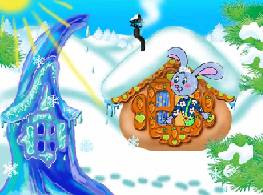

# Сказка «Лиса и Заяц» (про избушку ледяную и лубяную)

*Русская народная сказка «**Лиса и Заяц**» в пересказе Владимира Даля.*

Жил-был на поле серенький Зайчик, да жила Лисичка-сестричка.  
Вот как пошли заморозки, стал Зайка линять, а как пришла зима студёная, со вьюгой да со снежными сугробами, Зайка с холода и вовсе побелел, и надумал он себе избу строить: натаскал лубочков и давай городить хижину. Увидала эта Лиска и говорит:  
— Ты, косенький, что это делаешь?  
— Видишь, от холода избу строю.  
«Bишь, какой догадливый, — подумала Лиса, — давай-ка и я построю избу — только уж не лубочный домик, а палаты, хрустальный дворец!». Вот и принялась она лёд таскать да избу класть. Обе избы поспели разом, и зажили наши звери своими домами.

Глядит Лиска в ледяное окошечко да над Зайчиком посмеивается: «Вишь, чернолапотник, какую лачугу смастерил! То ли дело моя: и чиста, и светла — ни дать ни взять хрустальный дворец!»

Лисе зимою всё было хорошо, а как пришла весна по зиму да стала снег сгонять, землю пригревать, тут Лискин дворец и растаял да водою под гору сбежал. Как Лиске без дому быть? Вот подкараулила она, когда Зайка вышел из своей избы погулять, подснежной травки, заячьей капустки пощипать, прокралась в Зайкину избу и влезла на полати.

Пришёл Зайчик, торкнулся в дверь — заперта. Подождал маленько и стал опять стучаться.  
— Кто там? — закричала Лиса толстым голосом.  
— Это я, хозяин, серый Зайчик, пусти меня, Лисонька.  
— Убирайся, не пущу, — отвечала Лиса.  
Пообождал Зайка да и говорит:  
— Полно, Лисонька, шутить, пусти, мне уж спать хочется.  
А Лиса в ответ:  
— Постой, косой, вот как я выскочу, да выпрыгну, пойду тебя трясти, только клочья по ветру полетят!

Заплакал Зайчик и пошёл куда глаза глядят. Повстречался ему серый Волк.  
— Здорово, Зайка, о чём ты плачешь, о чём горюешь?  
— А как же мне не тужить, не горевать: была у меня изба лубяная, у Лисы ледяная. Лисья изба растаяла, водой ушла, она мою захватила, да и не пускает меня, хозяина!  
— А вот постой, — сказал Волк, — мы её выгоним!  
— Навряд ли, Волченька, выгоним, она крепко засела!  
— Я не я, коли не выгоню Лису! — зарычал Волк.  
Вот Зайчик обрадовался и пошёл с Волком гнать Лису. Пришли.  
— Эй, Лиса Патрикеевна, выбирайся из чужой избы! — закричал Волк.  
А лиса ему из избы в ответ:  
— Постой, вот как слезу с печи, да выскочу, да выпрыгну, да пойду тебя трепать, так только клочья по ветру полетят!  
— Ой-ой, какая сердитая! — заворчал Волк, поджал хвост и убежал в лес, а Зайка остался плакать в поле.

Идёт Бык.  
— Здорово, Зайка, о чём тужишь, о чём плачешь?  
— А как же мне не тужить, как не горевать: была у меня изба лубяная, у Лисы ледяная. Лисья изба растаяла, она мою захватила, да вот и не пускает меня, хозяина, домой!  
— А вот постой, — сказал Бык, — мы её выгоним.  
— Нет, Быченька, навряд выгнать её, крепко засела, уже её Волк гнал — не выгнал, и тебе, Быку, не выгнать!  
— Я не я, коли не выгоню, — замычал Бык.  
Зайчик обрадовался и пошёл с Быком выживать Лису. Пришли.  
— Эй, Лиса Патрикеевна, ступай вон из чужой избы! — промычал Бык.  
А Лиса ему в ответ:  
— Постой, вот как слезу я с печи, да пойду тебя, Быка, трепать, так только клочья по ветру полетят!  
— Ой-ой, какая сердитая! — замычал Бык, закинул голову и давай улепётывать.

Зайчик сел подле кочки и заплакал.  
Вот идёт Мишка-Медведь и говорит:  
— Здорово, косой, о чём тужишь, о чём плачешь?  
— А как же мне не тужить, как не горевать: была у меня изба лубяная, а у Лисы ледяная. Лисья изба растаяла, она мою захватила, да и не пускает меня, хозяина, домой!  
— А вот постой, — сказал Медведь, — мы её выгоним!  
— Нет, Михайло Потапыч, навряд выгнать её, крепко засела. Волк гнал — не выгнал. Бык гнал — не выгнал, и тебе не выгнать!  
— Я не я, — заревел Медведь, — коли не выживу Лису!  
Вот Зайчик обрадовался и пошёл, подпрыгивая, с Медведем домой гнать Лису. Пришли.  
— Эй, Лиса Патрикеевна, — заревел Медведь, — убирайся вон из чужой избы!  
А Лиса ему в ответ:  
— Постой, Михайло Потапыч, вот как слезу с печи, да выскочу, да прыгну, да пойду тебя, косолапого, трепать, так только клочья по ветру полетят!  
— У-у-у, какая лютая! — заревел Медведь, да и пустился впритруску бежать.

Как быть Зайцу? Стал он Лису упрашивать, а Лиса и ухом не ведёт. Вот заплакал Зайчик и пошёл куда глаза глядят и повстречал кочета, красного Петуха, с саблей на плече.  
— Здорово, Зайка, каково поживаешь, о чём тужишь, о чём плачешь?  
— А как же мне не тужить, как не горевать, коли с родного пепелища сгоняют? Была у меня избенка лубяная, а у Лисицы ледяная. Лисья изба растаяла, она мою заняла, да и не пускает меня, хозяина домой!  
— А вот постой, — сказал Петух, — мы её выгоним!  
— Вряд ли, Петенька, тебе выгнать, она больно крепко засела! Её Волк гнал — не выгнал, её Бык гнал — не выгнал, Медведь гнал — не выгнал, где уж тебе совладать!  
— Попытаемся, — сказал Петушок и пошёл с Зайцем выгонять лису. Как пришли они к избушке. Петух запел:

> Идёт кочет на пятах,  
> Несёт саблю на плечах,  
> Хочет Лиску зарубить,  
> Себе шапку сшить, —  
> Выходи, Лиса, пожалей себя!

Как заслышала Лиса Петухову угрозу, испугалась, да и говорит:  
— Подожди, Петушок, золотой гребешок, шёлковая бородка!  
А Петух кричит:  
— Кукареку, всю изрублю!  
Вот Лиса просит тоненьким, масленым голоском:  
— Петенька, Петушок, пожалей старые косточки, дай мне шубенку накинуть!  
А Петух, стоя у дверей, знай себе кричит:

> Идёт кочет на пятах,  
> Несёт саблю на плечах,  
> Хочет Лиску зарубить,  
> Себе шапку сшить, —  
> Выходи, Лиса, пожалей себя!

Нечего делать, некуда деваться Лисе: приотворила дверь, да и выскочила. А Петух поселился с Зайчиком в его избушке, и стали они жить, да быть, да добро копить.
