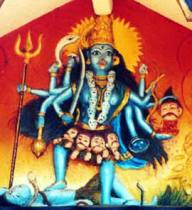
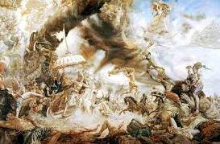

# Сказ «Тайна Байкала. Камень-кристалл Вечного Знания»

Когда я был маленьким, и мы ездили к дедушке, дед частенько по вечерам рассказывал мне удивительно красивые сказки. Рассказывал он о чудесной стране Беловодье, с цветущими лугами да высокими горами, где в высоких сказочных теремах, под защитой Светлых небесных Сил, безбедно и весело жили славные люди - дети великого Рода. Рассказывал о северной стране Даарии, чьи жители были настолько мудры и могущественны, что на всей Земле их считали Богами. А когда мне исполнилось 22 года, я узнал, что мой дед был Волхвом, настоящим Волхвом, о которых слагалось так много русских народных сказок. А сказки, что рассказывал мне вечерами дед - и не сказки вовсе, а забытая нынче история наших далёких Предков. Выполняя наказ деда, я поведаю вам историю одной из тайн Беловодья – ТАЙНУ БАЙКАЛА. Тысячи лет хранили её Волхвы и Хранители памяти Рода - сейчас, в 2010 году, пришло время открыть её людям. Слушайте:

## Тайна Байкала

Давным-давно, когда после Большого Оледенения в Асию вернулось тепло, Рода святой Расы расселились по всей земле Беловодья, от Уральских гор на западе до священного русла Русь-реки на востоке. Озеро Байкал называли морем х’Арийским, тогда оно разлилось пуще прежнего, и рыбы там всякой водилось видимо-невидимо, а уж климат какой нежный стал, какой плодородной стала земля-матушка - живи не тужи. Так и жили там Расичи, без нужды и печали, по Мудрым Заветам своих Первопредков. Но лишь два Круга Лет продолжались их счастье и безмятежность.

С востока далёкой Дравидии (совр. Индии) всё чаще приходили тревожные вести. Объявилась в тех краях старая знакомая - **страшная злая колдунья КалиМа** со своими серыми коварными приспешниками. С далёкой Земли Кащея привела она кровожадное воинство своё и силой колдовской захватила восток Дравидии, а народы её превратила в рабов. Кровь невинных дравидов и нагов рекою текла в тех местах, где прошлась КалиМа со своею звериною серою свитой. Сила же колдовская КалиМы заключена была в камне-кристалле Вечного Знания. И нельзя одолеть силу этого камня-кристалла никому из безсмертных и смертных - ведь везде и всегда самое грозное и неодолимое оружие - это ЗНАНИЕ. Никогда не расставалась КалиМа с камнем-кристаллом Вечного Знания, ни днем, ни ночью, потому что знала: как только выпустит она его из рук - в тот же день свою власть над людьми потеряет. И вот разорило воинство КалиМы все восточные земли Дравидии, не счесть загубленных людей, тесно стало КалиМе на востоке - двинулась чёрная стая на запад.

Много страшных бед натворила бы ещё КалиМа на Земле, но любое зло не безконечно и когда-то должно быть наказано. **Обратились народы Земли к Великой Расее**, со слезами просили спасти их от злобной колдуньи. И вот кликнули Расичи Великий Сбор - все Рода на тот зов откликнулись. Собралось войско несметное, сильное да безстрашное, потому что в нём были Расичи - испокон веков НЕУСТРАШИМЫЕ, испокон веков НЕПОБЕДИМЫЕ. Дали клятву они Земле-Матушке, матерям своим, жёнам, да детушкам, и Богам своим - Славным Сварожичам. Поклялись, что очистят Землю от Чёрной Смертельной Заразы. Всё, походом пошли на Дравидию, и молились народы по всей Земле за победу Расичей над КалиМой и её кровожадным воинством.

Скоро сказы сказываются, да не так скоро дело делается. Вот вступили безстрашные Расичи в пределы Дравидии, **началася Сеча Великая**. Долго битва шла не на жизнь - на смерть, много полегло Славных витязей, но ещё больше сгинуло ворогов. Не устояло злобное воинство КалиМы - дрогнуло, в бегство обратилося. Испугалась КалиМа, достала камень-кристалл Вечного Знания - источник силы своей, дабы выведать, как погубить войско Расичей да сохранить власть свою. Но камень-кристалл показал ей другое - гибель скорую показал он ей. Увидела КалиМа, что Силы Света помогают Расичам - да, да, никогда Сварожичи не оставляли свой народ в беде. Так вот бывает - даже камни имеют Душу и терпение их не Вечно - не стерпел Камень-кристалл того Зла, что творила с людьми КалиМа, отказался он быть ей пособником. Взвыла КалиМа в безсильной ярости, колдовать принялась, да всё без толку. Из могучей Колдуньи и повелительницы силами тьмы превратилась в простую старуху пугливую. И удрала прочь с Земли, забыв про остатки своего воинства, забыв даже про Камень-кристалл - так велик был её Страх Возмездия.

Ну а что до **камня-кристалла Вечного Знания** - то нашли его Расичи во дворце КалиМы. Подумали было передать его Мудрецам Гор, да решено было не спешить. Собрались Верховные Жрецы на Совет, обратились к Знанию камня - и смотрели сквозь время на всё, что ждёт Землю-Матушку до самого РАССВЕТА СВАРОЖЬЕГО. Нет, нельзя было вверять этот камень-кристалл людям, ни Мудрецам Гор, ни своим Хранителям. И тогда, когда с полной победой возвращались Славные Расичи в Родное Беловодье - в полной тайне, свершив в пути все приготовления, осторожно поместив камень в заполненный особым воском золотой ларец, а ларец в заполненный тем же воском пустотелый неприглядный серый камень - **схоронили тот камень на дне моря х’Арийского**, в самой южной стороне его, до поры до времени, пока не спадёт с Земли Ночная Тьма, пока не придёт Рассвет.

Поведал я Вам историю эту потому, что пришёл тот назначенный час, на небесных часах Сварога - Рассвет. Ну а верите Вы или нет - это мне без разницы. Главное - что Россию ждут Великие Открытия и Свершения, а мы с Вами будем живыми свидетелями давно не виданых чудес.

Со слов Ярослава записано 19 марта 2010 года.  
*\* Источник: http://s5y.narod.ru/taina\_ozer.htm*
