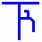

# Кара, Карат, Каракум, Каруна – терминология (руна КА)

**КА** – это руна союза, объединения. Но она не сама по себе «объединение», а всё что с ней связано. Пример: сборник Рун называется **КАРУНА**, т.е. объединяющий все Руны или «союз всех образов и понятий».

Мы до сих пор эту форму используем: когда руна КА стоит в начале какого-то образа, определения, текста, она означает «**собирающая в себя**», а если руна КА стоит в конце, она означает «**одно из множества**». Например, мама выглядывает в окошко: «Артём-ка, домой!», там ведь детей полно, т.е. один из тех, кого назвали Артёмом.

## Кара, Карат, Каракум, Рака

**КАРА** – собирающая в себя свет, т.е. то, что не излучает свет, но свет в себя вобрало. Например, чёрная дыра свет поглощает, но не излучает. Сейчас полностью изменили значение, «кара» понимается как наказание (кара божья).

**КАРАТ** – определяют, сколько потоков света (РА) хранит в себе камень или частица, т.е. твёрдое (Т) - видите, какое словопостроение, потому что раньше мыслили образно.

**КАРАКУМ** – очень старое славянское название одной из пустынь. Сегодня пытаются привязать это название к тюркскому, турецкому… а название чисто славянское.  
КАРА – вбирающая в себя свет.  
КУМ – родственная частица (отсюда слово «кумовья»).  
Т.е. посмотрите на песок, он как будто в себя свет вобрал, и это родственные частицы, отсюда и название КараКум.

**РАКА** – это одно из множества мест, где свет уже отсутствует. Т.е. переставили Руны КА и РА местами, КА уже в значении «одно из множества» и как бы противовес, совершенно другая, противоположная система. Если КА-РА вбирает в себя свет, то РА-КА значит уже нет света. Например, христиане кладут усопших в раку.
