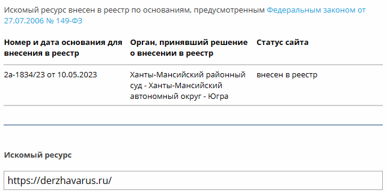
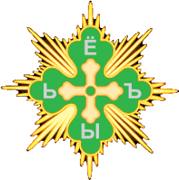
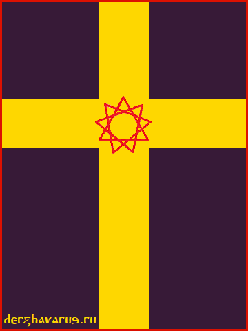

# О блокировке сайта Держава Русь

16.08.2023 провайдеру хостинга, на котором размещался сайт Держава Русь, поступила жалоба от РКН с требованием удалить запрещённую информацию и (или) ограничить доступ к сайту https://derzhavarus.ru.

В жалобе РКН было указано, что 10.05.2023 Ханты-Манскийский районный суд - Ханты-Манскийский автономный округ – Югра вынес решение о включении сайта https://derzhavarus.ru/ в «Единый реестр сайтов, содержащие информацию, распространение которой в РФ запрещено».

Единый реестр запрещённых сайтов / Скрин от 16.08.2023

Обжаловать решение суда можно в течение трёх месяцев со дня принятия решения. Решение было принято 10.05, а жалоба поступила 16.08, т.е. владелец сайта узнал о решении суда как раз через 3 месяца - обжаловать поздно.

«Запрещённая» информация (изображение и текст о возрождении Державы) была удалена с сайта, однако РКН всё равно настоял на блокировке и направил хостинг-провайдеру повторно жалобу. Сайт заблокировали. Оставлять сайт на серверах в РФ было нельзя, потому что здесь блокируют сайты, находящиеся в Едином реестре. Пришлось переехать на зарубежный сервер.

## Причина блокировки сайта Держава Русь

В Уведомлении РКН следующее описание запрещённой информации:

> Размещена информация, посвященная деятельности Межрегионального общественного объединения «Духовно-Родовая Держава Русь», на которой также демонстрируется символика данного общественного объединения: флаг с крестом, который означает пересечение Земного и Небесного с символом Звезды Инглии, признанная запрещенной на территории РФ.

*Прим.* на главной странице сайта Держава Русь было изображение креста со Звездой Инглии (см. ниже) и подпись: Крест означает пересечение Земного и Небесного / Звезда Инглии - символ Старой Веры. А также текст о причинах упадка Державы и информация о том, что необходимо делать для возрождения Державы (укрепление и объединение Родов). Не было никаких указов, субъектов, экстремизма и прочего, что приписывает сайту РКН. Только исторические факты.

Итак, было получено вот такое необоснованное обвинение и даны сутки на удаление запрещённых материалов.

Посмотрим, что пишут о Межрегиональном общественном объединении «Духовно-Родовая Держава Русь» и почему данное объединение запрещено в РФ. «ДРДР» основана в 2001 году, позиционирует себя как субъект РФ, члены «Духовно-Родовой Державы» направляли в государственные органы письма, оформленные как «указы» и «постановления». Тематика писем была нацелена на разжигание межнациональной и межрелигиозной розни [*прим.* - суд так решил].  
\* Источник: https://lenta.ru/

**Тогда за что РКН блокирует сайт Держава Русь?**  
Информация на сайте https://derzhavarus.ru/ не посвящена деятельности МОО «Духовно-Родовая Держава Русь»; на сайте нет подобных «указов» и «постановлений»; сайт не призывает создавать суверенный субъект РФ с последующим выходом из состава РФ; символика на сайте и символ «ДРДР» заметно отличаются.

## Крест и Держава под запретом в РФ?

Сайт Держава Русь был включён в «Единый реестр» после того, как на главной странице сайта появилось изображение **златый крест со Звездой Инглии** (изображение на сайте появилось 22 марта 2023, а 10 мая 2023 суд ХМАО - Югры вынес решение о включении сайта https://derzhavarus.ru/ в «Единый реестр запрещённых сайтов»).

Сравним символ МОО «ДРДР» и крест со Звездой Инглии на сайте Держава Русь:

Символ МОО «Духовно-Родовая Держава Русь» / Изображение: http://www.ansobor.ru

Крест со Звездой Инглии / Сайт Держава Русь

Что общего между этими изображениями нашёл Роскомнадзор?  
Только златый крест, причём разной формы. Как это понимать – в России запрещено любое изображение креста, они все посвящены «ДРДР»? Тогда флаг Швеции надо запретить в РФ, и вообще скандинавский крест. Кстати, изображение всё-таки удалено с главной страницы, возможно тогда РКН отменит блокировку сайта [*не отменили*].

Также на главной странице была размещена информация о том, что такое Держава, причины упадка Державы, и что для возрождения Державы необходимо **укрепление и объединение Родов**. Что здесь запрещённого? Или РКН выступает против укрепления семьи и сплочённости Народа?

В общем, причина блокировки: Крест со Звездой Инглии и возрождение Державы. РКН истолковал это, как информацию, посвящённую деятельности МОО «ДРДР».

Лето 7531 (20.08.2023)

**Примечания**  
\* 20.08.2023 видимо РКН отменил блокировку сайта, сегодня в Едином реестре (https://eais.rkn.gov.ru) искомый ресурс https://derzhavarus.ru не найден.

\* 21.08.2023 сайт Держава Русь снова внесли в Единый реестр. Причина указана та же, несмотря на то, что информация о возрождении Державы и крест со Звездой Инглии удалена.

\* 23.08.2023 доменное имя derzhavarus.ru в «Едином реестре», но исключили из Реестра главную страницу сайта https://derzhavarus.ru после удаления информации об Инглиизме, наших Богах и Солярной символике. Значит наша Древняя Вера и есть **главная причина блокировки – Инглиизм**! Чего и следовало ожидать. А объединение «ДРДР» - всего лишь предлог.

\* 25.08.2023 направлено обращение в РКН на почту zapret-info@rkn.gov.ru о том, что сайт необоснованно включили в Единый реестр. По пунктам указано, что ни сайт, ни владелец сайта – не имеют отношения к объединению «ДРДР». Ответа пока нет.

11.09.2023 сайт несколько часов был недоступен – это DDoS-атака на сервер.

### Статьи по теме

- РКН заблокировал «Христианское рабство»
- РКН заблокировал страницу «Белодух - Клич»
