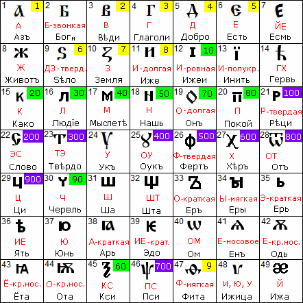

# Буквица славянская - Образы 49 буквиц

**Буквица – это письмо Святорусов**, самая распространённая форма письменности среди славянских народов древности. Состоит из 49 буквиц, у каждой своё название и Образ. Буквица развивает образное мышление и грамотную речь, учит понимать суть вещей.

Буквица славянская - 49 буквиц: начертание, название, звук, порядковый номер, числовое значение.

Каждое русское слово - это как аббревиатура из Образов. Зная образность буквиц можно понять значение слов, т.е. раскрыть Образ, который в них вложен. При этом главное не прочитать образ отдельного слова, а научиться соединять образы: почему это говориться так, а это иначе, и какой смысл в это глаголение вложен.

Глубинные образы Буквицы раскрываются по мере развития человека, то есть меняется наше восприятие, и соответственно начинаем видеть образы по-новому, на что раньше не обращали внимания. Век живи - век учись.

## Буквица славянская - глубинные Образы

1. **Азъ** [а]. **Бог, живущий на Земле и сотворяша** (сотворяющий). Но есть и другие глубинные образы: **изначалье, исток, единый, единственный, человек**. Образ мог меняться, если другой образ, повествующий, имел другое структурное значение. Чтобы эти два образа взаимодействовали, их надо было согласовать между собой. Поэтому и были образы гласящие, а между ними образы согласующие. Сейчас мы имеем просто гласные и согласные буквы. Но когда говорят гласные, у современного человека не возникает вопроса – а что они гласят? Если буквы согласные, то согласные с чем? В Буквице, как и в Рунах, каждый последующий образ влияет на предыдущий, поэтому руническое слово читалось в одну сторону, а образ его структурного значения, читался в обратном порядке. Так и здесь, образы вроде разные, но суть одна. Изначалье, исток – это также означает движение, направление именно к данному образу.  
Числовое значение - 1.

2. **БОГи** [б-звонкая]. **Бог**, буквица «и» пишется мелким шрифтом, т.е. не просто множество Богов, а Бог и ещё кто-то: Бог и человек, Бог и другой Бог и т.д. много форм. У данной буквицы нет числового значения, так как Богов много. Образ - **множество**, превосходящая форма, которая **преобладает** над чем-то, т.е. преобладающее, большее. Пример: есть созвездие Б. Медведицы, - раз есть большее, значит существует и что-то меньшее.

3. **Веди** [в]. **Множество определённое** (преобладание), допустим: много знаний. Тажке образ: **собранное воедино, направленность**; **связующее звено между двумя системами** (между прошлым и будущим, между светлым и тёмным, между излучением и поглощением и т.д.), то есть, это есть **взаимосвязь**. «Веды» - это не только **мудрость, знание**, это весь спектр ВСЕГО - цветов, запахов, вкусов, ощущений.  
Числовое значение 2 - соотносится с количеством связанных систем.

4. **Глаголи** [г]. **Движение, истечение, направление**. Когда человек глаголит, он направляет свою мысль на кого-то или на что-то, то есть передача информации осуществляется по следующей схеме: излучатель (уста) - поток звуковой информации (речь, глаголение) - приемник (уши). Если человек просто говорит и его никто не слушает, то он балакает, но не глаголет. Одновременно глагол подразумевал **тройственность** - передача звуковой формы, образной формы и сокрытой (тайной) формы, то есть мысли. Поэтому числовое значение 3.

5. **Добро** [д]. **Приобретение; накопление; множение; созданность; находящийся над чем-то; сверх того, что есть; превосходящее что-либо**, т.е. превосходная форма. Пример: Одновременно «Добро» означает полноту и гармонию созданного; развивающуюся форму. «Добро» означало еще и «возвышение, поднятие, преуспевание». Сравните – «Д» есть целостность (три стороны и ещё одна над чем-то) и полное развитие (гармонию) человека: тело, Душа, Дух, Совесть, то есть и тут, и там четырехэлементная структура.  
Числовое значение - 4.

6. **Есть** [е]. Образ: **быть; форма существования Бытия; нахождение в данной реальности; нахождение в проявленном состоянии**; то, что имеет объем и восприятие, зримое и чувственное. Одновременно это означает то, что находится в развитии. Т.е. эта форма существования касается только планов восприятия, что существует перед нашим взором, и это касается только Земного мира.

7. **Есмь** [йе]. **Разнообразие, многоплановость, многомерность, многоструктурность, обсуждение и разсуждение**, применительно к определенной точке обсуждения, а точкой может быть всё: человек, Бог, Вселенная. Т.е. если у нас есть эта форма бытия (Есмь), то у нас есть как бы разнообразие. Пример: слово ЕЛИ с буквицей Есть - это означает: кушали, вкушали, трапезничали, яствовали, т.е. приём разнообразных форм энергий (материй). А раз Есмь - многообразие, многоплановость, то и числовое значение – множество.

8. **Живот** [ж]. Данный образ означает не только **жизнь**, но и **существование различных форм; взаимосвязь множеств; преобразование** (предварительное образование, изначальное создание) и **преобразовании** (изменение чего-либо); **зарождение и рост; достижение определенного предела**, за которым появляется новый Путь к новому пределу (эволюция, мутация). Жизнь - многогранна, разнообразна, а **разнообразие** не может иметь числовую форму.

9. **Дзело** [дз-твёрдое]. Означает не только **весьма, сверх, много**, но и **то, что находится сверх нашего понимания; за гранью нашего сознания и воображения; то, что нам еще не ведомо и то, что мы еще не познали**. Иначе говоря, всё находящееся вне рамок восприятия. Оно, как бы, взаимосвязано, проистекает (существует), но для понимания оного необходимо подниматься над самим собой сегодняшним, то есть развиваться.  
Числовое значение – 6.

10. **Земля** [з]. Вселенская структура, многомерная форма: **то, что входит в определённую систему как составная часть**; то, **с чем жизнь контактирует**, соприкасается; планета.  
Числовое значение – 7.

11. **Иже** [и-долгая]. **Соединение, союз, единство, гармония, равновесие**. Все пути сошлись в одной точке, и они гармоничные. Образ ИЖЕ: **уравновешивающая (гармонизирующая) жизнь бытия**.  
Числовое значение - 8.

12. **Ижеи** [и-ровная]. **Истинную жизнь бытия гармонизирует со Вселенной**. Начертание «i» показывает образ: вертикальная линия - связь небесного и земного; точка - вышнее; то есть **связь с Вышним**, с вышней (изначальной) точкой. Данная буквица используется **для определения вселенских масштабов**. Допустим, слово *Мiръ* означает - Вселенная. Или в староканонических книгах написано *Исусъ*, потом переписали - *Iсусъ*, то есть ему приписали божественное происхождение, хотя по тем же книгам он говорил, что он сын человеческий.  
Числовое значение – 10.

13. **Инить** [и-полукраткая]. С двумя точками или с чертой на верху, которая указывает на ограниченность пространства - **гармония наша истинна, утверждённая и сотворённая**, т.е. уже приведённая в определённый порядок. К примеру, слово *Мiръ* с буквицей Инить - это Община.

14. **Гервь** [гх]. **Неизведанное, но проявленное в Яви**. Данная буквица всегда прописывалась в так называемых удивительных формах (ныне - восклицательных) и использовалась для выражения, обозначения чего-то **удивительного**, чудесного, но, одновременно, и **непонятного**; то, что не определялось каким-то характерным признаком, но данный образ невозможно было описать.

15. **Како** [к]. **Объединение трёхмерное** (к) в человеке (а) и объединяет его ещё с одной структурой сферной «О», т.е. что-то ещё. Как бы человек - вселенная, и рядом есть ещё одна вселенная (как говорят: микрокосмос и макрокосмос). То есть определяющей как «оно, он», соединяются два мира, как бы слияние двух или более систем воедино, создаётся **объём**.  
Числовое значение – 20.

16. **Людие** [л]. Графический образ этой буквы слагается из трёх составляющих - сферы человека, которая ограничивает часть пространства; взаимосвязи между небесным и земным (человеческим) и мира, в котором обитают живые существа. В совокупности это буквица Л (людиe). Если «како» - это объёмность, то здесь происходит **соприкосновение объёмов**, так как каждый человек, ограничивает определённую часть (объём) пространства. То есть, какие-то самостоятельные части объединяются в какое-то нечто, завершённое подобие единого.  
Числовое значение - 30.

17. **Мыслете** [м]. Человек (людина) живёт во внешнем мире, но одновременно, и в своём внутреннем мире (мыслит), т.е. наблюдается выход на новый уровень. В графике буквицы как бы соединились две «направленности»: *Л+Л=М*. И как результат этой взаимосвязи, образ буквы МЫСЛЕТЕ: **мысль, мыслить, думать, обращаться** (за поддержкой).  
Числовое значение – 40.

18. **Нашь** [н]. **Материализованная мысль** - воплощённый образ, существующий сам по себе. То есть, мы как бы добавили ещё одно воплощение (сферу) к предыдущему. **Наше – то, что существует при нас**; с нами; внутри нас; не за пределами нашего восприятия. Исходя из данного образа, слово «НЕ» есть не до конца сформированная структура, находящаяся внутри нашего собственного мира, не выходящая за его рубеж. Мысль есть, но мы не можем её пощупать. Она за гранью бытия, но внутри нас. Поэтому если ребёнку говоришь НЕ, он это не слышит, то, что внутри вас он не воспринимает. «Не ходи» - он воспринимает - ходи. То есть, это форма не восприятия, которая **существует сама по себе**.  
Числовое значение - 50.

19. **Онъ** [о-долгая]. Читается ОНО, потому что буквица Еръ тоже звучит - [о]. **Некто, нечто**, что-то, находящееся в особом состоянии, отделённое от земного, но для нас уже проявленное. ОНО - форма **не нашего внутреннего мира, но имеющая некую связь с нами**.  
Числовое значение – 70.

20. **Покои** [п]. Вмешательство одного мира в другой мир всегда вызывает конфликтную ситуацию. И как две чаши весов, эти миры стараются прийти к равновесию. Но если эти чаши подпереть, первоначальная система равновесия нам больше не понадобится. У нас получится ПОКОЙ. Эти подпорки (П) для двух взаимосвязанных миров (око) приведены в **состояние устойчивого равновесия** (и), то есть, **когда прекращается всякое движение, давление**.  
Числовое значение – 80.

21. **Реци** [р-твёрдая]. **Говорить, изрекать, речь**. Но здесь, в отличие от глаголения, присутствует **жёсткая** (силовая), **чёткая форма подачи словесной информации**. Реци означает - разделять, разграничивать общепринятые антагонистические понятия (правда - неправда; зерна - плевелы, кривда - ложь), разводить их по разные стороны. Реци - есть **разделяющая, четко определяющая форма**, которая разграничивает понятия по однородности, структуре, форме.  
Числовое значение – 100.

22. **Слово** [эс]. Когда говорят, то в процессе этого создаётся звуковая (вибрационная) структура, которая содержит в себе поднесущую форму (информацию) и несущую (носитель). Данная структура передачи звуковой информации, как мы знаем, именуется СЛОВО, где «С» - **соединительная форма**; «Л» - **направляющая из одной сферы в другую**, объединённых мудростью - ОВО. У нас уже не система, а двойственная структура о двух сферах, т.е. это вибрация, проникающая в различные сферы мировосприятия. Поэтому *слово* мы называем - **материализованная мысль** (мысль, воплотившася в вибрацию), которой дали сосуществование. Поэтому «из песни слов не выкинешь» - уберешь вибрацию, и это не будет песней.  
Числовое значение – 200.

23. **Твердо** [тэ]. Троичность нашего мира Яви и ещё две сферы (миры Прави и Нави). Само понятие «твердо» означает - **утверждение; определение; определённую структуру, ограниченную определённым пространством** Яви и Нави. Графика буквы Т: I - основа (взаимосвязь земного и небесного), перекрытая поднебесной (–), и отграничена гранями (||), определёнными рамками, определёнными сферами, в которых всё это имеет какое-то определённое наставление. Поэтому, если мы рассматриваем какое-либо явление, событие, отображённое в слове, где стоит «твердо», оно и определяет меру утверждения.  
Числовое значение – 300.

24. **Укъ** [у]. Форма, определяющая **взаимодействие** с кем или с чем-либо (упрощающая форма), т.к. всякое взаимодействие (попытка понять и принять другую точку зрения) неизбежно приводит к упрощению. Представьте: существует какая-то структура, а «укъ» указывает образное взаимодействие, где находится то или иное, вовлечённое в данное структурирование.  
Числовое значение – 400.

25. **Оукъ** [оу]. Если образ «Укъ» - «нахождение рядом с чем-либо», то «Оукъ» - **определённая форма со своими устоями**, структурой, содержанием (о), находящаяся рядом с чем-либо (укъ).  
К примеру, ныне множество упрощённых трактовок о том, что слово Русь произошло от того, что в данной местности проживали светловолосые (русые) люди. Но это слово писали через «Укъ» - русые (русы головы), а державную форму через «Оукъ».

26. **Ферт** [ф-твёрдая]. Указывает на раскрытие глубинного значения смысла слова, давая возможность «дойти до самой сути». Образ - **значимость сути** - то, что имеет определённое значение, стоять фертом (руки в бока). Когда определение буквы соединялось с определением структуры, то происходило определение взаимодействия:  
**Фу** - структурная форма, **определяющая конкретику**. «Фу, руским духом пахнет».  
**Фи** - ничего не представляющая из себя структура, бытийность. «Фи, какая фифочка».  
**Фига** - пустой путь. Ещё говорили ШИШ тебе, крест из пальцев, дорога в никуда.  
Числовое значение – 500.

27. **Хиеръ** [х]. **Пересечение определяющих значений** (х), взаимосвязывающее небесные и земные структуры (ять) для речения (р) во временной протяжённости (ъ).  
**Хорошо** - собирание небесной и земной силы в гармонической форме.  
**Хлеб** (через ЯТЬ) - связывает, собирает земную и небесную силу (энергию).  
**Хула** - отражённая (искажённая, ложная, людская) информация.  
**Ха** - связывающее земное и небесное, а также Богов, живших на Земле (положительная энергия - созидание).  
Числовое значение – 600.

28. **Отъ** [от]. В графике буквы «Отъ» мы видим объединение двух структур: «Омъ» (W) и «Твердо» (Т). Т.е. есть какая-то структура (сфера, круг), и всё **исходящее от данной структуры**, оно означало Отъ.  
Числовое значение – 800.

29. **Ци** [ц]. **Система определения** (ц), взаимосвязывающая земное и небесное (ять), ограниченная пределом. Образ – **цель, целеустремлённость** (к конкретной цели).  
Числовое значение – 900.

30. **Червль** [ч]. Черта (чер), ведомая (в) людям (л) созидающим (ь). Образ - **разграничение определённых порядков**. ЧЕРвлёный, черта, чертовщина, то есть то, что находится за чертой восприятия. Мы это не воспринимаем, так как наше восприятие ограничено одной сферой, которая сама есть высший предел. Червль – это **структурированная, определённая форма**. А также Червль – это **красота** (естественная, природная).  
Числовое значение – 90.

31. **Ша** [ш]. **Выходящий за определённые рубежи, за определённые образы восприятия; определённая широта (площадь), структура.** Пример:  
**Шалость** - выход людей за определённые рамки поведения.  
**Шатун** (медведь) - выпавший из определенных рамок поведения.  
**Шар** - определенное ограниченное пространство.

32. **Шта** [шт]. **Пространство, ограниченное каким-то рубежом, пределом; защитная форма.** Пример:  
**Чаща** - определённой меры (ча) предел (ща).  
**Щитъ** - защитная форма; сделанное для защиты из плотного материала.  
**Щавель** - защитные (лекарственные) функции лесного растения.

33. **Еръ** [о-краткая]. **Твёрдость** в понятии **утверждения какого-то действа**, происходящего под определённым управлением (выполнение необходимого действия - **сотворяша**). К примеру:  
**Ъкрикъ** [окрик] - краткое, быстро выполненное действие.  
**ПОСТЪ** - Полное Очищение Собственных Телес Сотворяша.

34. **Еры** [ы-мягкая]. **Множество**, множественное действие, множественная структура; **сотворённое вдали** от конкретного места; соединение.  
**Ыные** – чужые. То есть множество, неизвестно кем созданное, незнакомое, чуждое.

35. **Ерь** [е-краткое]. **Cотворённое, созданное, существующее**, природное (жизнь, Богом данная: при Роде); кроме того, природная структура после определённых буквиц означала не только выполнение, но и **продолжение какого-то действия** определённого значения. Примеры:  
**Омь** – сотворённая и существующая вибрация. Название реки.  
**Гать** - твёрдый путь по болоту, т.е. искусственный путь сотворили.

36. **Ять** [ие]. **Божественная связь; взаимодействие Небесных и Земных структур**. Дифтонговое звучание сейчас пишем [ие], а изначально и правильно [iе] - здесь форма бытия (е) и бытия высшего, вселенского (i). Поэтому [ie] как дифтонговая форма означала именно высшую, божественную форму, которая проявлялась. К примеру, слова СВѢТ, ВѢРА пишут с буквицей Ять, они связаны с Вышним.

37. **Юнь** [о]. Графика буквы Ю: сфера (круг) и что-то вовне соприкасается (связано) с ней. **Соприкосновение; взаимосвязь** касательная; **прикосновение**, имеющее какое-то отношение к чему-либо целому, либо **находящееся за пределами** определённого круга вещей (знаний, устоев, традиций). Примеры:  
**Вюнъ** (вьюн) - тот, кто обвивается, но не является частью целого, допустим: дикий виноград.  
**Юродъ** - выпавший за пределы круга, имеющий связь, но живущий своей структурой (не живущий по законам Рода). См. Урод и Юрод - подмена слов.  
**Юла** - то, что вращалось вне нашей среды. Наш был волчок.  
**Юлить** - вести себя, уподобясь чужестранцам, не по-нашему.

38. **Арь** [а-краткая, я]. **Oднородная структура**. Взаимосвязь небесного (i) и земного (а), но взаимосвязь очень тонкая (соприкосновение), где каждое существует само по себе, хотя это понятия одного рода.

39. **Эдо** [ие-краткое]. **Прикосновение к целому**, но при этом получаем только какую-то часть. Т.е. мы прикасаемся, мы ещё не знаем, что это такое, мы пытаемся определить, к какой структуре это можно приписать.

40. **Ом** [ом]. **Cияние; созидание; продолжение движения и существование** вне зависимости от того, познали мы до конца данную структуру или нет.

41. **Енъ** [е-носовое]. **Oн; структура, определяющая восходящий (уходящий в высь) образ**.  
**Езыкъ** - народ, племя (общее понятие).  
**Езычѣ** - представитель нашего народа, племени.  
**Езычѣник** - изгой из нашего Рода (езыче никакой).  
**Езыкь** - представитель существующего чуждого народа.  
**Езычьник** - неизвестно кем сотворённый.

42. **Одь** [е-краткое носовое, еу, ю]. **Божественное, передающееся по наследству** (из уст в уста); **правильность, правота, близость, согласие**. Фонетическое звучание буквицы «Одь» [Оде]: е-краткое носовое, а ранее: [еу] [ю]. Поэтому слово *уста* фонетически проговаривалось как [еуста] [юста].  
**Юста** - произносящие какие-то правила, определённые события. И всё это как бы есть божественный Родовой Устой, т.е. правила, которые формировались на протяжении многих поколений. Отсюда и юстиция.  
Образ буквицы [Оде] показывает всё, что мы можем воспринять вокруг себя.

43. **Ёта** [ё-краткое носовое]. **Форма познания**. Даже выражение осталось: «Не сомневаюсь ни на йоту (ёту)», т.е. нет сомнений, мы это знаем. Графика буквицы: соединение, взаимосвязь буквиц ИЖЕИ и ЕНЪ, т.е. добавилась связь земного и небесного к структуре, определяющей образ.  
Если ЕЗЫКЪ (с буквицец Енъ) - общее определение понятия народ; то ЕЗЫКЪ (первая - Ёта) - это народ, почитающий традиции и Богов, родственный нам по определённым критериям (наш народ). Мы это познали. О другом народе мы можем не знать, но о своём мы знаем всё. Поэтому образ «Ёта» - **познание** (указующая форма).

44. **Ота** [о-краткое носовое]. Неприятие чего-либо неизвестного, но существующего (**непознанная, вопросительная форма**).  
**Одуже** - где, откуда?

45. **Кси** [кс]. Начертание буквицы показывает образ: **Дух**, пришедший (v), развивается на земле, проходя все стадии (петля буквы З), и уходит далее (снизу ~). Данная буквица прописывалась везде, где шло **определение духовного, определение могущества Духа**. Дух есть прибежище всего (жизни, света, чистоты и пр.). Всё, что связано с Духом, духовностью, определяла буквица «Кси». Это образное значение сохранилось и до нашего времени, допустим: греческий термин *ксенофобия* - боязнь Духов. Наши предки Духов не боялись, что видно из примеров:  
**Окстись** - подумай о своем Духе (не марай его).  
**Ксенiя** - Дух, живущий в бытие, который мы знаем.  
**Легксей** - несущий Дух Лега.  
Числовое значение – 60.

46. **Пси** [пс]. Графика: I (связь) + V (примыкание двух структур) = (триединая форма: дух-душа-совесть). Образ - **Душа** и всё, что относится к душевному плану, порядку, **душевным формам**.  
**Психология** - наука о Душе.  
**Псевдо** - не принадлежащий своей Душе.  
Числовое значение - 700.

47. **Фита** [ф-мягкая]. **Единство двух** (в начертании буквицы видим, как две половинки слились), **слияние, природа**. Эта форма встречалась, когда шло объединение, соприкосновение, проникновение одного в другое.  
В латинском Фита - Ph. И заметьте, щелочной баланс - Ph. Фантом, эфимерный писалось через Фиту.  
**Файно** - красиво на уровне Души.  
Числовое значение - 9.

48. **Ижица** [и, ю, у]. **Движение, плод, гармоничное распространение**.  
**Ипостась** - сущность, природа, естество.  
**Истина** – земная истина, **Iстина** - вселенская истина.

49. **Ижа** [й]. Отражает характеристику движения времени (**мера времени**).  
**Мйр** - самая малая частица времени, которой пользовались наши предки. Фонетически она звучит кратко, сжато [мйр], т.к. Ижа произносилась как [и-краткое] - [й]. И в то же время она делится, измеряет, даёт понятие **объёмности, взаимосочетания**. Кроме того, данная буквица использовалась для показа **структур-антиподов** (белое-чёрное, время-пространство). Заметьте, даже в начертании буквицы отражён принцип зеркальности: d+е. Поэтому наш мир (бытие) - это структура размеренная, большая (е) - «макромир». А другой, напротив, маленький (d) - «микромир». Эта структура отмечена как бы и временем, и сочетанием.

Здесь приведена общая структура Буквицы: начертание, числа, Образы, таблица. Более подробно о глубинных образах с примерами словопостроения см. уроки.

### Уроки: Буквица

- Глубинные образы буквиц (А – Л)
- Глубинные образы буквиц (М - Щ)
- Глубинные образы буквиц (Ъ - Ижа)
