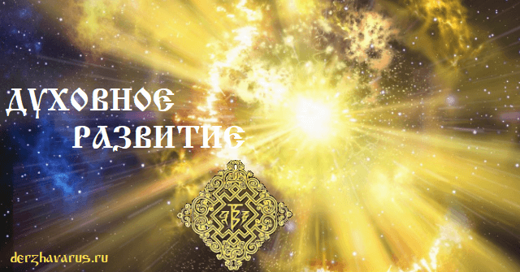

# Духовное развитие - Светлый путь

**Духовное развитие** – это самосовершенствование, самопознание, развитие таких качеств как: сдержанность, правдивость, терпение, стойкость, милосердие и т.п.; жизнь по Совести и согласно Заповедям Богов Светлых, а не чужых учений. Неприятие чужеродных путей развития, ведущих к физическому и духовному рабству.

Духовное развитие - это Светлый путь

Когда **Совесть** становится главой всех деяний человеческих - наступает Духовное развитие человека. Живя по Совести, человек способен выполнить все Заповеди Богов и Предков, сколько бы их нибыло, ибо Совесть превыше всего.

## Духовное развитие - Светлый путь

**Духовное развитие** – это восхождение человека по Ступеням Веры в Мире Яви и дальнейшее продвижение по Златому Пути Духовного развития и совершенствования через Миры Нави и Слави к Божественному Миру Прави.

При этом у человека есть свобода выбора - идти вверх Светлым путём, либо вниз Тёмным путём. Когда человек соскальзывает на тяжкий путь, неважно осознанно или нет, он подвергает себя Уроку Жизни (Суд Совести), и если не выберется на Светлый путь, то потеряет покровительство всех Богов и Предков. Ощутив потерю Покровителей, он осознаёт неправильность выбора и старается вернуться на Светлый путь, но сделать это ему будет намного тяжелее.

## Методы духовного развития

- Соблюдение Заповедей
- Соблюдение Законов Рода вашего
- Подвижничество
- Принесение бескровных жертв
- Изучение Древних Вед (Мудрость)
- Познание Образов Древних Рун
- Духовные практики

Духовные практики (телесные и энергетические) улучшают контакт с собственным телом и энергией, учат чувствовать и осознавать себя, те процессы, которые происходят внутри, насколько они важны для твоей Души.

### См. также

- Инглиизм
- Разум, Тело, Душа, Дух
- 16 пороков и 16 обетов - Веды Перуна
