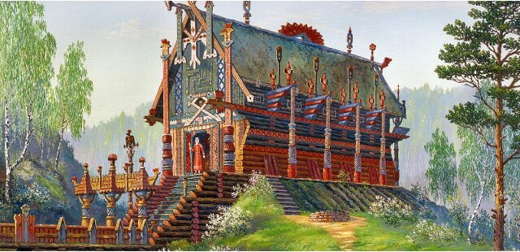

# Хоромы – это Храм

**Хоромы (дом, изба)** – это Храм: в каждом русском доме есть Красный угол (алтарь), совершаются богослужения, глава Рода является Родовым священнослужителем, он в домашних условиях ведёт службы, а остальные ему помогают в служении. То есть хоромы - это **Родовой Храм**, в котором царит Любовь и созидание.

Храм Свентовида. Весна. / Художник Иванов В.Б.

**Храм должен быть красивым**, чтобы возбуждать (порождать, усиливать) в Душе человека радость, настраивать на созидание. Символика архитектуры раскрывает представления славян о Мироздании (к примеру, конёк кровли в форме коня, птицы). Солярные символы украшают хоромы, домашнюю утварь, одежду славян.

> **Храм** м. – хоромы, жилой дом, храмина ж. | Храм и храм Божий, здание для общественного богослуженья, всякого исповеданья. [Толковый словарь Даля]

В храме живут Боги: муж – Бог, жена – Богиня, дети – чада Божии по образу и подобию. Красный угол - связь с Пращурами, обмен энергией. Хоромы должны излучать светлую энергию, радость, светлые мысли.

## Хоромы - храм

**Красный угол** - в Родовом Храме (хоромы) почитают Предков - Родотеизм, поэтому здесь установлены родовые Куммиры (Боги-Покровители супруга и супруги).

**Священная Инглия** - в доме следует возжигать огневицу.

**Богослужение** - чтение Гимнов и Обращений Богам и Предкам, принесение им треб и даров, соблюдение славянских праздников. То есть, это внешнее выражение внутреннего содержания Веры, настроения Души.

## Храмослужение

В хоромах глава Рода ведёт службы Правьславления вседневные и праздничные; читают Гимны и Обращения Богам и Предкам перед трапезой и после; перед сном и после сна; начиная дела и после окончания их. Примеры обращений:

Во Славу Богов и Предков наша!  
*\* Произносят перед возложением треб на алтарь.*

Славься Пращур-Род, Род Небесный, благодарим Тя, за трапезу наша, за хлеб-соль, что даруешь Ты нам, для питания телес наша, для питания Души наша, для питания Духа наша, да буде крепка Совесть наша и да будут все деяния наша, да во славу всех Предков наша и во славу Рода Небеснаго, Тако бысть, тако еси, тако буди!  
*\* Читают перед трапезой и после оной.*

Род наш Небесный, Бог Единый, от сна восстав, благодарю Тя за сон покойный, за отдых телесный, и принимаясь за деяния своя, прошу Тя: помози мне во всякое время, во всяком деянии, и избави мя от зла тёмного, да будут вси деяния моя, да во Славу Твоя и во славу Рода моего и Расы Великой, тако бысть, тако еси, тако буди!  
*\* Речём, когда встаём ото сна.*

Род наш Небесный, Бог Единый, отходя ко сну, зову Тя: даруй мне сон покойный и отдых телесный, и сохрани мя от всякия бед и пошли Лега Сна-Хранителя за Душой присмотра ради, и если я помру во сне, прими Душу мою к Себе, ибо Ты — Бог-Хранитель Душ и телес наша, и посели её в Вырии Небесном и прости вси прегрешения мне вольные и невольные, ибо Велик и Мудр Ты, тако бысть, тако еси, тако буди!  
*\* Речём, отходя ко сну.*

Покойной ночи всем Богам и Предкам! Спокойной ночи домовому! Покойной ночи всем добрым людям! Ныне и присно и от Круга до Круга.  
*\* Это краткое обращение речём, отходя ко сну, вместо предыдущего обращения.*

Сегодня все знают поговорку «мой дом – моя крепость», однако в первую очередь, **хоромы - это Храм**, и соответственно выстраивается всё пространство: архитектура, декор, взаимоотношения и т.д.

### Похожие: хоромы и храм

- Храмослужение (Урок 1)
- Храмы славян (Чудинов)
- Русский дом (хоромы, изба) – план
