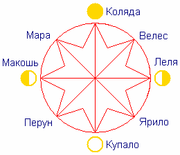

# Кологод - природосообразность (Что такое Праздник?)

**Кологод – это система обрядов и праздников**, которая помогает человеку в течение года оставаться в гармонии с Природой. 8 столпов Кологода – это наши Боги или Законы Природы (любого Бога мы можем объяснить на уровне Прави, Нави, Яви). Между глобальными переходами есть ещё срече (встреча) – осенняя, весенняя…, а между ними ещё по 3 мелких встречи. Достаточно посмотреть народный календарь, чтобы убедиться, что там есть система. Ниже приведены главные праздники славян - глобальные переходы.

## Что такое Праздник и Обряд

**ПРАЗДНИК** (от слова «празь» - *через*), т.е. это «**порог**», через который надо пройти, чтобы измениться, преобразиться и пойти дальше. Это переход в другое состояние. Пройти эту границу надо так, чтобы поднять иммунитет, сохранить гормональную систему, биохимический состав, быть в одном биоритме с Природой, т.е. это регулирование. Поэтому праздник надо пройти правильно - правильно подготовиться, правильно войти, правильно поучаствовать и правильно из него выйти, тогда внутренние системы будут работать нормально, всегда будешь здоровый, крепкий, весёлый, молодой. Поэтому всё это обстраивается обрядами, чтобы человек был в своём эгрегоре, была связь с Предками. Действие того или иного Бога (Закона) перед глобальными праздниками начинается за 2 недели, поэтому славяне уже в это время начинают готовиться – должны очиститься (тело, Душу, мысли, дом), это так называемый «вход в праздник», т.е. ПОСТЪ, баня, уборка.

**ОБРЯД** (корень «ряд») - рядить значит **ладить**, т.е. в обряде мы себя отлаживаем - другое питание, другие действия, и сам хоровод другого биоритма, потому что надо быть природосообразным, надо совпасть с биоритмами Природы и помочь организму плавно перейти в зимнее состояние или в летнее и т.д. Поэтому на каждый период обряды разные, если вести себя неправильно, то быстро постареешь, схватишь какую-нибудь болезнь или проблему и т.п.

## Кологод - славянские праздники

Мужское время - с Коляды до Купалы (солнце разгорается), женское время – с Лели до Макоши, а период с Макоши до Коляды – для всех неблагоприятный.

**1. Коляда – День рождения Солнца** (декабрь). Это глобальный поворот, переход, перерождение всего. Только в это время природа даёт человеку возможность избавиться от болезней, проклятий, начать всё сначала. Поскольку это время мужчин, им даются сверху (Предки помогают) различные подсказки, мысли, как устроить год.  
Кологод («коло» - колесо, солнце) - это наш Алатырь - восьмиконечная звезда, которую несут колядовщики. Эта звезда многоцветная, символизирует всех наших Богов, все Законы, и весь этот спектр даётся нам изначально. Раскручивается алатырь спиралью посолонь (т.е. по часовой стрелке), и человек должен так прожить кологод, чтобы каждый новый круг выйти с новой спиралью (детей народил, дерево посадил, диссертацию сделал, книжку написал и т.д.). Как только человек перестаёт мыслить и развиваться, он начинает идти в обратную сторону и приходит в точку смерти.

**2. Велес – экологическая мудрая программа** (февраль). Велес – это образ - Законы Природы. Он Бог мудрости, дикой природы, подземного мира... Т.е. начинается всё с подземного мира, о котором мы должны заботиться, чтобы не нарушать экологию. Дальше плодородный слой почвы, на котором растут растения – пища для птиц и животных. Человек этим всем пользуется и должен мудро поступать с окружающей средой, соблюдать Законы Природы. Период с Коляды до Велеса - это время закладки новых дел. В это время заключают договора, выбирают пастуха, строят новые планы и т.п., потому что так работает природа и у человека голова так работает. Пока солнце слабое, люди принимают ответственные решения на будущее.

**3. Леля – Божественная искра между юношей и девушкой** (март, апрель). Леля – это весеннее равноденствие, в природе выравнивается мужская и женская сила. Солнце разгорается, природа расцветает, у людей начинает очень активно работать гормональная система, кровь разжижается, это время любви. На Лелю водят два хоровода навстречу друг другу: мужской посолонь, женский осолонь. Через глаза и руки передаётся энергия, поэтому в хороводе нет резких движений, все ищут равновесие, происходит обмен энергиями, у кого её много отдаёт, у кого мало забирает. Происходит ЛАД на целой деревне.

**4. Ярило – сексуальная мощь** (май, начало июня). В природе всё начинает яриться, всё ярое – ростки, лепестки, цветки, и люди должны яриться (по-славянски эта процедура называется яриться). Устраивают Ярилины игрища, ярмарки. На Ярилу происходит очень сильное прозрение, ясновидение. Ярило – это подготовка к Купало.

**5. Купало – максимальная сила** (июль). На Купалу самое яркое солнце, почти не заходит, мужское и женское совпало. Вся природа светится, набирает максимальную силу, и у людей огонь максимально разгорается, причём на равных у мужчин и у женщин. Потому на Купалу старались зачинать детей, в светлое время дня на земле, а не в постели. 26 марта полдеревни детей рождалось, и говорили – купальский ребёнок, здоровый ребёнок. Хоровод на Купалу водят один общий.

**6. Перун – посвящение в мужчины** (август). На день Перуна мужчины показывают свои навыки и умения обращения с оружием, свою силу, мальчики проходят обряд посвящения в мужчины. С этого времени у мужчин начинается резкое падение гормона, они уходят миросозерцать, им надо сменить деятельность, отдохнуть (охота, рыбалка), а женщины в цвету: на Купалу детей зачали, если не зачали, просто сил набрались.

**7. Макошь – самоанализ** (сентябрь, октябрь). Макошь - Богиня судьбы. Заканчивается год, в это время для человека самое важное провести самоанализ, осознать, что сделал в уходящем году, какие были ошибки. Только проведя самоанализ и осознав ошибки, человек может преобразиться и выйти на следующий виток спирали. Обряд на Макошь - выйти в поле, взять горсть земли, вспомнить, что было плохого и хорошего в уходящем году, положить землю; взять следующую горсть земли и т.д. После того, как проанализировали уходящий год, в получившейся горке разгрести середину и зажечь маленький костёр или поставить свечку. С этим «костром судьбы» сгорает всё, что происходило. Таким образом, человек провел самоанализ, он не в церковь пошел батюшке руку целовать, чтобы ему грехи отпустили, а сам осознал свои ошибки – это самое трудное, самого себя проверить и изменить. Также есть Обряд с деревом – привязать нитку к веточке и идти вокруг дерева, закручивая спираль, говоря в слух, что происходило в уходящем году. Мужчины ходят посолонь (по часовой), женщины осолонь.

**8. Мара – изучение Древней Мудрости** (ноябрь). Мара от слова «МА» - мать, это наша матрица, основа. На Мару солнце умирает, самые короткие дни, ультрафиолета очень мало, значит и биохимический состав другой, кровь другая, гормональная система на спад, у чувствительных людей депрессия. Что делать в это время, хоровод водить? В это время хорошо работает голова, поэтому надо целенаправленно читать мифы, сказки, былины. На Мару открывается соответствующий канал и человек может в давно известных сказках осознать то, чего раньше не замечал, получить Божественные знания. И насколько он что-то приобретёт, станет ясно представлять, с этим и войдёт в следующий Кологод.

\* Васильченко Людмила Павловна - педагог славяноведения.
