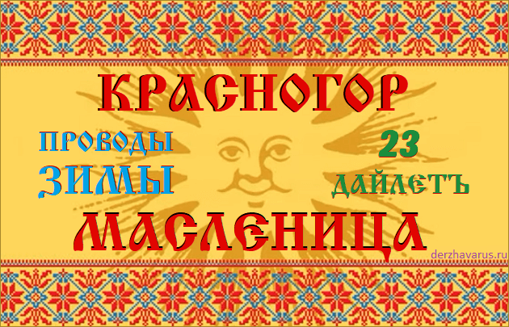

# Красногор или Масленица - проводы Зимы

**Красногор**, **Масленица** - это проводы Зимы, древний славянский праздник, который отмечают на второй день после Весеннего равноденствия. В этот день провожают Богиню Марену на Север в её Ледяные Чертоги; пекут блины, устраивают народные гулянья, игрища, хороводы, прыгают через костёр, сжигают куклу из соломы, которая символизирует снежную Зиму.

Славянский праздник Красногор - Масленица - Проводы Зимы / 23 Дайлетъ

## Древнее название праздника Масленица - Красногор

- Красногор
- День Масленицы-Марены
- Проводы Богини Зимы
- Проводы Русской Зимы *(современное название)*

**Красногор** - это славянское название праздника, которое означает «*красная гора*», то есть красивая гора (*красный = красивый*). Красногор означает пробуждение Природы, сходит снег, появляются первые цветы, т.е. пришла Весна. Поэтому пора проводить Зиму, вернее Богиню Зимы - Марену (МаРа).

## Число Масленицы - 23 Дайлетъ

Масленица отмечается на **второй день после Весеннего равноденствия**, по славянскому календарю это **23 Дайлетъ - Красногор**. По современному григорианскому календарю Масленица выпадает на 24 или 25 марта.

Почему Масленица после весеннего равноденствия? Потому что прежде чем проводить Зиму, надо встретить Весну. Природа не терпит пустоты. Поэтому Весеннее равноденствие 22 Дайлетъ - это День Весты (Богиня Веста управляет приходом Весны, пробуждением Природы Мидгард-Земли).

Красногор (Масленица) входит в цикл весенних праздников, которые приурочены к новой ипостаси Солнца, Весеннему равноденствию. То есть выравниваются день и ночь, а после Масленицы день длиннее ночи, Солнце набирает силу.

## Обряды на Масленицу - сжигание куклы

На Масленицу проводятся гулянья, игрища, хороводы, пекут блины, ходят в гости, но особо следует отметить обряды с костром. Разжигают два костра: через один прыгают, на другом сжигают соломенную куклу.

**1. Сжигание куклы**. На Масленицу сжигают куклу из соломы, которая символизирует Зиму (снег), а не Богиню Марену, как многие думают. То есть как бы спектакль: весеннее солнце стало сильным и легко растопит снег, как огонь соломенную куклу. При этом в огонь вместе с куклой кладут блины и зерно (просо, овёс), чтобы был богатый урожай для кормления домашней скотины.

После ритуала сжигания куклы горсть пепла развеивали над полем, садом или огородом, чтобы вырос хороший урожай. Ибо, как говорили наши Предки:

> «Богиня Веста на Мидгард-Землю пришла, на Красногор новую жизнь принесла, огонь запалила и зимние снега растопила, всю землю живой силой напоила и от сна Марены разбудила. Будет Мать Сыра Земля полям нашим жизньродящую силу давать, будет отборное зерно в полях наших прорастать, чтобы всем Родам нашим - хороший урожай дать».

**2. Прыгают через костёр**. Огонь очищает Душу и тонкие тела человека, поэтому на Масленицу прыгают через костёр. Только не через жертвенное огневище, а разжигают отдельный костёр.

Главное очищение огнём проводят после солнцестояния, на День Бога Купала.

## Христианская Масленица - Сырная седмица

Несколько слов о христианской «Масленице», которая вовсе не Масленица, не проводы Зимы. То, что сегодня называют Масленицей, это **Сырная седмица** или **Мясопуст** (мясопустная неделя) - подготовительная неделя перед Великим постом. В этот период нельзя есть мясо, только рыбу, яйца, молочные продукты («сырные»), отсюда и название недели.

Христианская Масленица привязана к иудейскому празднику Песах (Пасха) и отмечается перед Великим постом. Поэтому дата «Масленицы» каждый год меняется в зависимости от даты празднования Пасхи. Часто выпадает на февраль, т.е. до весеннего равноденствия целый месяц, провожать Зиму неуместно.

\*\*\*  
Необходимо разделить славянский праздник Красногор (**Масленица**) и христианский мясопуст (**Сырная седмица**). Наш праздник связан с Природой и славянской культурой, а христианский мясопуст - с еврейской историей.
