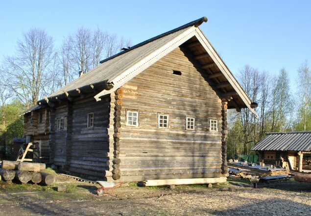
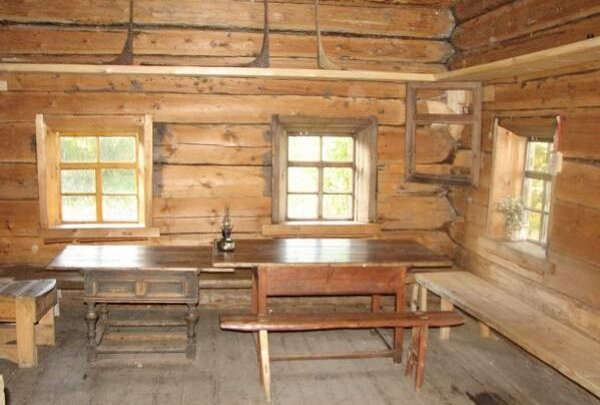

# Курная изба

**Курная изба** – это изба с печкой по-чёрному. Дым из печи поднимается под потолок и опускается по стенам до воронцов (полки над окнами), затем через дымоволок (отверстие над дверью) вытягивается на улицу. То есть изба окуривается, отсюда и название: курная изба.

Курная изба XIX века из Архангельской области. Нижняя половина дома – подклет, верхняя – изба. / Музей «Новое Старое».

Воронец – полка в курной избе.

**Воронец** – сплошная полка по периметру избы над окнами. Над ней 5-7 нетёсаных венцов сруба. Воронец служит барьером для дыма, а также сбора сажи, предохраняя от неё скамьи.

**Дымоволок** – дымовое отверстие в курной избе. Делается над дверью и выходит в сени, где по деревянной трубе (вытяжка) дым выводится на улицу за пределы чердака.

**Печной столб** – вертикальное бревно, установленное у «центрального» угла печи, т.е. ближний угол к центру избы, он смотрит в красный угол. Печной столб - это символичная ось избы. В бытовом значении, к нему крепят брусья (полатный и пирожный), которые разделяют избу на куты. А в образном значении, он соединяет Миры: подземный (возле столба делали голбец или лаз в подпол), явный (куты избы) и вышний (столб уходил вверх под матицу, т.е. связь с крышей). Поэтому старались делать, чтобы печной столб не прерывался, ставили одно бревно, которое шло из подпола до матицы.

## Курная изба

Курная изба была широкая, просторная, с высоким потолком порядка 4 метров, чтобы дым не мешал нормально дышать. Остывающий дым вытягивало на улицу через дымоволок, поэтому стены ниже воронцов и предметы быта не пачкались.

Именно курная изба (**чёрная изба**) была основным видом жилья русских крестьян. **Белая изба**, в которой печь с трубою и потому нет копоти, появилась лишь в XVIII веке. Вот тогда стали опускать потолки до 2,50 метров и даже ниже, чтобы отапливать меньший объём. При этом белая изба всё равно была прохладней, чем курная, в которой и пол был тёплый, а в печах парились как в бане.

**Преимущества курной избы**: более тёплая, чем белая; требует меньше дров для обогрева; дым является антисептиком и защищает от насекомых.

Но есть и недостатки, к примеру, сложно поддерживать чистоту в доме, поскольку сажа с потолка летит на пол.

В курных избах жили в дыму? Нет, печь по-чёрному топится быстро 30-40 минут, потом у вас чистая тёплая изба. Т.е. не целый день в дыму ходили, а только утром печь протопили и всё. Печь обычно топят раз в сутки.
