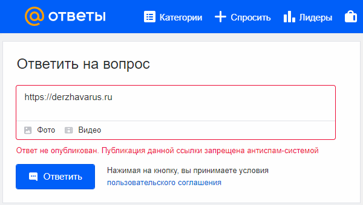

# Ответы Mail.ru блокирует ссылки на сайт Держава Русь

Ответы Mail.ru блокирует ссылки на сайт Держава Русь, то есть препятствует распространению информации о реальном прошлом Руси, Вере наших Предков - Инглiизм. Попробуйте на сервисе Ответы Mail.ru опубликовать ссылку на сайт https://derzhavarus.ru - появится сообщение: «Ответ не опубликован. Публикация данной ссылки запрещена антиспам-системой».

Скрин: Ответы Mail.ru блокирует ссылки Держава Русь

Однако есть способы, как использовать подобные ресурсы для просвещения.

23.09.2021

О блокировке сайта Держава Русь / 2023
