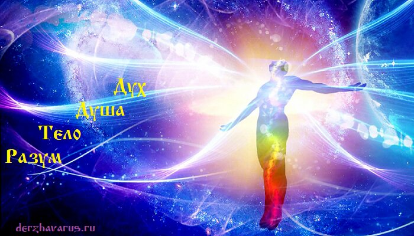

# Разум, Тело, Душа, Дух - структуры развития человека

**Разум, Тело, Душа, Дух** – это структуры развития человека: умственные и физические навыки, взаимосвязь с обществом и внутренние качества. Для гармоничной жизни, человек должен одновременно развивать все четыре структуры: Разум, Тело, Душу и Дух, а Совесть должна быть мерилом всех его созидательных деяний, направленных на процветание древних Родов, на умножение потомства, и укрепление в сердце каждого Изначальной Веры наших Мудрых Первопредков.

Структуры развития человека: Разум, Тело, Душа, Дух.

## Разум, Тело, Душа, Дух

**Разум – система изучения, познавания**. Есть слово «УМ» (то, что человек умеет), а от него происходит слово «Раз-УМ» (как бы первый раз что-то сделать). Допустим, человек разумеет, как сплести корзину – то есть предполагает, как это можно сделать. А когда сделает, скажет: «я УМею», то есть понял как делать, воплотил в жизнь (ум – это система воплощения; уже полученные знания в жизни). Разум – это способность логически и творчески мыслить.

**Тело – физическая структура**. Правильная осанка, нормальный вес, укрепление сердечно-сосудистой, дыхательной, пищеварительной и других систем организма. Развитие физических качеств, крепкое здоровье, высокая работоспособность для защиты и процветания Рода.

**Душа – взаимосвязь с обществом**. Умение общаться, находить общий язык, готовность помочь. При этом душевный человек не обязательно духовный, он может вообще ничего не ведать. Также и духовный человек может не быть душевным, если живёт вдали от общества, посвятил себя духовным практикам, а для развития Души нужно людское окружение.

**Дух – сущность человека**. Жизненный опыт, мудрость, внутренние качества (стойкость, сдержанность, миролюбие, терпение и т.д.). Духовное развитие – это стремление к изучению Древней Мудрости, познанию окружающего Мира и самого себя, как неотъемлемой части Вселенной; наполнение своей жизни святостью и деяниями добрыми.

### См. также

- Тело принадлежит Роду, а не вам лично
- Слово и Душа. Что такое Русь и Рус?
- Дух и Душа – в чём отличие?
- Душа и Круг Абсолюта
