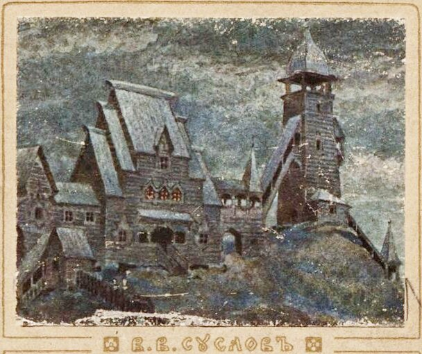
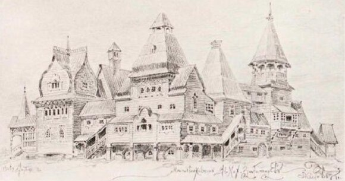
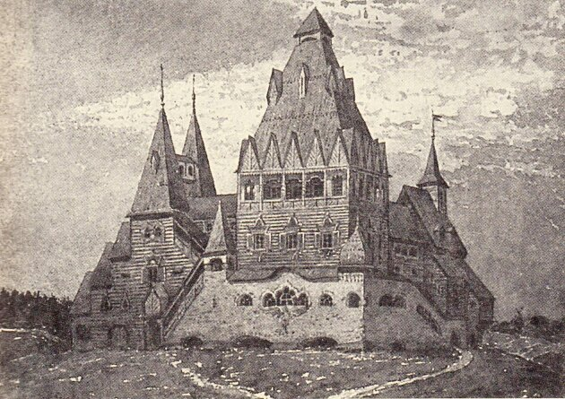
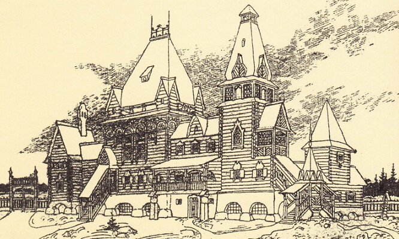
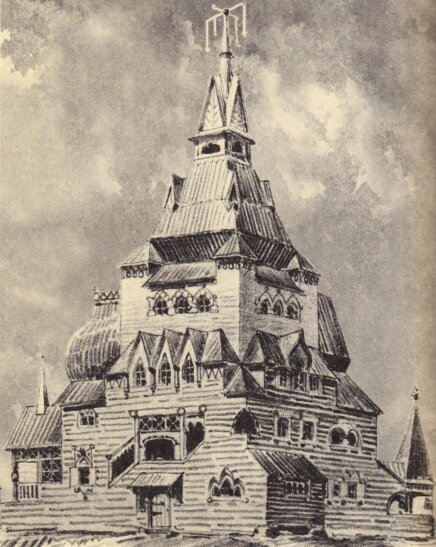
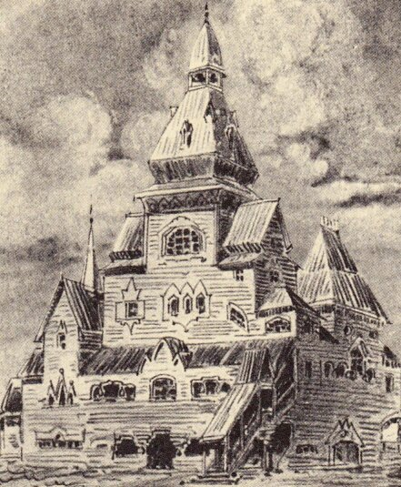
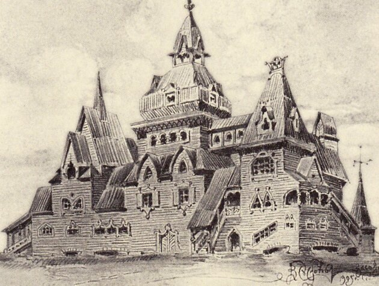
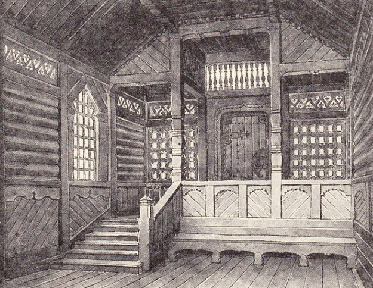
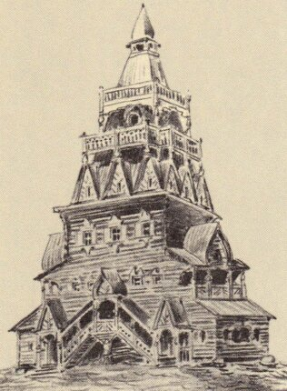

# Русское зодчество - хоромы (рисунки Суслова)

Рисунки из альбома «Русское зодчество по преданиям народной старины», В.В. Суслов, 1911 г. – хоромы, терема. **Русское деревянное зодчество** имеет ярко выраженные конструктивные и архитектурно-художественные особенности. Декором служила резьба по дереву на конструктивно значимых элементах. Хоромы строили порой 7-8 этажные!

Русское зодчество по преданиям народной старины, В.В. Суслов / 1911 г.

**Многосрубные терема**, стр. 4.  
«Как про старое время, доселешнее,  
про хоромы наши сказывают».

## Русское зодчество - рисунки

Рисунки Суслова не относятся к определённой эпохе, области России и типу построек. Как сказано в предисловии, автор передавал в архитектурных образах свои настроения, как безотчётные отклики личных впечатлений, воспринятых при долгом изучении на местах древних памятников отечественного искусства.

**Терем на каменных сенях**, стр. 13.  
«Ты пожалуй-ка ко мне во высокъ теремъ:  
Напою, накормлю хлебом солiю»

**Русское зодчество** уходит своими корнями в дохристианский период. Однако христианизация повлияли на архитектуру. В Киевской Руси после крещения, большинство архитекторов были выходцами из Греции, и развивали естественно, традиции Византии. Затем в XVI веке русский престол в Московии захватили прозападные Романовы, стали превозносить европейский классицизм. Зато по всему отдалённому Северу русское зодчество развивалось самобытным путём. Северные зодчие отринули запрет патриарха Никона на возведение шатровых церквей, и царь им не указ.

**Терема на каменных погребах**, стр. 21.  
«Крыши у нас да все серебряные,  
шеломы, потоки золоченые».

Вспомнили о народном зодчестве лишь при Николае I (1796-1855). Академик Лев Даль, сын автора бессмертного «Словаря живого великорусского языка» был талантливым зодчим, он неустанно призывал выработать «национальный стиль», обратив внимание, прежде всего на деревянное зодчество Русского Севера. Но трагическая смерть прервала творчество Даля в расцвете сил. Его дело продолжил Владимир Суслов, он исследовал необъятные северные просторы нашей Родины, побывал в Швеции, Норвегии, Финляндии, замерял и зарисовывал шедевры народного зодчества, выявляя «запасы самостоятельного художественного развития». Главный труд Суслова – «**Памятники древнерусского зодчества**» - был издан Академией художеств в 1885-1901 годах.

**Дом «клубом» с вышкою**, стр. 32.  
«Среди двора его широкаго стоит хоромина высокая, со сенями изукрашенными».

В 1911 году В.В. Суслов выпустил удивительный альбом архитектурной фантазии - «**Русское зодчество по преданиям народной старины**». В альбоме больше 100 рисунков, возвращающих зрителя в мир Древней Руси, сопровождаемые надписями из летописных сказаний, народных былин, пословиц, поговорок. Связь народной поэзии с рисунками заключается не в логической связности, а в общем духе, почерпнуть из одного источника – сокровищницы народного гения.

Современники встретили альбом восторженно, впечатление от полусказочных картин глубокой старины было ошеломляющим.

**Деревянные жилые строения**, стр. 33.  
«На кого сей дом состроится, на того он и поладится».  
«Ищи добра на стороне, а дом люби по старине».

Новый удар по русской народной культуре нанесли иудеи в 1917 году – крушили, запрещали, изгоняли... и в этом хаосе исчез альбом Суслова, воспевший былинную Русь.

**Терема**, стр. 49.

> «Надевали кожанцы рабочие,  
> обували лапонцы липовые,  
> брали топорики булатные,  
> с раннего утра до полуночи,  
> будто дятлы в дерево пощёлкивали,  
> а к полуночи поспели три терема,  
> что верхи-то со верхами совиваются,  
> совиваются да соплетаются.  
> …  
> к утру-свету сюда и жить пошли».

**При внутренних покоях**, стр. 40.  
«Сени новые, кленовые, решетчатые».

Почти 100 лет спустя к нам возвращается диковинный альбом В.В. Суслова под названием «**Жемчужины русского зодчества по преданиям старины**», 2003 г. Правда почему-то без поэзии и нескольких рисунков.

**Дом шатром**, стр. 53.  
«Кругом верха теремного обходички соплеталися».

## Хоромы

Данные рисунки являются продолжением темы «Что такое русский дом (хоромы)?» В первой части рассмотрели план русского дома, как сориентировать по сторонам света. Теперь внешний вид дома, яркие примеры русского зодчества. Здесь в конструкцию заложены числа Инглиизма, образы Огня. Но обратите внимание, что в альбоме на многих храмах и лестницах теремов купол-луковица - это ошибка, луковицу привнесли христиане, чтобы энергия не поднималась к небесам.

Примечание:  
\* Русское зодчество по преданиям народной старины, 1911 г. - смотреть онлайн  
\* Жемчужины русского зодчества по преданиям старины, 2003 г. - скачать альбом
