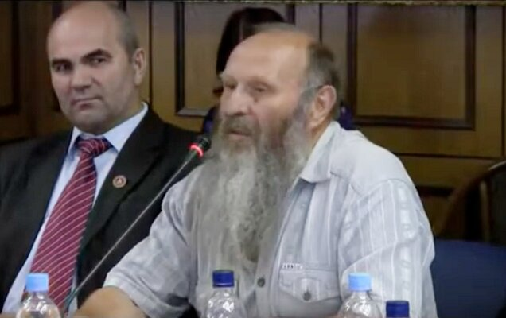

# Слово и Душа. Что такое Русь и Рус?

«*Искони божественное слово, и божественное слово у Бога, и божественное слово — Бог*». Т.е. слово должно творить, выстраивать пространство, чтобы это пространство жило и вершилось. А для этого надо понимать слово на уровне Души.

Великов Александр Степанович – академик Международной Академии энергоинформационных наук, психолог, магистр валеологии. / Слово и Душа.

Всё чаще мы употребляем в своей речи слова заимствованные из других языков, хотя имеем в нашем древнем русском языке понятия гораздо более обширные, более точные. Начнём с того, что такое Русь?

## Что такое Русь?

**Русь – это понятие не территориальное**, а общеВселенское. Существует Всеясветная Русь (то есть всюду, где есть Свет, существует Русь). Существует Русь, как планета (наша планета, она издревле называлась Русь). И действительно, в мироздании дисгармоничными силами происходит постоянное уничтожение Всеясветной Руси и в частности нашей планеты.

Планета Русь является живой, и поэтому она отвечает на вызовы, которые человечество относит к ней, отвечает соответствующими реакциями, соответствующими ответами. Это чётко надо знать, чтобы понять, что такое Русь, почему она вселенского масштаба. **Русь – это постоянный круговорот посылов (посевов) и возрождений, через знания и слово.** Вот это очень важно, что через знания (посев) и возвращения в космос – круговорот знаний и слова.

И отсюда нам необходимо понять, как же мы со словом взаимодействуем, каким словом мы что-либо обозначаем, или кого-либо, или что-то или что-нибудь. Вот пример разных понятий: *что-либо* – это что любо; *что-то* – это так, ни то ни сё; *что-нибудь* – это то, что не будет никогда. Когда мы употребляем в нашей речи вот такого рода слова, мы должны очень точно помнить, что было в древней Книге Жизни.

## Слово - Бог

Что было сказано о слове в древней «Книге Жизни», которую мытари Медичи, уворовав из Царьградской библиотеки, сожгли. Потом они переделали и записали в так называемой «Библии», совершенно не то, что было изначально. Изначально в Книге Жизни была записана фраза:

> Искони божественное слово, и божественное слово у Бога, и божественное слово — Бог.

То есть любое слово, которое мы имеем возможность произносить вовне, в нас оно должно быть божественным, должно быть творческим, **слово должно творить, выстраивать пространство**, чтобы это пространство жило и вершилось.

Человек – это существо, у которого безграничные силы, и если этими силами человек показывает на негатив, то негатив увеличивается; если человек посылает вовне слово божественное и посылает в направлении Света, то такой Свет будет увеличиваться.

**Пример:** чтобы темноту в комнате изменить, надо сделать простую вещь – включить свет. Не надо давить на темноту, не надо бороться с ней, потому что любая борьба (противодействие) вызывает только противодействие. Нам надо научиться действовать самим, чтобы то, чем действуют другие можно было перекрыть, чтобы действие других не было таким разрушающим.

Поэтому надо понять, что **издревле слово божественное**. И нам отсюда надо идти дальше. А как идти? Поняв, что такое Русь, надо понять, что такое Рус.

## Что такое Рус?

**Рус – это в этимологии Дух** (синоним руса – Дух). Рус – это тот, кто живёт в Духе постоянно, знает этику Мироздания, живёт по ней и передаёт эти знания другим.

Русичи – это те, кто только приближается к этим понятиям. А русские – это все люди, населяющие одну территорию вместе с русами и русичами, пользующиеся их языком, но не до конца его понимающие. К сожалению, не ведают этики, не ведают законов мироздания.

Поэтому прежде чем двигаться дальше, нам следует понять, что **в своей речи надо использовать именно слово РУС**, подразумевая под этим ДУХ. А Дух убить нельзя, поэтому Дух русов убить практически невозможно. Но, к сожалению, можно уничтожить физическое тело. Да, к сожалению, — потому что каждое физическое тело очень необходимо для мироздания. Через каждое физическое тело, находящийся в нём Дух имеет возможность нарабатывать новый опыт для мироздания. Именно поэтому следует нам сделать всё возможное, чтобы **восстанавливать физические тела людей**. Не воскрешать, как некоторые предлагают, а поддерживать их в чистоте и гармонии, делать всё возможное, чтобы физические тела русов не подвергались различного рода инъекциям со стороны, в том числе идеологическим инъекциям, словесарным, и другого рода инъекциям, которые постоянно, так или иначе, вносят в нашу с вами действительность.

## Слово и Душа

Поэтому **из речи русов следует убрать непонятные для Души и Духа слова**. Надо знать о том, что наши Духи и Души продолжают общаться на родном языке. Если мы в обычной речи говорим на русском языке, но употребляем иностранные слова (которые являются эрзацами русского языка), то мы таким образом, разделяем своё тело и свою Душу.

Поэтому я предлагаю постараться всем людям, кто ратует, убрать из своей речи слова, которые разрушают наши Души, наши Духи. Именно ратует, а не болеет или переживает. Потому что болеть – это болезнь; переживать – это пережёвывание себя и других; а ратует – включает творчество Света, чтобы наше дело вершилось, в частности то, о котором мы сегодня говорим.

## Видео

Круглый стол на тему «К вопросу о признании геноцида русского народа», Госдума, 10 июня 2010 г. Великов Александр Степанович (1:10:25).

### См. также

- Слово и мысль во взаимодействии с Природой
- Голосовая речь человека
- Сила голоса
