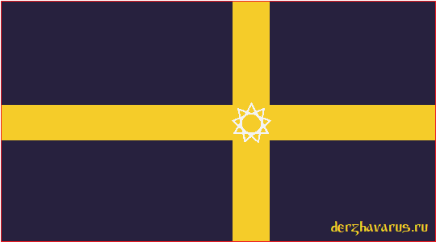
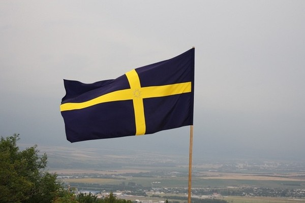

# Стяг Беловодья - Стяговый Штанд Свята Расы

**Стяг Беловодья** (**Стяговый Штанд Свята Расы**) представляет собой прямоугольное полотнище Марённого *(тёмно-тёмно-фиолетового)* цвета с золотым крестом и Звездой Инглии. Соотношение ширины к длине в пропорции 1:1,8.

Стяг Беловодья / Стяговый Штанд Свята Расы / Флаг Руси

## Описание флага и значение его цветов

Отношение ширины флага к длине составляет 1:1,8 [5:9]. На Штанде располагаются определяющие символы Свята Расы, в частности, Золотой Крест — цвет Божий, направленный к четырём Родам Расы Великой; а также надписи прославляющие Богов.

**Цвета флага Беловодья**: белый, красный, златый, чёрный (тёмно-фиолетовый).

- **Чёрный** — цвет земли, а также цвет небес.
- **Красный** - цвет жизни, справедливости.
- **Златый** - цвет Богов.
- **Белый** – цвет Расы, цвет чистоты, Совести.

См. также: Значение цвета в славянской культуре

Фото: Стяговый Штанд Свята Расы / Изображение: my.mail.ru

- **Стяг** – военное знамя, значок, возносимый на древке. | Стяг мог получить это значенье и от стяганья, сбора вокруг себя воинов.  
  *Толковый словарь В.В. Даля [стягивать]*
- **Штандарт** – знамя / флаг.

## Беловодье – Священная Земля Славян и Ариев

**Беловодье** (**Пятиречье, Семиречье, Рассения, Тартария, земля Свята Расы**) – это обширная территория от Урала до Великого океана на Востоке, и от Северного океана до Ирийских гор (Монгольский Алтай) и Индии. Наши Предки переселились сюда из Даарии **111 806 лет** назад (109 807 г. до н.э.).

См. Беловодье – прародина Ариев и Славян

После переселения из Даарии в Беловодье, на одной территории совместно проживали как Арийские народы (Да'Арийцы и Ха'Арийцы), так и Славянские народы (Расены и Святорусы). Жили они в мире, облагораживая землю, насаждая сады и леса, созидая совместно Величественные Капища (Храмы) и Города. Роды Великой Расы помогали друг другу по-братски – именно отсюда берёт начало понятие **Белое Братство**, ибо во всех созидательных деяниях Совесть и Чистые помыслы были мерилом всего.
