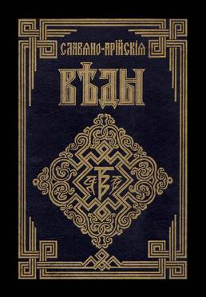

# ВЕДЫ

Во мраке невежества я пребывал,  
Я кривде поверил и в прелести впал  
Дороги неправды в тупик завели  
Познания Истин не дали они

Как долго я правду по свету искал  
Священные книги пророков читал,  
Но истина где-то была далеко,  
И черпать её было мне нелегко.

Стучи, и откроют, Христос завещал!  
Великий учитель славян признавал  
Он был послан Правью, от Рода отца  
Нести иудеям заветы Творца.

Ученье Его извратили жиды  
Посланника Бога распяли они  
Им правда Иисуса страшнее огня  
Для власти и торга помеха одна

Учитель апостолам так завещал:  
Ходить к Самарянам, не надо сказал!  
Там Истина правит, там ложь не живёт  
Идите спасайте еврейский народ!

Кто те Самаряне, что знают они?  
Откуда познания Истин пришли?  
Чьего они Рода, и кто их жрецы?  
Какие писанья им были даны?

Я правду нашёл, она в Ведах была  
В славянских посланиях скрыта Она  
Её разгадать не сумели враги  
Рунической вязью писали волхвы!

Мне древние Веды открыли глаза  
В них Рода заветы, в них Мудрость жива  
В них правда великая скрыта для нас  
Славяно-Арийских наследников рас!

_Василий Чаплыгин_
