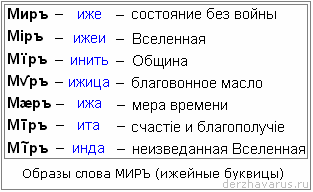

# 7 букв «И» (Миръ, Мiръ, Мїръ, Мvръ…)

Наши Предки не зря хранили и передавали множество буквиц, ведь каждая буквица несла определённый Образ. Большевики убрали эти образы, язык стал безобразным, поэтому дети сейчас и не знают, о чём говорят.

Для примера рассмотрим различные образы слова Мир.

## Образы слова Мир

**1. Миръ (иже) – состояние без войны**. Образ буквицы Иже – объединительный, союзный, гармоничный, равновесный. То есть, две противоборствующие стороны объединили свои усилия и получилась гармония, равновесие. Буквица Иже – как две «i», т.е. уравновешивает, допустим: «Слово и Дело», Иже их не только на разные чаши в противовес поставила, но и объединила, теперь это единая система, взаимодействующая, слово не расходится с делом, дело не расходится со словом.

**2. Мiръ (ижеи) – Вселенная**. Здесь две «i» слились, т.е. два потока истекающих с Небес на Землю слились; как бы показывает направление движения Небесной силы из определённой точки. Веды называют эту точку-истечение Великий Ра-М-Ха, т.е. та точка, откуда потёк поток Инглии – Жизньродящего Света. Буквица Ижеи всегда несла вселенскую форму и ставилась везде, где смысловое значение касалось Вселенских, Небесных структур.

**3. Мїръ (инить) – Община**. Первая точка – истечение от Богов, вторая – истечение от Предков, т.е. объединение имело общную форму или общинную. Вдумайтесь в образ названия «Истекающая НИТЬ», т.е. связывающая Богов и Предков воедино, общая структура. Буквица Инить ставилась в словах, которые передают общную структуру, касающуюся и Мира Божественного (Мира Богов) и Мира Предков, или как бы сейчас сказали: объединяющая Правь и Славь. А раз Община объединяет Правь и Славь, поэтому мы и называем себя Православными - Правь славим и Славь своими деяниями правим (положительно).

**4. Мvръ (ижица) – благовонное масло**. Ижица – очень интересная буквица, она в разных вариациях образа могла иметь даже разное звучание [И, У, В, Н], но в данном случае Миръ обозначает благовонное масло. В общем контексте образ Ижица – благость, благое, т.е. она прописывалась везде, что касается благих деяний. Примеры:  
**Паvел** – имя читаем как Павел, оно пришло из другого языка: Па – отец, наставник; Ижица – благое; Ел – как Бог на арамейском, еврейском языках. Т.е. Павел – отец несущий благость божью.  
**Vпостась** – благостное состояние. Ижица – благость, ПОСТ – очищенное, чистое, светлое, Ась – «а сейчас». Т.е. «ипостась» – в данный момент чистая, светлая благость.  
**Славеv** – славен («Н» не звонкая, а глухая, сглатывается). Но есть Славеvъ – славен нашим сотворением, т.е. нашими деяниями: «Человек славеvъ трудом», а когда пишем «Бог наш Славеv» на конце Ижица, потому что Он благостен.

**5. Мæръ (ижа) – мера времени** - самая мельчайшая частица времени. Буквица Ижа как бы показывает движение времени, оно течёт вниз, влево, вправо, вверх, вниз, т.е. оно не прямолинейно, оно изменяется.  
В современной системе: прошлое – всегда плохо, настоящего нет (поясняют, что было секунду назад - уже прошлое, что произойдёт через секунду - уже будущее), будущее в не критики, оно всегда светлое. Наши Предки говорили: «Нет прошлого, нет настоящего, нет будущего – есть одно течение жизни и оно всегда действительно настоящее». Т.е. отдельного настоящего нет, оно всё у нас настоящее. В настоящее входит всё наше прошлое и грядущее, поэтому даже читая летописи, допустим о Ливонской войне, мы говорим: «Мы победили», но битва то была в XVI веке. Почему говорим «мы победили»? Потому что связь с нашими Предками позволяет нам так говорить, мы же неотрывны от своего Рода. Поэтому когда говорим «мы» - подразумеваем весь наш Род, наша РАСА. Мы победили аримов 7522 Лета назад, мы выйграли первую, вторую и третью Ассу, т.е. Небесную битву.

**6. Миръ (ита) – счастiе и благополучiе**. Две точки «i» (счастiе – высшая форма бытия, благополучiе), соединительная «и» образовали черту. Данное слово употребляли допустим, когда приходили в гости: «Мир вам», т.е. «Мир дому сему» - желали не состояния без войны, не благовонное масло или общинную форму, а счастiе и благополучiе.

**7. Миръ (инда) – неизведанная Вселенная**. Начертание буквицы Инда – волна, волновая структура, т.е. неизведанная. Поэтому «Мир тьмы» пишем с буквицей Инда.

## Осталась одна буква «И»

Многие задают вопрос: Почему в летописях нет таких буквиц?  
Ответ: Потому что христиане этих буквиц не знали. Раньше вообще христианских священников называли одним словом – греки, т.е. люди не руские. Когда Кирилл и Мефодий составляли церковно-славянскую азбуку из 49-буквенной древлесловенской Буквицы, они оставили только 2 буквицы «И» (из 5), но потом поняли, что для созвучия не хватает ещё одной формы, поэтому у них получилось 3 буквы «И», при этом они не делали различия между одной точкой, двумя, тире или волнистой линией, для них это одна буква «i», над которой стоит надстрочный знак. А у славян надстрочные знаки имели важное значение, допустим буквица М - «Мыслите», с надстрочным знаком могла превратиться в «Мудрствуйте». Большевики пошли дальше, **заменили все ижейные одной буквой «И»** в двух формах: И, Й - всё (!) просто звуки, без имени и образа.

\* Уничтожение руского языка
