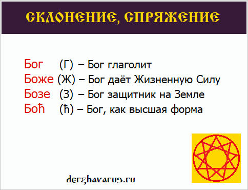

# Склонение слова Бог, Боже, Бозе, Бох

**Склонение**, **спряжение** в древнерусском языке указывало, в какой повествовательной форме используется то или иное слово. Пример: слово Бог.

Склонение, спряжение слова Бог, Боже, Бозе, Бох

## Склонение: Бог, Боже, Бозе, Бох

**Бог** – форма «Глаголи» (**Г**), т.е. Бог, который глаголит - повествует.

**Боже** – форма «Живете» (**Ж**), т.е. Бог, который даёт Жизненную Силу. Поэтому мы «дети Божии», а не «Богии». Но есть форма «У-Богий», т.е. рядом с Богом.

**Бозе** (Бози) – форма «Земля», «Защита» (**З**), т.е. Земное покровительство; Бог - защитник на Земле.

**Бох** – форма с буквицей Гервь (**ћ**, звук [гх]), поэтому и произносится глухо [богх]. Гервь – это возвеличивание, т.е. здесь Бог - как бы высшая форма, допустим: «Славен Вышний Боћ».

### См. также

- Буквица - глубинные образы
- 7 буквиц «И»: Миръ, Мiръ, Мїръ, Мvръ…
- Употребление буквиц Еръ (Ъ) и Ерь (Ь)
- Кон, Князь, Конунг, Книга (этимология)
