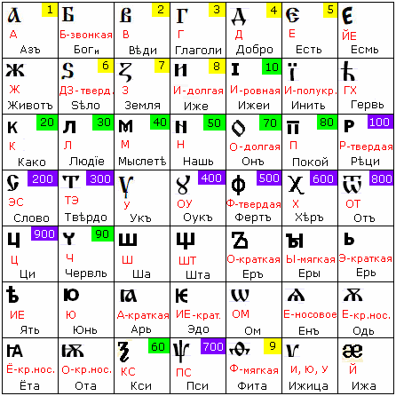

# ДревлеСЛОВенская Буквица

  
  
49 букв, у каждой буквы свой Образ (см. Глубинные образы буквиц). Примеры:

**Буквица Азъ** происходит от сочетания Рун «Ас» и «Земля», плюс добавлена буквица «Еръ» (сотворение), т.е. образ буквицы Азъ: «Бог, живущий и сотворяющий на Земле». Азъ – это как бы **родословная от древних Богов**. Но не так как сейчас говорят: «вот возгордились, Богами себя объявили». Почему объявили? Мы все дети Божьи, только одни это осознают, другие не осознают, а третьи вообще отказались от титула «Чада Божье» или «Сын (дочь) Божьи» и объявили себя рабами чужого бога… но это их выбор.

**Буквица Боги** – «и» пишется мелким шрифтом, т.е. подразумевается не просто множество Богов, а Бог и ещё кто-то, т.е. может быть много форм: Бог и человек, Бог и другой Бог и т.д. Христиане в Азбуке изменили название и образ данной буквицы на «**Буки**», т.е. буквы, и изменили произношение: звук был звонкий, стал глухой. Т.е. у славян образ – «множество Богов», и он как продолжение буквицы Азъ, а у христиан образ «много букв».

**Буквицы Есть и Есмь** – «Есть» означает бытие, форма существования, т.е. «я существую». А буквица «Есмь» используется как связка, как определение (Азъ есмь Царь). В Азбуке букву «Есмь» удалили.

**Буквица Животъ** – в ёё начертании видим Руну Ман – Руна человека, и снизу добавлен полукруг, т.е. человек познаёт окружающий мир в трёх формах: физической, Душевной и Духовной. **Животъ = Жизнь**, отсюда поговорки: «Не щадя живота своего», т.е. жизни, или «Положить живот за други своя». Числового значения у данной буквицы нет, потому что Жизнь многогранна, многообразна, и это многообразие нельзя выразить в числовой форме.

**Буквица Еръ** – раньше она всегда звучала («о» краткая), а в Азбуке она звучит уже только под ударением. Сейчас вообще не звучит «твёрдый знак».

**Буквица Ижица** – звучание было мягкое «и», «ю», «у». А христиане изменили звучание, произносили её как «и» в начале слова, как «в» в середине, как «н» в конце слова.

## Буквица и Азбука

**После христианизации появилась Азбука:**  
- Буквицу сократили на шесть букв (Есмь, Инить, Гервь, Ёта, Ота, Ижа);  
- Изменили образные названия (пример: Буки, Глаголь, Живёте, Червь, Ща, Юсъ);  
- Изменили у нескольких буквиц звучание и начертание; пример: у буквиц Ци и Шта сдвинули ножки вправо, получились «Ц» и «Щ».
